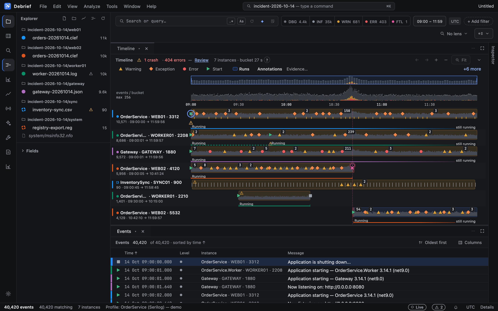
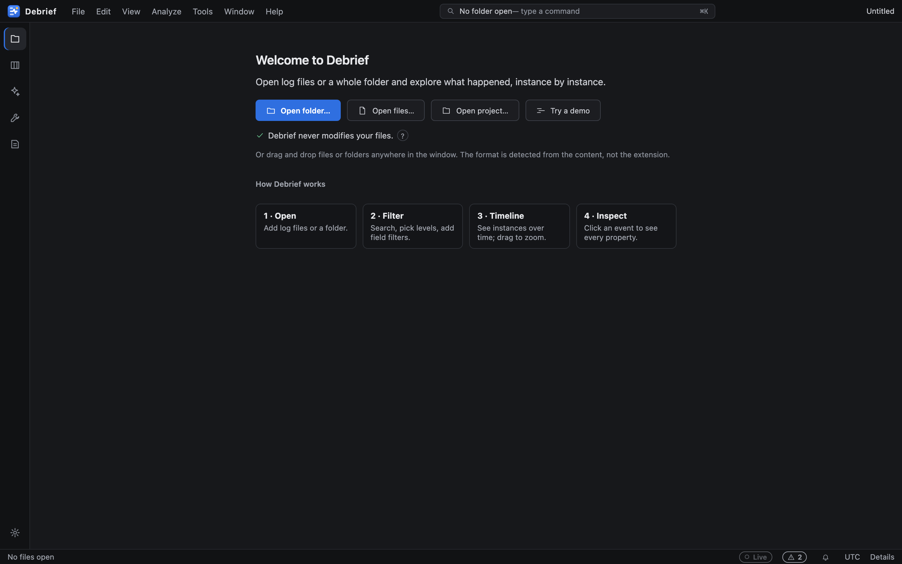

<div align="center">


# IMT — Integrated Maintenance Tool

**An IDE for analysing software logs and diagnostic files to find software issues.**

Open a folder of logs from many machines and processes. IMT merges them into one timeline per
instance, a fast filterable grid, charts and analysis views, all driven by an editable parsing
profile, and it never leaves your machine.

</div>



## At a glance


Many inputs, one engine, sandboxed plugins: logs, Windows diagnostics, profiler captures and
built-in collectors flow through importers (built in, or Rust plugins that each run out of process in a sandbox)
into one Rust engine that parses, cleans, stores, queries and analyses them. The
workbench only shows and shares what the engine computes. Details: [architecture](docs/architecture.md)
and every design diagram in [docs/design.md](docs/design.md). How IMT compares with other log tools: [docs/comparison.md](docs/comparison.md).

## Why IMT

Support and development teams usually get a zip of logs from several services on several machines
and have to answer "what happened, in which process, and when?". `grep` and a text editor do not
scale to that. IMT is built for exactly this job:

- **Instance-first.** Every process on every machine is a lane on one shared time axis, so a crash
  on one box lines up with the errors it caused on another.
- **Format-agnostic.** The format is detected from the file *content*, not the extension; anything
  unusual is taught to IMT with a profile or the format wizard, not code.
- **Fast on big inputs.** Parsing runs in parallel in a Rust engine and streams into a DuckDB store in a
  worker process with a full-text index, so memory stays flat whatever the folder size; the grid is virtualised
  and every large result is paged or bucketed. A saved project (`.imtz`) opens without the original logs.
- **Safe on hostile input.** Files are untrusted. Parsers never panic, enforce limits, and are
  fuzzed. IMT only reads your files and never modifies them.
- **Local only.** No telemetry and no network calls to analyse your data.

## Key features

Every feature, with screenshots, is in [docs/features.md](docs/features.md).

- **Timeline per instance.** One lane per process on a shared time axis, with lifecycle markers and drag-to-zoom ([details](docs/features.md#timeline-per-instance-with-lifecycle-markers)).
- **Events grid.** A virtualised grid with an inspector for every property ([grid](docs/features.md#events-grid-with-virtualisation), [inspector](docs/features.md#inspector)).
- **Home and search.** A dashboard of everything opened with a health check, a timeline minimap, and *Search everything* across events, sources, fields, notes and knowledge ([Home](docs/features.md#easy-to-start-hard-to-get-wrong), [search](docs/features.md#filters-facets-and-the-query-language)).
- **Filters and query language.** Facets, chips and a pipe query language with `stats` ([details](docs/features.md#filters-facets-and-the-query-language)).
- **Many formats, extensible by plugins.** Detected from content; add more with profiles or Rust plugins that run out of process in a sandbox, shipped as signed `.imtplugin` packages ([details](docs/features.md#many-formats-extensible-by-plugins), [SDK](docs/plugin-sdk.md)).
- **Profiles and pipelines.** Extractors, cleanup steps, markers and badges in editable TOML ([details](docs/features.md#profiles-extractors-pipelines-markers-and-badges)).
- **Charts and analysis.** Anomalies, patterns, exceptions, comparisons, clock-skew correction and configuration diff ([charts](docs/features.md#charts), [analysis](docs/features.md#analysis)).
- **Known issues, incident summary and playbooks.** Declare errors you have diagnosed, build an incident report in one step and follow repeatable investigations, all without a model ([details](docs/features.md#known-issues-the-incident-summary-and-playbooks)).
- **Video sources.** Turn a screen recording into frames described by the local model and aligned to the logs ([details](docs/features.md#video-sources)).
- **Live tail and alerts.** Follow growing files and raise alerts as events arrive ([details](docs/features.md#live-tail-and-alerts)).
- **Windows diagnostics.** Event logs, registry exports, Performance Monitor, process monitor and the diagnostics collector ([details](docs/features.md#performance-monitor-process-monitor-and-diagnostics-collector)).
- **Profiling and dumps.** Analyse profiler captures and heap snapshots, record .NET and native processes, and read crash dumps and UMDH heap logs ([profiling](docs/features.md#profiling), [dumps](docs/features.md#crash-dumps-and-umdh-heap-logs)).
- **Local AI assistant, Chromium browser and Research.** Models run on your machine and can read screenshots and your Markdown knowledge files; when a question needs the web, the AI researches it itself read-only in a real Chromium browser it starts for the purpose (you see it and can stop it) and answers with citations ([assistant](docs/features.md#local-ai-assistant), [browser and Research](docs/features.md#the-ais-browser-real-chromium)).
- **Jobs and notifications.** Long tasks run as jobs, with a pane and a notification centre ([details](docs/features.md#jobs-and-notifications)).
- **Sharing and reports.** Projects, redacted exports, incident reports and `.imtz` bundles ([projects](docs/features.md#projects-sessions-and-export), [share](docs/features.md#explain-and-share)).
- **Dockable workspace.** Panels, multiple windows, themes and accessibility ([details](docs/features.md#dockable-workspace)).
- **Robust and private.** One bad file, plugin or panel never takes the app down; no telemetry ([robustness](docs/features.md#robust-by-design), [privacy](docs/features.md#privacy)).

## Quick start

### Install

Download the installer for your platform from the **Releases** page of this repository:

| Platform | Package |
|---|---|
| Windows | NSIS `-setup.exe` |
| macOS | `.dmg` |
| Linux | `.deb` or `.rpm` |

No release yet, or you want the latest? [Build from source](#building-from-source).

### A two-minute tour



1. **Open the samples.** Start IMT, choose *Open folder…* (`Ctrl/⌘+Shift+O`) and pick the
   [`samples/`](samples/) folder (or drag it onto the window). It holds one incident seen through
   every supported format: Serilog CLEF/JSON/text, log4net, CSV, Windows event logs, IIS/nginx
   logs, syslog, OpenTelemetry and more, from several machines (see [`samples/README.md`](samples/README.md)).
2. **Load the sample profile.** Open the **Profile** tab, *Import…* and choose
   [`samples/profiles/orderservice.imtprofile.toml`](samples/profiles/orderservice.imtprofile.toml), then *Save & apply*.
   It extracts CPU and memory from text lines, so the CPU chart gets data.
3. **Read the timeline.** Each lane is one process. Triangles are warnings, circles errors,
   diamonds exceptions, green arrows starts. Drag across the timeline to zoom.
4. **Filter.** Click an `ERR` chip, or open the facets on the left and filter by `MachineName`.
5. **Inspect.** Click an event to see all of its properties; `↑`/`↓` move through the grid.
6. **Ask a question.** Press `Ctrl/⌘+/` and type
   `level >= warning | stats count() as n by SourceContext | sort n desc`.
7. **Find what changed.** Run *Show anomalies*, *Show patterns* and *Show exceptions* from the
   command palette (`Ctrl/⌘+K`), then select an error spike and run *Analyse this moment*.
8. **Teach IMT a format.** Click *Set up format…* next to a file shown in italics and mark a sample line.

The built-in browser demo (`npm start`, below) loads similar data without installing anything.

## Documentation

| Document | What it covers |
|---|---|
| [docs/features.md](docs/features.md) | Every feature, with screenshots |
| [docs/user-guide.md](docs/user-guide.md) | Supported inputs, profiles, the query language, keyboard shortcuts, command line |
| [docs/architecture.md](docs/architecture.md) | Overview, crates, the plugin runtime, windows and sessions, the ADR index, C4 and UML diagrams |
| [docs/design.md](docs/design.md) | All design diagrams on one page |
| [docs/playbooks.md](docs/playbooks.md) | The investigation playbook file format |
| [docs/plugins.md](docs/plugins.md) | Extending IMT: profiles, Rust plugins, UI plugins, process plugins |
| [docs/plugin-sdk.md](docs/plugin-sdk.md) | Writing, testing, signing and installing a third-party plugin |
| [docs/units.md](docs/units.md) | How quantities are typed in transit and formatted in one place |
| [docs/profiling.md](docs/profiling.md) | The profiling engine and its views |
| [docs/development.md](docs/development.md) | Building, packaging, testing, CI/CD and the project layout |
| [docs/releasing.md](docs/releasing.md) | Releases and signed updates |
| [docs/testing-manual.md](docs/testing-manual.md) | Manual tests that need a real desktop |
| [docs/fuzzing.md](docs/fuzzing.md) | Fuzzing and property-based tests |
| [docs/comparison.md](docs/comparison.md) | IMT compared with other log tools |
| [docs/roadmap.md](docs/roadmap.md) | Planned work, engineering follow-ups and open redesign items |
| [docs/ux-audit/](docs/ux-audit/README.md) | The 2026-10-22 usability audit that led to perspectives and Home (a point-in-time record) |
| [CHANGELOG.md](CHANGELOG.md) | What changed for users, per release (feeds *Help ▸ What's new*) |
| [docs/adr/](docs/adr/0001-architecture.md) | Architecture decision records, starting at 0001 |
| [samples/README.md](samples/README.md) | The sample logs, their formats and the views they show |

## Building from source

Prerequisites: Rust (stable, with `rustfmt` and `clippy`), Node.js 24.15 or later with npm, and the
[Tauri 2 platform dependencies](https://v2.tauri.app/start/prerequisites/). The store links the official prebuilt
libduckdb: `npx tauri build` fetches and verifies it itself, and plain `cargo` builds need
`node app/scripts/libduckdb.mjs` first ([docs/development.md](docs/development.md#prerequisites)).

```sh
cd app
npm ci
npm start             # UI only, in a browser, against the built-in mock backend (http://localhost:4200)
npx tauri dev         # the desktop app with the real engine
npx tauri build       # installers for the current OS, in target/release/bundle/
```

Prerequisites per platform, Visual Studio Code, third-party notices, regenerating the screenshots,
tests and CI are in [docs/development.md](docs/development.md).

## Plugins and roadmap

Extend IMT with profiles (TOML), Rust plugins (each runs in its own sandboxed process, with a memory cap, and as a
signed `.imtplugin` package when third-party) or Angular UI plugins:
see [docs/plugins.md](docs/plugins.md), the [plugin SDK](docs/plugin-sdk.md) and
[ADR 0017](docs/adr/0017-one-ipc-out-of-process-plugins.md). Planned work is in [docs/roadmap.md](docs/roadmap.md).

## Contributing

Read [AGENTS.md](AGENTS.md) first: it sets the design principles, the security and robustness rules
and the quality gates. Build, test and CI details are in [docs/development.md](docs/development.md).
Use [Conventional Commits](https://www.conventionalcommits.org/); releases are `v*` tags following semver.

## Security and privacy

- Files are treated as untrusted: parsers never panic, enforce limits and are fuzzed. IPC arguments
  are validated in Rust, and only paths the user chose are opened.
- Tauri capabilities are least-privilege and the CSP has no `unsafe-eval` and no remote origins.
- No telemetry. Crash reporting, if ever added, will be opt-in.
- Found a vulnerability? Please report it privately to the maintainers rather than in a public issue.

## Licence

Licensed under either of

- Apache License, Version 2.0 ([`LICENSE-APACHE`](LICENSE-APACHE))
- MIT license ([`LICENSE-MIT`](LICENSE-MIT))

at your option.

*About IMT* (command palette, *Help*) shows the version, the build commit and date, both licence
texts and the third-party notices in a searchable viewer, and can copy the version information.

Unless you explicitly state otherwise, any contribution intentionally submitted for inclusion in IMT
by you, as defined in the Apache-2.0 license, shall be dual licensed as above, without any additional
terms or conditions. Dependency licences are checked in CI with `cargo deny` (see [`deny.toml`](deny.toml)).
