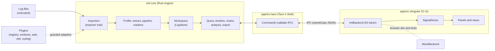

<div align="center">


# IMT — Integrated Maintenance Tool

**An IDE for analysing software logs and diagnostic files to find software issues.**

Open a folder of logs from many machines and processes. IMT merges them into one timeline per
instance, a fast filterable grid, charts and analysis views, all driven by an editable parsing
profile, and it never leaves your machine.

</div>


> The screenshots in this README are captured automatically from the UI running against the
> built-in demo data. See [Regenerating the screenshots](#regenerating-the-screenshots).

## Contents

[Why IMT](#why-imt) · [Features](#features) · [Quick start](#quick-start) · [Supported inputs](#supported-inputs) ·
[Profiles](#profiles) · [Query language](#query-language) · [Keyboard shortcuts](#keyboard-shortcuts) ·
[Command line](#command-line) · [Architecture](#architecture) · [Plugins](#plugins) ·
[Building from source](#building-from-source) · [Testing](#testing-and-quality-gates) · [CI/CD](#cicd) ·
[Project layout](#project-layout) · [Roadmap](#roadmap) · [Contributing](#contributing) ·
[Security and privacy](#security-and-privacy) · [Licence](#licence)

## Why IMT

Support and development teams usually get a zip of logs from several services on several machines
and have to answer "what happened, in which process, and when?". `grep` and a text editor do not
scale to that. IMT is built for exactly this job:

- **Instance-first.** Every process on every machine is a lane on one shared time axis, so a crash
  on one box lines up with the errors it caused on another.
- **Format-agnostic.** The format is detected from the file *content*, not the extension; anything
  unusual is taught to IMT with a profile or the format wizard, not code.
- **Fast on big inputs.** Parsing runs in parallel in a Rust engine; the grid is virtualised and
  every large result is paged or bucketed.
- **Safe on hostile input.** Files are untrusted. Parsers never panic, enforce limits, and are
  fuzzed. IMT only reads your files and never modifies them.
- **Local only.** No telemetry and no network calls to analyse your data.

## Features

### Timeline per instance, with lifecycle markers


- One lane per instance (by default machine + process; configurable with `[instance] key`), each
  with an event-density histogram and markers for start, stop, crash, exception, error and warning.
- Drag to zoom, `Zoom in`/`Zoom out`/`Fit`, and previous/next range history (`Alt+←` / `Alt+→`).
- Lifecycle markers (start/stop) can be kept visible at any zoom level.
- Time can be shown in UTC or local time.

### Events grid with virtualisation

- Millions of rows stay smooth: only visible rows are rendered, results are paged from the engine.
- Choose columns, sort oldest/newest first, group by any fields, follow growing files with **Live**
  (live tail), and jump from a marker or a metric to the exact rows behind it.
- Row actions on a selection: highlight, mark, extract a value, mask, drop, bookmark, and "same
  CorrelationId".

### Inspector


Click a row or a timeline marker to see the level, instance, rendered message and message template,
every property, the exception and stack trace, and where the event came from (`file:line`). Quick
actions show the surrounding ±2 minutes, the same correlation id, or copy the event as JSON.

### Filters, facets and the query language


- Full-text search (with regex and case toggles), level chips, time range, field filters, "marked
  only", and a **facets sidebar** listing every field with its coverage and number of distinct values.
- A small query language in the spirit of KQL/LogQL with completions and history: filters, `stats`,
  `sort`, `head` and percentiles. See the [cheat sheet](#query-language).


### Many formats, extensible by plugins

Serilog (CLEF, JSON and text), log4net/NLog layouts, generic JSON and CSV, plus plugins for
Windows Event Logs, registry exports, `msinfo32`, Performance Monitor, IIS/Apache/Nginx logs, HAR,
OpenTelemetry and syslog/journald. Gzip and zip archives are read transparently. See
[Supported inputs](#supported-inputs).


Files IMT cannot read yet are listed with a **Set up format** button: mark the timestamp, level and
message on a sample line and IMT generates a pattern (or a Serilog output template) and re-imports.


### Profiles, extractors, pipelines, markers and badges


A **profile** is a TOML pipeline: `files → parse → instance → extract → pipeline → markers → charts`.
Edit it as a form or as TOML, with live previews; a profile that does not compile is never saved, and
previous versions are kept. Extractors turn text into typed fields (numbers, byte sizes, durations)
that then work everywhere: columns, filters, group-by, marker rules and charts. Pipeline steps clean
and enrich events during import (drop, keep, mask, dedupe, rename, parse JSON/key-value, lookup,
shift time, ...). See [Profiles](#profiles).


Markers are rules (condition + label + colour). Give a marker a built-in icon, a custom sanitised
SVG/PNG, or a generated badge such as a hexagon with "3". Rules can be created from a selection
("Highlight lines…", "Infer pattern from selected lines…").

### Charts


Charts (Apache ECharts) are defined in the profile or added ad hoc: aggregate any numeric field
(`count()`, `avg(cpu)`, ...) per time bucket, split by instance or any field, with lifecycle markers
drawn over the series. Drag across a chart to zoom the whole workspace.

### Analysis

Analysis runs in the engine and is available from the command palette (`Ctrl/⌘+K`).

| View | What it does |
|---|---|
| **Moment** | Everything around a point in time or a selected range: per-instance counts, top patterns, metrics against the previous window, and what users were doing. `Ctrl/⌘+Shift+M`. |
| **Patterns** | Clusters similar messages into templates so 100k lines become a short list, with first/last seen and level colouring. |
| **Exceptions** | Groups exceptions by type and normalised stack with counts, first/last seen and affected instances. |
| **Anomalies** | Error-rate spikes, slow-request outliers and crashes, listed with their time window and instance. |
| **Compare** | Two windows side by side ("current vs previous", before/after a time, or any two selections): changed fields, new values and event mix. |
| **Field statistics** | Distributions and percentiles for a field. |
| **Traces** | Follows trace/span/request ids (for example from OpenTelemetry). |

<table>
<tr>
<td width="50%"></td>
<td width="50%"></td>
</tr>
<tr>
<td></td>
<td></td>
</tr>
</table>


### Performance Monitor, process monitor and diagnostics collector

<table>
<tr>
<td width="50%"></td>
<td width="50%"></td>
</tr>
</table>

- **Performance Monitor** (Windows): build a Data Collector Set from presets, install and start it
  with `logman`, then open the `.csv`/`.blg` result next to your logs. Counter rows become metrics.
- **Process monitor**: samples CPU, memory and other counters of the processes you pick and writes
  them as rolling CLEF files that open live in IMT; process start/exit events give start/stop markers
  and show crashes and restarts. Also available headless as `imt-monitor`.
- **Diagnostics collector**: gathers app logs, Windows event logs, `msinfo32`, registry keys, a
  performance-counter sample and environment info into one `.imtz` bundle, with redaction. Run it
  from the app (*Collect diagnostics bundle…*) or on a customer machine with `imt-collect`.

Windows-only collectors are skipped with a clear note on other platforms.

### Projects, sessions and export

- **Projects** (`.imtproj`): sources, profile, filters, time range, zoom history, columns and
  bookmarks saved and reopened (`Ctrl/⌘+S`); recent projects; file association.
- **Bookmarks** on events and time ranges (`Ctrl/⌘+D`).
- **Export** the filtered events to CSV or Serilog CLEF (re-importable), and query results to CSV.
- **Sessions are autosaved**: after a crash IMT offers to restore your work.

### Dockable workspace


Every view is a panel. Drag tabs to split, float a panel (`Float panel` button), maximise it, and
reset the layout from the command palette. Layouts are remembered.

### Light and dark themes


Theme follows the system by default, or choose **Theme: dark/light** in the command palette.

### Robust by design

- **Never modifies your files.** Input is opened read-only.
- **Safe mode** (`--safe-mode` or `IMT_SAFE_MODE=1`, or *Restart in safe mode*) starts without
  plugins and without the saved profile, for when something misbehaves.
- **Plugin containment.** Plugin code runs inside guarded adapters: panics become errors attributed
  to the plugin, and repeat offenders are quarantined (see the *Plugin health* panel, where a plugin
  can be reset or disabled).
- **One bad file never stops the import.** It is reported as unrecognised with a reason; the rest
  loads.
- **Bounded resources.** Limits on line length, regex size, archive expansion and result sizes;
  external tools run with timeouts; locked files and missing rights produce a message and a next step
  (retry, restart as administrator) instead of an error dialog.

### Privacy

Everything runs on your machine. IMT sends no telemetry and makes no network requests to analyse
files; the webview's content security policy allows no remote origins. Logs written by IMT itself do
not contain file contents.

## Quick start

### Install

Download the installer for your platform from the **Releases** page of this repository:

| Platform | Package |
|---|---|
| Windows | `.msi` or NSIS `-setup.exe` |
| macOS | `.dmg` |
| Linux | `.deb` or `.rpm` |

No release yet, or you want the latest? [Build from source](#building-from-source).

### A two-minute tour


1. **Open the samples.** Start IMT, choose *Open folder…* (`Ctrl/⌘+Shift+O`) and pick the
   [`samples/`](samples/) folder (or drag it onto the window). It holds Serilog CLEF/JSON/text,
   log4net and CSV files from several machines.
2. **Load the sample profile.** Open the **Profile** tab, *Import…* and choose
   [`samples/profiles/orderservice.imtprofile.toml`](samples/profiles/orderservice.imtprofile.toml), then *Save & apply*.
   It extracts CPU and memory from text lines, so the CPU chart gets data.
3. **Read the timeline.** Each lane is one process. Triangles are warnings, circles errors,
   diamonds exceptions, green arrows starts. Drag across the timeline to zoom.
4. **Filter.** Click an `ERR` chip, or open the facets on the left and filter by `MachineName`.
5. **Inspect.** Click an event to see all of its properties; `↑`/`↓` move through the grid.
6. **Ask a question.** Press `Ctrl/⌘+/` and type
   `level >= warning | stats count() as n by SourceContext | sort n desc`.
7. **Find what changed.** Run *Show anomalies*, *Show patterns* and *Show exceptions* from the
   command palette (`Ctrl/⌘+K`), then select an error spike and run *Analyse this moment*.
8. **Teach IMT a format.** Click *Set up format…* next to a file shown in italics and mark a sample line.

The built-in browser demo (`npm start`, below) loads similar data without installing anything.

## Supported inputs

The format is detected from the content. UTF-8 and UTF-16 are both read. Gzip files and zip archives
are detected by magic bytes and expanded (with size caps against zip bombs).

| Format | Typical files | Provided by | Notes |
|---|---|---|---|
| Serilog CLEF, Serilog `JsonFormatter`, JSON lines, whole-file JSON arrays (NLog, ECS, pino, ...) | `.clef`, `.json`, `.log` | `imt-core` JSON importer | Keys are configurable in `[parse.json]`; nested objects are flattened |
| Serilog text and console output | `.log`, `.txt` | `imt-core` text importer | Described by the same `outputTemplate` you use in `appsettings.json` |
| log4net / NLog pattern layouts and any text via regex | `.log`, `.txt` | `imt-core` text importer | Named groups in `[parse] regex`; multi-line messages and stack traces attach to their event |
| CSV / TSV / `;` / `|` delimited | `.csv`, `.tsv` | `imt-core` CSV importer | Delimiter and columns auto-detected |
| Windows Event Logs | `.evtx` | `imt-plugin-windows` | Binary importer; message is `Provider EventId: key=value, ...` (offline, no message DLLs) |
| System information | `.nfo` (msinfo32) | `imt-plugin-windows` | One record per row with `Category`, `Item`, `Value` |
| Performance Monitor logs | `.csv`/`.tsv` (PDH), `.blg` | `imt-plugin-windows` | `.blg` is converted with `relog` (Windows only) |
| Windows registry exports | `.reg` | `imt-plugin-registry` | One record per key/value, shown as a tree in the Registry panel |
| IIS / W3C extended, Apache / Nginx common and combined | `.log` | `imt-plugin-web` | |
| HAR captures | `.har` | `imt-plugin-web` | One record per request |
| OpenTelemetry OTLP/JSON logs and traces | `.json`, `.jsonl` | `imt-plugin-otel` | Spans and span events linked by `TraceId` / `SpanId` |
| syslog (RFC 5424, RFC 3164) and journald (`journalctl -o json`) | `syslog`, `.log`, `.json` | `imt-plugin-syslog` | Severity is mapped to IMT levels |
| CBS / DISM text logs | `CBS.log` | built-in text importer | Needs a one-line profile regex, no plugin |

Timestamps: ISO 8601/RFC 3339, Serilog defaults, `/` and `.` dates (day-first or month-first, detected
per file), month names, 12-hour clocks, epoch seconds/milliseconds, time-only console logs, and your own
.NET (`dd/MM/yyyy HH:mm:ss.fff`) or strftime formats. Timezone for offset-less times is configurable.

## Profiles

A profile only needs the keys that differ from the built-in default. The full schema, with every key
documented, is [`crates/imt-core/src/default_profile.toml`](crates/imt-core/src/default_profile.toml);
a worked example is [`samples/profiles/orderservice.imtprofile.toml`](samples/profiles/orderservice.imtprofile.toml).

```toml
name = "OrderService"

[instance]
key = ["MachineName", "ProcessId"]            # what one lane on the timeline is

[[extract]]                                   # turn text into typed fields
name = "process-stats"
regex = 'CPU (?P<cpu>[\d.]+)% .* WorkingSet (?P<ws>[\d.]+) ?(?P<ws_unit>KB|MB|GB)'
when = [{ field = "SourceContext", op = "eq", value = "Diagnostics.ProcessMonitor" }]
[extract.fields]
cpu = { type = "number", unit = "%" }
ws  = { type = "bytes", unit_from = "ws_unit", to = "MB" }

[[pipeline]]                                  # clean up during import
step = "drop"
when = [{ field = "SourceContext", op = "contains", value = "HealthChecks" }]

[[marker]]                                    # first matching rule is the primary marker
kind  = "gateway-timeout"
label = "Gateway timeout"
badge = "3"
shape = "hexagon"
color = "#3987e5"
description = "Payment gateway timed out; check the PSP status page"
when  = [{ field = "@message", op = "matches", value = '(?i)gateway.*time(d)? ?out' }]

[[chart]]
title = "CPU %"
y = "avg(cpu)"
bucket = "1m"
split_by = ["MachineName", "ProcessId"]
```

- **Pseudo-fields:** `@level @message @exception @template @source @line`.
- **Condition operators:** `eq ne contains notContains matches exists missing gt lt in`.
- **Extractor field types:** `string number integer bool bytes duration`.
- **Pipeline steps:** `drop keep mask dedupe remove_fields rename set set_level truncate parse_json
  parse_kv lookup shift_time plugin`.
- Profiles are checked by the engine (user regexes are length- and size-limited); an invalid profile
  is rejected with a message that says what to fix.

## Query language

Press `Ctrl/⌘+/` to focus the query bar and `Ctrl/⌘+Enter` to run. Keywords are case-insensitive.
A query is an optional filter followed by `|` stages.

| Syntax | Meaning |
|---|---|
| `timeout` or `"connection reset"` | full text over message, exception and template |
| `level >= warning` | compare a field (`= != > >= < <=`); levels are ordered |
| `RequestPath contains "/capture"` / `!contains` | substring |
| `message ~ "time(d)? ?out"` / `!~` | regular expression |
| `StatusCode in (500, 502, 504)` | one of a list |
| `exists(Exception)` / `missing(CorrelationId)` | field present or absent |
| `a and b`, `a or b`, `not a`, `( ... )` | boolean logic (`and` may be omitted) |
| `` `my field` `` / `@level` | quoted and pseudo field names |
| `\| where expr` | filter again after a stage |
| `\| stats count() as n, p95(Elapsed) by SourceContext` | aggregate; functions: `count count_distinct avg min max sum p50 p95 p99` |
| `\| sort n desc` | order the result |
| `\| head 10` (or `limit 10`) | first rows |
| `\| fields a, b` | choose columns |

Examples:

```text
level >= error and RequestPath ~ "/capture" and ElapsedMs > 5000
exists(@exception) | stats count() as n by Application, MachineName | sort n desc | head 20
SourceContext = "Outbox.Dispatcher" and message contains "timed out" | stats count() by ProcessId
level >= warning | stats p50(ElapsedMs) as p50, p95(ElapsedMs) as p95, p99(ElapsedMs) as p99 by RequestPath
```

Plain filters narrow the grid, timeline and charts; `stats` queries show a results table you can
export as CSV. The full grammar is in
[`crates/imt-core/src/ql/mod.rs`](crates/imt-core/src/ql/mod.rs).

## Keyboard shortcuts

`Mod` is `Ctrl` on Windows/Linux and `⌘` on macOS.

| Shortcut | Action |
|---|---|
| `Mod+K` | Command palette (every action is in it) |
| `Mod+O` / `Mod+Shift+O` | Open files / open folder |
| `Mod+/` | Focus the query bar |
| `Mod+Enter` | Run the query (in the query bar) |
| `Mod+Shift+M` | Analyse this moment |
| `Mod+S` / `Mod+Shift+S` | Save project / save project as |
| `Mod+D` | Bookmark the selected event |
| `Mod+Shift+E` | Export events |
| `Mod+B` | Toggle the sidebar |
| `Mod+,` | Settings |
| `Alt+←` / `Alt+→` | Previous / next time range |
| `↑` / `↓` | Move through the events grid |

## Command line

The desktop app takes paths to open at startup and an optional safe-mode flag:

```sh
imt-app <folder-or-files...>        # open files and folders at startup
imt-app --safe-mode                 # no plugins, no saved profile (also: IMT_SAFE_MODE=1)
```

Two headless tools ship in the workspace for servers and customer machines:

```sh
imt-collect [--plan plan.json|plan.toml] [--out dir] [--print-default-plan]
imt-monitor --config <monitor.json> --out <dir> [--duration <10m|30s|2h|1500ms>]
```

`imt-collect` writes an `.imtz` bundle that IMT opens directly; `imt-monitor` writes rolling CLEF files.
Run them from a checkout with `cargo run -p imt-collect -- --help` or `cargo run -p imt-monitor -- --config monitor.json --out ./logs`.

The original `imt` command-line filter still exists at the workspace root. It takes a path, loads its
regexes from a `confy` configuration file and writes `*-filtered.log` files:

```sh
cargo run -p imt -- <file-or-folder>
```

## Architecture

The Rust engine is the single source of truth for data and behaviour; Angular only presents what the
engine returns. The Tauri shell depends on the `LogStore` trait and importers on the `Importer` trait
(ports and adapters), so the in-memory store can later be replaced without touching commands or UI.



- **Engine** (`crates/imt-core`): importers, profiles and pipelines, query language, timeline and chart
  aggregation, analysis, exports, projects and the plugin registry.
- **Shell** (`app/src-tauri`): thin Tauri 2 commands that validate every argument and run work off the
  UI thread; least-privilege capabilities and a strict CSP.
- **UI** (`app/src`): standalone Angular components and signals, `@ngrx/signals` stores, dockview
  panels, ECharts. Components never call `invoke` directly; they use the injected backend service.
- **Contracts:** the wire contract is [`app/src/app/core/api.types.ts`](app/src/app/core/api.types.ts)
  (camelCase JSON), mirrored by the Rust DTOs.

Read more in [docs/architecture.md](docs/architecture.md) (C4 and UML diagrams as editable
[draw.io files](docs/diagrams/)) and [ADR 0001](docs/adr/0001-architecture.md).

## Plugins

Extend IMT at three levels: **profiles** (TOML, no code), **engine plugins** (Rust crates implementing
`Importer`, `BinaryImporter`, `RecordTransform`, `Exporter`, `Collector`, `WorkspaceHook`) and
**UI plugins** (Angular providers for views, commands, inspector sections and field formatters).
All engine plugins are registered through `PluginRegistry`, which wraps them in guarded adapters.
See [docs/plugins.md](docs/plugins.md). Runtime-loaded (WASM) plugins are on the [roadmap](docs/roadmap.md).

## Building from source

### Prerequisites

- **Rust** (stable) with `rustfmt` and `clippy`.
- **Node.js ≥ 24.15** (see [`app/.nvmrc`](app/.nvmrc)) and npm.
- **Tauri 2 platform dependencies** ([official guide](https://v2.tauri.app/start/prerequisites/)):
  - *Linux:* `libwebkit2gtk-4.1-dev libgtk-3-dev librsvg2-dev libayatana-appindicator3-dev patchelf`
    (as installed by CI on Debian/Ubuntu).
  - *macOS:* Xcode Command Line Tools.
  - *Windows:* Microsoft C++ Build Tools and the WebView2 runtime. MSI bundling needs WiX, NSIS
    bundling needs NSIS (both are handled by `tauri build`).

### Develop

```sh
cd app
npm ci
npm start             # UI only, in a browser, against the built-in mock backend (http://localhost:4200)
npx tauri dev         # the desktop app with the real engine (starts `npm run start` for you)
```

```sh
cargo test -p imt-core        # engine tests, including end-to-end runs over /samples
```

Regenerate the sample logs with `python3 samples/generate.py` (do not edit them by hand).

### Package

```sh
cd app
npx tauri build                         # all bundle types for the current OS
npx tauri build --bundles deb,rpm       # Linux
npx tauri build --bundles msi,nsis      # Windows
npx tauri build --bundles dmg           # macOS
```

Installers are written to `target/release/bundle/`:

| OS | Output |
|---|---|
| Linux | `bundle/deb/*.deb`, `bundle/rpm/*.rpm` |
| Windows | `bundle/msi/*.msi`, `bundle/nsis/*-setup.exe` |
| macOS | `bundle/dmg/*.dmg` (and `bundle/macos/IMT.app`) |

### Regenerating the screenshots

The README screenshots are captured by a Playwright script against the browser build with the mock
backend (1600×1000, dark theme plus one light shot). Views that are missing are skipped with a warning.

```sh
cd app
npm run e2e:install     # once: Playwright browsers
npm run screenshots     # writes docs/screenshots/*.png
```

The script is [`app/scripts/screenshots/capture.ts`](app/scripts/screenshots/capture.ts); set
`IMT_SHOT_PORT` to use another dev-server port.

## Testing and quality gates

Every change ships with tests, and every bug fix starts with a failing regression test. Before
committing, all of these must pass:

```sh
cargo fmt --all --check
cargo clippy --workspace --all-targets -- -D warnings
cargo test --workspace
cargo deny --workspace check
(cd app && npm audit --omit=dev --audit-level=high && npx ng build && npx ng test --watch=false)
```

- **Coverage targets:** `imt-core` ≥ 99% lines (`cargo llvm-cov -p imt-core --summary-only`); Angular
  ≥ 80% lines overall and close to 100% for stores, services and pure utilities.
- **Engine end-to-end tests** run against [`samples/`](samples/) (`crates/imt-core/tests`).
- **UI tests** are layered: Vitest + TestBed unit and component tests, and Playwright end-to-end flows
  against the browser build (Chromium and WebKit, with accessibility checks and a production-CSP check):
  `cd app && npm run e2e`.
- **Property tests (proptest)** assert that parsers never panic and that invariants hold;
  **fuzzers (cargo-fuzz)** cover every parser and run nightly in CI. See [docs/fuzzing.md](docs/fuzzing.md).

## CI/CD

Gitea Actions workflows live in [`.gitea/workflows/`](.gitea/workflows/):

- **`build.yml`** runs on pushes to `main`, pull requests and `v*` tags:
  1. *check* (Linux): `cargo test`, `fmt`, `clippy -D warnings`, `cargo-deny`, the Angular build with
     `npm audit`, unit tests with coverage, and the Playwright end-to-end tests.
  2. *bundle* (matrix): `.deb`/`.rpm` on `ubuntu-latest`, `.msi`/NSIS `.exe` on `windows-latest` and
     `.dmg` on `macos-latest`, uploaded as run artifacts.
  3. *release*: on a `v*` tag, creates a Gitea release with all installers attached.
- **`fuzz.yml`** fuzzes every parser nightly (and on demand) and uploads reproducers on failure.

Runners are expected to carry the labels `ubuntu-latest`, `windows-latest` and `macos-latest`. Creating
a release needs a repository secret **`RELEASE_TOKEN`** (a Gitea access token with `write:repository`
scope). Dependencies are updated by Renovate, which also pins CI actions to commit digests.

## Project layout

```text
.
├── AGENTS.md                      engineering rules for contributors and coding agents
├── assets/icon/                   application icon (SVG and PNG)
├── app/
│   ├── src/app/                   Angular 22 UI: shell, grid, timeline, inspector, analysis, profile,
│   │                              markers, tools, projects, lifecycle, dock, core (backend + mock)
│   ├── src-tauri/                 Tauri 2 shell: commands, capabilities, lifecycle (safe mode, sessions)
│   ├── e2e/                       Playwright end-to-end tests (mock backend)
│   └── scripts/screenshots/       README screenshot generator
├── crates/
│   ├── imt-core/                  engine: importers, profile, query/ql, workspace, analysis, export, plugins
│   ├── imt-plugin-registry/       .reg importer
│   ├── imt-plugin-windows/        .evtx, msinfo32 .nfo, Performance Monitor (.csv/.blg) and logman control
│   ├── imt-plugin-web/            IIS/W3C, Apache/Nginx, HAR
│   ├── imt-plugin-otel/           OpenTelemetry OTLP/JSON
│   ├── imt-plugin-syslog/         syslog and journald
│   ├── imt-monitor/               process monitor (library and `imt-monitor` CLI)
│   └── imt-collect/               diagnostics collector (library and `imt-collect` CLI)
├── docs/                          architecture, roadmap, backlog, plugins, fuzzing, ADRs, draw.io diagrams, screenshots
├── fuzz/                          cargo-fuzz targets
├── samples/                       generated sample logs and an example profile
├── src/                           the original `imt` command-line filter
└── .gitea/workflows/              CI (build, release, fuzz)
```

## Roadmap

Highlights; the full list is in [docs/roadmap.md](docs/roadmap.md) and engineering follow-ups are in
[docs/backlog.md](docs/backlog.md). Nothing in this section is available yet unless stated.

- **Profilers (planned):** .NET Framework 4.6.2+ via ETW (production-safe) and the CLR Profiling API
  ("deep mode"), .NET Core/5+ through `dotnet-counters`/`dotnet-trace`/`dotnet-gcdump`, and C++
  (UMDH, WPR, `perf`, `heaptrack`), with a shared flame graph and allocation snapshot diff.
- **Local-only AI assistant (in progress):** an embedded GGUF model chosen from the machine's hardware
  that proposes regexes, pipelines and markers, which the engine validates before they are used. It
  runs locally and sends nothing off the machine.
- **Persistent store:** a DuckDB/DataFusion spike behind the `LogStore` port for data larger than RAM.
- **More sources and sharing:** remote sources (SSH, Seq, Elasticsearch, Loki), redaction rules,
  incident report builder, WASM plugins, auto-update and signed releases.

## Contributing

Read [AGENTS.md](AGENTS.md) first: it sets the design principles (SOLID, ports and adapters, pure
core and thin edges), the security and robustness rules, ownership when working in parallel, and the
quality gates above. In short:

- Use [Conventional Commits](https://www.conventionalcommits.org/) (`feat:`, `fix:`, `refactor:`,
  `test:`, `docs:`, `ci:`, `chore:`); releases are `v*` tags following semver.
- Keep the UI/engine contract in sync: a change to `api.types.ts` is mirrored in the Rust DTOs.
- New file formats are new `Importer`s; new behaviour for users should be profile configuration.
- Record significant architecture decisions as ADRs in [`docs/adr/`](docs/adr/).

## Security and privacy

- Files are treated as untrusted: parsers never panic, enforce limits (line size, regex size,
  archive expansion) and are fuzzed. IPC arguments are validated in Rust, only paths the user chose
  are opened, and they are canonicalised.
- Tauri capabilities are least-privilege and the CSP has no `unsafe-eval` and no remote origins;
  log text is never bound as HTML.
- No telemetry. Crash reporting, if ever added, will be opt-in.
- Found a vulnerability? Please report it privately to the maintainers rather than in a public issue.

## Licence

Licensed under either of

- Apache License, Version 2.0 ([`LICENSE-APACHE`](LICENSE-APACHE))
- MIT license ([`LICENSE-MIT`](LICENSE-MIT))

at your option.

Unless you explicitly state otherwise, any contribution intentionally submitted for inclusion in IMT
by you, as defined in the Apache-2.0 license, shall be dual licensed as above, without any additional
terms or conditions. Dependency licences are checked in CI with `cargo deny` (see [`deny.toml`](deny.toml)).
