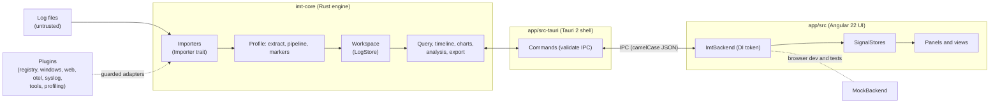

<div align="center">


# IMT — Integrated Maintenance Tool

**An IDE for analysing software logs and diagnostic files to find software issues.**

Open a folder of logs from many machines and processes. IMT merges them into one timeline per
instance, a fast filterable grid, charts and analysis views, all driven by an editable parsing
profile, and it never leaves your machine.

</div>


> The screenshots in this README are captured automatically from the UI running against the
> built-in demo data. See [Regenerating the screenshots](#regenerating-the-screenshots).

## At a glance


Many inputs, one engine, any plugin language: logs, Windows diagnostics, profiler captures and
built-in collectors flow through importers (built in, or plugins in Rust, C#/.NET or any gRPC
language) into one Rust engine that parses, cleans, stores, queries and analyses them. The
workbench only shows and shares what the engine computes. Details: [Architecture](#architecture)
and every design diagram in [docs/design.md](docs/design.md). How IMT compares with other log tools: [docs/comparison.md](docs/comparison.md).

## Contents

[At a glance](#at-a-glance) · [Why IMT](#why-imt) · [Features](#features) · [Quick start](#quick-start) · [Supported inputs](#supported-inputs) ·
[Profiles](#profiles) · [Query language](#query-language) · [Keyboard shortcuts](#keyboard-shortcuts) ·
[Command line](#command-line) · [Architecture](#architecture) · [Plugins](#plugins) ·
[Building from source](#building-from-source) · [Testing](#testing-and-quality-gates) · [CI/CD](#cicd) ·
[Project layout](#project-layout) · [Roadmap](#roadmap) · [Contributing](#contributing) ·
[Security and privacy](#security-and-privacy) · [Licence](#licence)

## Why IMT

Support and development teams usually get a zip of logs from several services on several machines
and have to answer "what happened, in which process, and when?". `grep` and a text editor do not
scale to that. IMT is built for exactly this job:

- **Instance-first.** Every process on every machine is a lane on one shared time axis, so a crash
  on one box lines up with the errors it caused on another.
- **Format-agnostic.** The format is detected from the file *content*, not the extension; anything
  unusual is taught to IMT with a profile or the format wizard, not code.
- **Fast on big inputs.** Parsing runs in parallel in a Rust engine; the grid is virtualised and
  every large result is paged or bucketed.
- **Safe on hostile input.** Files are untrusted. Parsers never panic, enforce limits, and are
  fuzzed. IMT only reads your files and never modifies them.
- **Local only.** No telemetry and no network calls to analyse your data.

## Features

### Timeline per instance, with lifecycle markers


- One lane per instance (by default machine + process; configurable with `[instance] key`), each
  with an event-density histogram and markers for start, stop, crash, exception, error and warning.
- Drag to zoom, `Zoom in`/`Zoom out`/`Fit`, and previous/next range history (`Alt+←` / `Alt+→`).
- Lifecycle markers (start/stop) can be kept visible at any zoom level.
- **Runs.** Each start → stop on a lane is drawn as a band, even when many instances share one log
  file: pair per lane or by a field such as `Worker` or `ProcessId`. A run still going shows as
  *still running*; a start without a stop (often a crash) and a stop without a start are flagged.
  Hover for times, duration and both messages, click to filter to the run. Set rules up with the
  guided editor in the Markers manager (presets for services and processes, live preview), and see
  every run in the **Runs** view. Profiles use `[[span]]` rules; a default rule ships enabled.
- Time can be shown in UTC or local time.
- **Several timelines.** *New timeline* adds more timeline panels, each with its own query and
  instance selection. While a panel is linked (*Sync time*) it zooms, pans and shares the time cursor
  with the main timeline; unlinked, it keeps its own range and cursor (and is marked *Unlinked*).
  Extra timelines are kept in projects and sessions.
- **Annotations** from plugins (for example reboots and service uptime found in Windows event logs)
  are drawn over the lanes: a span is a translucent band on the lane it concerns, on every lane of a
  machine when it is about the machine (and the machine is part of the lane key), or across the full
  height otherwise; a point is a glyph. Severity is shown by an icon and a fill pattern (hatched,
  dotted, plain), never by colour alone. Hover or focus one for its label, owner and time; click it
  (or press `Enter`) to filter to the events behind it. The **Annotations** legend switches kinds on
  and off, and annotations refresh with every data change, including live tail.

### Events grid with virtualisation

- Millions of rows stay smooth: only visible rows are rendered, results are paged from the engine.
- Choose columns, sort oldest/newest first, group by any fields, follow growing files with **Live**
  (live tail), and jump from a marker or a metric to the exact rows behind it.
- Row actions on a selection: highlight, mark, extract a value, mask, drop, bookmark, and "same
  CorrelationId".

### Live tail and alerts

- **Open for live tail…** picks files or a folder and follows them, optionally skipping their
  history (start at end); **Toggle live tail** follows what is already open. Rolled, dated and rotated
  files (Serilog, log4net, NLog, logrotate) are followed as one log, across renames, truncation and
  copy-truncate.
- **Follow** keeps the timeline on the newest events, optionally in a sliding window (last 1, 5, 15
  or 60 minutes, or custom); zooming or panning pauses it ("Resume following"). While the grid is not
  following, an **N new events** pill shows what arrived.
- **Tail status** lists every file with its state (tailing, read whole, rotated, truncated, deleted,
  error) and sets how often the live detectors run (`detectEveryMs`). Changed file states arrive
  with each live update and show as badges in the sidebar without polling; polling remains as a
  fallback.
- **Alerts**: detectors (error spike, silence, crash, slow outlier, rate change, memory growth) and
  your own rules (a query-language condition matched N times within a window, edited in **Live alert
  rules**) raise alerts in the **Alerts** panel and as toasts. Alerts have stable ids, so repeats are
  not shown twice; **Mute this kind for 15 min** is applied in the engine, so a muted alert is not
  raised at all and does not start its cooldown.
- Bursts of changes are coalesced into at most one UI refresh per 250 ms, and a reloaded window
  restores its live controls from the engine (`live_state`).

### Inspector


Click a row or a timeline marker to see the level, instance, rendered message and message template,
every property, the exception and stack trace, and where the event came from (`file:line`). Quick
actions show the surrounding ±2 minutes, the same correlation id, or copy the event as JSON.

### Filters, facets and the query language


- Full-text search (with regex and case toggles), level chips, time range, field filters, "marked
  only", and a **facets sidebar** listing every field with its coverage and number of distinct values.
- A small query language in the spirit of KQL/LogQL with completions and history: filters, `stats`,
  `sort`, `head` and percentiles. See the [cheat sheet](#query-language).
- Queries run in the engine off the UI thread, report progress and can be cancelled; a superseded
  query is dropped instead of overwriting a newer result.


### Many formats, extensible by plugins

Serilog (CLEF, JSON and text), log4net/NLog layouts, generic JSON and CSV, plus plugins for
Windows Event Logs, registry exports, `msinfo32`, Performance Monitor, Process Monitor CSV exports,
minidump summaries, IIS/Apache/Nginx logs, HAR, OpenTelemetry, syslog/journald, log4j/log4net/NLog
XML events, SQL Server `ERRORLOG` and Docker and Kubernetes container logs. Gzip and zip archives
are read transparently. See [Supported inputs](#supported-inputs).


Files IMT cannot read yet are listed with a **Set up format** button: mark the timestamp, level and
message on a sample line and IMT generates a pattern (or a Serilog output template) and re-imports.


### Profiles, extractors, pipelines, markers and badges


A **profile** is a TOML pipeline: `files → parse → instance → extract → pipeline → markers → charts`.
Edit it as a form or as TOML, with live previews; a profile that does not compile is never saved, and
previous versions are kept. Extractors turn text into typed fields (numbers, byte sizes, durations)
that then work everywhere: columns, filters, group-by, marker rules and charts. Pipeline steps clean
and enrich events during import (drop, keep, mask, dedupe, rename, parse JSON/key-value, lookup,
shift time, ...). See [Profiles](#profiles).

Two pipeline steps cover transforms the others cannot express. **Calculated fields** (`step = "calc"`)
compute a new field from others with a small expression (arithmetic, comparisons, `if`, `round`,
`coalesce`, string functions) and the result works like any extracted field. A **Rhai `script`**
step runs a short [Rhai](https://rhai.rs) script on every event to change its message, level, time
or fields, or to drop it. Both are compiled when the profile loads, so an error names its place;
scripts have no file, network or process access and run under operation, depth and size limits, and a
failing event is left unchanged and counted in the pipeline statistics.


Markers are rules (condition + label + colour). Give a marker a built-in icon, a custom sanitised
SVG/PNG, or a generated badge such as a hexagon with "3". Rules can be created from a selection
("Highlight lines…", "Infer pattern from selected lines…").

Plugins contribute marker kinds of their own, named `<plugin-id>/<kind>` (for example
`net.decryptology.windows/app-crash` for Application Error 1000); kinds with the start, stop or crash
role are always shown on the timeline. The markers manager lists them with an owner badge and their
rule read-only: you can switch a kind off or restyle it (label, colour, icon, badge, shape,
description), which writes a `[[marker_override]]` to the profile through the same
validate-and-save flow as every other profile change.

### Charts


Charts (Apache ECharts) are defined in the profile or added ad hoc: aggregate any numeric field
(`count()`, `avg(cpu)`, ...) per time bucket, split by instance or any field, with lifecycle markers
drawn over the series. Drag across a chart to zoom the whole workspace.

### Analysis

Analysis runs in the engine and is available from the command palette (`Ctrl/⌘+K`).

| View | What it does |
|---|---|
| **Moment** | Everything around a point in time or a selected range: per-instance counts, top patterns, metrics against the previous window, and what users were doing. `Ctrl/⌘+Shift+M`. |
| **Patterns** | Clusters similar messages into templates so 100k lines become a short list, with first/last seen and level colouring. |
| **Exceptions** | Groups exceptions by type and normalised stack with counts, first/last seen and affected instances. |
| **Anomalies** | Error-rate spikes, slow-request outliers and crashes, listed with their time window and instance. |
| **Compare** | Two windows side by side ("current vs previous", before/after a time, or any two selections): changed fields, new values and event mix. |
| **Field statistics** | Distributions and percentiles for a field. |
| **Traces** | Follows trace/span/request ids (for example from OpenTelemetry). |

<table>
<tr>
<td width="50%"></td>
<td width="50%"></td>
</tr>
<tr>
<td></td>
<td></td>
</tr>
</table>


### Clock-skew correction

Logs from several machines only line up when their clocks agree. *Adjust clock…* on a source shifts
its timestamps by a typed offset, by aligning the selected event on a reference event in another
source (*Use selected event as clock reference*), or by the engine's suggestion: the median delta of
events that share a `CorrelationId`, `TraceId` or `RequestId`, shown with the number of pairs, their
spread and a confidence. The engine applies the offset when records are loaded, so every view,
filter and analysis follows it; offsets are kept per source path (they survive reloads, rotation and
projects), bounded to ±7 days, and shown in the inspector's *Clock* section. See
[ADR 0006](docs/adr/0006-clock-skew-applied-on-load.md).

### Configuration diff

*Compare configuration files…* (Tools) diffs two configuration-like files or folders by path, not by
line: JSON, XML, INI, TOML and YAML are built in, the registry plugin adds `.reg` exports and the
Windows plugin `msinfo32` `.nfo` reports. Changed, added and removed values are listed with their
typed old and new values; volatile keys (install dates, last-write and boot times, timestamps) are
ignored by default and the ignore list is editable. Two folders (for example two snapshots of one
machine) are compared file by file. Parsers enforce size, depth and node limits, and the diff
exports to CSV or HTML.

### Profiling

Profiler captures open next to the logs (drag them onto the window or use *Open profile…*); IMT tells
captures from logs by content, so a mixed drop goes to the right place. Formats: `.nettrace`
(dotnet-trace / EventPipe), `perf script` text, collapsed ("folded") stacks, pprof (`.pb.gz`),
Chrome trace and `.cpuprofile`, speedscope JSON, and V8/Chromium `.heapsnapshot` files. All analysis
runs in the `imt-profile` engine:

- **Hotspots** sortable by self/total time, samples, calls, average per call, allocations,
  exceptions and wait time; **call tree** and **inverted tree** with expand-hottest-path,
  "just my code" and recursion folding; the **caller/callee** (butterfly) view.
- **Flame graph and icicle** with search, zoom and *Flame (focus)*, a **differential flame graph**
  and a per-function comparison of two captures (baseline vs regression).
- **Thread timeline** (CPU, GC, JIT, exceptions, lock waits); brushing a range re-aggregates every
  view. Captures with a wall-clock start appear on the log timeline and in the Moment view.
- **Automatic findings** linking to the evidence, and **heap snapshots**: top types, snapshot diff,
  growth over three or more snapshots, dominator tree with retained sizes and paths to GC roots.

Values are labelled *sampled* (an estimate) or *exact*. Open captures and the profiling view state
are kept in projects and sessions. Details, limits and how to regenerate the sample captures are in
[docs/profiling.md](docs/profiling.md).

### Performance Monitor, process monitor and diagnostics collector

<table>
<tr>
<td width="50%"></td>
<td width="50%"></td>
</tr>
</table>

- **Performance Monitor** (Windows): build a Data Collector Set from presets, install and start it
  with `logman`, then open the `.csv`/`.blg` result next to your logs. Counter rows become metrics.
- **Process monitor**: samples CPU, memory and other counters of the processes you pick and writes
  them as rolling CLEF files that open live in IMT; process start/exit events give start/stop markers
  and show crashes and restarts. Also available headless as `imt-monitor`. For .NET Framework
  processes (Windows) it can add the runtime counters (GC collections and heap sizes per generation,
  Large Object Heap and more, as `Dotnet*` fields); .NET Core and .NET 5+ processes are marked
  `DotnetRuntime = "core"` with a notice because their counters need EventPipe. The monitor shows
  live charts of the sampled counters.
- **Event Log follower** (Windows): follows chosen Windows event log channels live, with a level
  filter and an optional backfill window, and writes the events as rolling CLEF files that open live
  in IMT. It resumes where it stopped (positions are saved), retries after a cleared log or stopped
  service, and reports the state of each channel.
- **Diagnostics collector**: gathers app logs, Windows event logs, `msinfo32`, registry keys, a
  performance-counter sample and environment info into one `.imtz` bundle, with redaction. Run it
  from the app (*Collect diagnostics bundle…*) or on a customer machine with `imt-collect`.

Windows-only collectors are skipped with a clear note on other platforms.

These tools come from the built-in **tools plugin** (`imt-plugin-tools`): Performance Monitor
templates and collector sets, the process monitor, the diagnostics collector, elevation checks and
the live counter source. Like any plugin it can be disabled or quarantined, and it is left out in
safe mode; the shell then still checks administrator rights itself, and the tools say why they are
unavailable. Files the tools write (collector-set XML, bundles, agent configuration) are never
replaced without confirmation.

### Scheduled and triggered collection (`imt-agent`)

`imt-agent` collects unattended on servers, without the IMT app running: schedules are cron
expressions, fixed intervals, or triggers (a process metric above a threshold for a while; a new
log event matching a query). Actions run the diagnostics collector, record the process monitor,
copy logs or run a Performance Monitor capture. Each run gets its own folder with a manifest; old
runs are pruned by count, age and size; a schedule never overlaps itself; low disk space skips a
run; every external tool has a timeout; and the agent opens no network connection. It runs once
(`imt-agent once`), in the foreground (`imt-agent run`) or as a service (Windows Service,
generated systemd unit or launchd plist). In IMT, *Open collection schedules* edits
`imt-agent.toml` with validation per field (comments in the file are kept) and *Open collection
runs* browses and opens the output. See [ADR 0005](docs/adr/0005-headless-agent.md) and
[`imt-agent.example.toml`](crates/imt-agent/imt-agent.example.toml). The Windows service has been
type-checked but only exercised on the Windows CI runner.

### Local AI assistant

An optional assistant helps to set IMT up for a format: it proposes a regex, a parsing profile,
pipeline steps, markers or extractors from sample lines. It only proposes; the engine validates and
previews every proposal and you apply it. The model runs on your machine in a separate worker process
(`imt-ai-worker`), so a native crash cannot take IMT down, and nothing about your logs leaves it.
The set-up wizard checks your hardware and, only when you ask, downloads a model and a prebuilt
llama.cpp `llama-server` build for your platform (CPU, Vulkan, CUDA, Metal and others); downloads
are resumable and checked against pinned SHA-256 hashes. Builds are not bundled and nothing needs
compiling ([ADR 0009](docs/adr/0009-prebuilt-llama-server-runtimes.md)). Settings ▸ AI chooses the
build, or a `llama-server` of your own.

### Internal web browser

*Search the web for this error* (the event's context menu, the inspector, the chat, the palette) opens
IMT's own browser window: the engine builds the search from the event without names from your logs or
other private details, and you can edit it first. You browse in a separate window with its own cookies
and history; the **Web** panel (Tools ▸ Web) has back and forward, the address box with your search engine
(DuckDuckGo, Google, Bing, Stack Overflow or your own URL template with `{q}`), *Add page to AI context*
and *Open in your browser*. The AI never searches the web by itself. It sees a page only when you add it
to a chat (as cited, untrusted web content it must not take instructions from), when you turn on *Let AI
read the browser* for a chat, or in **agent mode**: then it drives the visible browser one step at a time,
asks before new sites, typing and forms, highlights data from your logs headed into an address or a field,
stops for logins, payments and CAPTCHAs, and logs every step; *Stop* takes the browser back at once. It
can also suggest a search or a page as a card that opens only when you click it; *Open and let AI read
it* opens it and the chat goes on with the page. Pages get no access to IMT at all; downloads and popups
are blocked. See [ADR 0011](docs/adr/0011-internal-browser.md).

**Research mode:** when a question needs outside information (an error code, an exception, how a product
behaves), or you say "search" or "look up", the AI researches by itself, read-only: it searches with your
engine in the visible browser, reads up to five result pages of that search (1–10 in Settings ▸ Web
browser, or "read 10 results"), never follows links further, types nothing and fills no forms, skips
logins, payments and CAPTCHAs, and answers with a summary, likely causes and fixes as steps, a citation per
claim, and the pages it read or skipped. If the search text contains data from your logs, you confirm or
edit it first. *Research this* (an event, the inspector, the chat's *Research…*) does the same on demand,
with a 3/5/10 picker; turn automatic research off and the AI only offers the button. Research runs as a
job you can stop from the Jobs pane or the Web panel.

### Jobs and notifications

Everything that takes a while is a **job**: AI answers and chat turns, web research, imports, long queries
and analyses, exports and bundles, model and runtime downloads, the folder survey, storage clean-up and
diagnostics collections. The engine runs them in queues per kind with limits (one AI request at a time,
because there is one model; one import per window; two exports and two downloads; analyses on all but one
core), so starting one never blocks the UI. The **Jobs** pane (activity bar, *View ▸ Jobs*) lists running,
waiting and finished jobs with progress, time left, Cancel, Retry, View and, for waiting AI requests, move
up and down; a job shows only once it has run about two seconds. When a job of ten seconds or more
finishes, a toast says so with **View** (the answer and its citations, the analysis with its query, the
exported file in Finder or Explorer, the workspace, the model manager), and a desktop notification when
IMT is not in front. Finished jobs are saved with the project; jobs cut off by a crash come back as
interrupted, with Retry. **Notifications** (the bell) collects what may need you: finished and failed jobs,
live alerts (repeats merge: "Error spike on WEB02 (×4)"), files that were not imported (*Set up format*), a
plugin that was switched off (*Reset plugin*), the paused AI (*Reset AI*), an update, a recovered session.
See [ADR 0012](docs/adr/0012-jobs.md).

### Projects, sessions and export

- **Projects** (`.imtproj`): sources, profile, filters, time range, zoom history, columns and
  bookmarks saved and reopened (`Ctrl/⌘+S`); recent projects; file association.
- **Bookmarks** on events and time ranges (`Ctrl/⌘+D`).
- **Export** the filtered events to CSV or Serilog CLEF (re-importable), and query results to CSV.
- **Sessions are autosaved** per window: after a crash IMT offers to restore your work.

### Explain and share

- **Redaction**: the profile's `[redact]` section picks built-in detectors (bearer tokens, JWTs,
  API keys, passwords, connection-string secrets, user names in home folders, e-mail, card
  numbers with a Luhn check, IPv4/IPv6, GUIDs, phone numbers, host names) and custom regex rules,
  where they apply (message, exception, fields or all) and how values are replaced: `<email>`,
  a salted hash `<email:1a2b3c4d5e>` that stays equal within one export (a new salt per export),
  or nothing. *Toggle redacted view* masks the grid, facets and source context of a window;
  exports, reports and bundles can be redacted too, with a preview of what will be masked.
- **Images**: charts and the timeline export as PNG or SVG (light or dark). The timeline SVG is
  drawn from the timeline model, not a screenshot; every SVG is sanitised by the engine.
- **Incident reports**: collect bookmarks, events, charts, timeline snapshots, query results,
  health-check findings and annotations into sections with Markdown notes, reorder them, and
  export a self-contained HTML file (no scripts) or a PDF with selectable text and vector charts.
  Reports are saved in the project.
- **Dashboards** per profile (`[[dashboard]]`): grids of chart, stat (with sparkline), table,
  top-N, alert and annotation tiles that follow the window's filters or a sliding window of their
  own; edit with the mouse or keyboard (arrows move, Shift+arrows resize) and show them full
  screen in wall mode. The sample profile has an "OrderService health" dashboard.
- **Shareable bundles** (`.imtz`): the project, the effective profile, the raw logs or the
  filtered (optionally redacted) events as CLEF, reports, dashboards and a manifest with SHA-256
  hashes, with a size estimate before writing. Opening one extracts it to a temporary folder
  (archive limits, no path may leave it), checks the hashes and opens it read-only.

### Dockable workspace


Every view is a panel. Drag tabs to split, float a panel (`Float panel` button), maximise it, and
reset the layout from the command palette. Layouts are remembered.

The default layout is minimal: the timeline, and the events grid with the query bar. The inspector
waits at the right edge and slides out when you select an event (pin it to keep it docked); views for
what you just opened (a registry export, a profile capture, a diagnostics report) open by themselves.
Everything else is one click away on the **activity bar** on the left: Explorer, Search, Timeline,
*Analysis ▸* (patterns, anomalies, exceptions, Moment, compare, traces, runs, …), Metrics, *Live tail*,
*AI*, *Tools ▸* and the profile editor. Plugins can add their own buttons to it.

### Windows, tray and notifications

- **Several windows, one workspace each.** *New window* (`Mod+Shift+N`) opens a window with its own
  files, profile, filters, live tail and project; closing a window frees its workspace and stops its
  live tail.
- **One IMT per user.** Starting IMT again (or opening files from Finder or Explorer) hands the
  paths to the running instance, which opens them as set in *Settings → Window & tray*: in a new
  window (the default), in the current window, or by asking each time. An empty window is always
  reused. Dismissing the "this window / new window" question cancels and drops the files.
  `--new-window` always opens a new window; `--new-instance` and safe mode start a separate process
  (see [Command line](#command-line)).
- **Closing the last window** asks (the default), quits, or keeps IMT running in the system tray,
  where live tail, the process monitor and other background work continue. The tray menu shows the
  windows, a new window, recent projects, the running background tasks with *Stop* actions, a
  diagnostic screenshot and *Quit*. IMT can also start hidden in the tray. Without a tray (for
  example Linux without an app indicator) closing the last window quits.
- **Desktop notifications** (off, alerts only (the default), or alerts and finished work): live
  alerts in a window you cannot see, a crash detected at start, failed jobs, a plugin or the AI
  switched off, imports and long jobs finished while IMT is not in front, and updates. They are
  rate-limited and never contain file contents; clicking one opens its message in Notifications.

The tray and notifications use the platform's own facilities; they are covered by unit tests of
their pure logic but have not been checked on every desktop environment.

### Updates, storage, language and accessibility

- **Updates are opt-in and signed.** IMT checks for a new version only when you choose *Check for
  updates…* or turn on *Check for updates automatically* in Settings ▸ Updates (off by default). The
  check is one HTTPS request for `latest.json` that carries no identifier; every update is verified
  with the key built into the app before it is installed. See [docs/releasing.md](docs/releasing.md).
- **Storage.** Settings ▸ Storage lists what IMT keeps on disk (opened-bundle copies, the web view
  cache, AI runtimes and models, logs, error snapshots, session backups) with sizes. *Clear cache…*
  says what goes and how much, then removes it.
- **Language.** All UI text is marked for translation and extracted to an XLF file; a generated
  pseudo-locale checks for hard-coded text and overflow. Settings ▸ General ▸ Language offers system
  default, English and the pseudo-locale (used after a restart); only English ships today. Log text and
  file contents are never translated, and messages produced by the Rust engine are not translated yet.
- **Accessibility.** The Playwright suite runs axe against WCAG 2.0, 2.1 and 2.2 level A and AA and
  fails on serious violations; severity and state are never shown by colour alone.

### Light and dark themes


Theme follows the system by default, or choose **Theme: dark/light** in the command palette.

### Robust by design

- **Never modifies your files.** Input is opened read-only.
- **Safe mode** (`--safe-mode` or `IMT_SAFE_MODE=1`, or *Restart in safe mode*) starts without
  plugins and without the saved profile, for when something misbehaves. It runs as a separate
  process with its own sessions, so it never touches the main instance's.
- **Crash detection that is not fooled.** A running marker records the process id and its start
  time; a marker left behind is reported as a crash only when that process is gone (a reused PID is
  recognised by its different start time). Separate instances (`--new-instance`, safe mode) keep
  their marker and sessions in `<data>/instances/<pid>/`, removed on a clean exit; folders of dead
  processes are pruned at the next start.
- **Plugin containment.** Plugin code runs inside guarded adapters: panics become errors attributed
  to the plugin, and repeat offenders are quarantined. Every call has a time budget; a watchdog marks
  a plugin that overruns it as *hung* and its further calls fail fast. A plugin whose required
  dependency is missing, incompatible, disabled or quarantined becomes *inactive* with the reason,
  and so do its dependents. The *Plugin health* panel shows each plugin's status (active, disabled,
  quarantined, inactive), what it requires and provides, the reason it is inactive, its dependents,
  warnings, whether it is hung, and per-subscriber event counters (delivered, dropped, failures,
  skipped); a plugin can be reset or disabled there. A plugin that crashes, is quarantined or becomes
  inactive is also reported to its window as an engine error (`imt://error`, which can trigger an
  error snapshot). Plugins are deactivated when their window closes and when IMT exits.
- **One bad file never stops the import.** It is reported as unrecognised with a reason; the rest
  loads.
- **Bounded resources.** Limits on line length, regex size, archive expansion and result sizes;
  external tools run with timeouts; locked files and missing rights produce a message and a next step
  (retry, restart as administrator) instead of an error dialog.
- **Diagnostics with or without the UI.** *Help ▸ Report a problem…* (and *Save diagnostics…* on the safe-mode and crash banners) and `imt-app --export-diagnostics [<file.zip>] [--force]` (no window, no plugins; exits 0/1) write one zip with IMT's logs, each child process's log (AI engine, llama-server, plugin processes; secrets scrubbed), `processes.json`, steps, snapshots, crash marker and a versioned `manifest.json`; opening that zip in IMT shows it as a diagnostics workspace (one lane per log, crash/restart markers, the *Diagnostics report* panel). Sample: `samples/diagnostics/imt-diagnostics-sample.zip`.

### Easy to start, hard to get wrong

- **Try a demo** on the welcome screen opens the bundled sample incident and offers a short, skippable
  guided tour of the timeline, grid, query bar, Moment view, markers and overview.
- **Overview after every import:** a health check lists crashes, error spikes, exceptions, unread lines,
  files that could not be opened (with the reason) and plugins with problems, each with a button to jump
  to the time, show the events or fix the cause. It can be turned off.
- **Import progress with Cancel:** files, bytes, the current file and the time left; a cancelled import
  says clearly what was not read, and *Re-import all* loads the rest.
- **Undo and redo** for user edits; changes to the profile are undone by saving the previous version
  through the normal, validated save. The profile editor keeps the last 20 saved versions with a diff
  and *Restore*.
- **Templates** for common formats (Serilog, log4net, NLog, Microsoft.Extensions.Logging, IIS, Apache/Nginx
  access and Apache error logs, syslog, Windows events, Android logcat, Hadoop/Spark, CSV, plain text) with a
  live preview against your own file.
- **"Did you mean"** for unknown field names in the query language (computed by the engine) and for
  commands in the palette; helpful empty states say what to do next.
- **IMT never modifies your files.** Opened logs and folders are only read. IMT writes only where you
  explicitly save or export, and never replaces an existing file without asking: every write command
  refuses to overwrite unless the user confirmed it (in the system's save dialog or in IMT).

### Privacy

Everything runs on your machine. IMT sends no telemetry and makes no network requests to analyse
files; the webview's content security policy allows no remote origins. Logs written by IMT itself do
not contain file contents.

## Quick start

### Install

Download the installer for your platform from the **Releases** page of this repository:

| Platform | Package |
|---|---|
| Windows | `.msi` or NSIS `-setup.exe` |
| macOS | `.dmg` |
| Linux | `.deb` or `.rpm` |

No release yet, or you want the latest? [Build from source](#building-from-source).

### A two-minute tour


1. **Open the samples.** Start IMT, choose *Open folder…* (`Ctrl/⌘+Shift+O`) and pick the
   [`samples/`](samples/) folder (or drag it onto the window). It holds one incident seen through
   every supported format: Serilog CLEF/JSON/text, log4net, CSV, Windows event logs, IIS/nginx
   logs, syslog, OpenTelemetry and more, from several machines (see [`samples/README.md`](samples/README.md)).
2. **Load the sample profile.** Open the **Profile** tab, *Import…* and choose
   [`samples/profiles/orderservice.imtprofile.toml`](samples/profiles/orderservice.imtprofile.toml), then *Save & apply*.
   It extracts CPU and memory from text lines, so the CPU chart gets data.
3. **Read the timeline.** Each lane is one process. Triangles are warnings, circles errors,
   diamonds exceptions, green arrows starts. Drag across the timeline to zoom.
4. **Filter.** Click an `ERR` chip, or open the facets on the left and filter by `MachineName`.
5. **Inspect.** Click an event to see all of its properties; `↑`/`↓` move through the grid.
6. **Ask a question.** Press `Ctrl/⌘+/` and type
   `level >= warning | stats count() as n by SourceContext | sort n desc`.
7. **Find what changed.** Run *Show anomalies*, *Show patterns* and *Show exceptions* from the
   command palette (`Ctrl/⌘+K`), then select an error spike and run *Analyse this moment*.
8. **Teach IMT a format.** Click *Set up format…* next to a file shown in italics and mark a sample line.

The built-in browser demo (`npm start`, below) loads similar data without installing anything.

## Supported inputs

The format is detected from the content. UTF-8 and UTF-16 are both read. Gzip files and zip archives
are detected by magic bytes and expanded (with size caps against zip bombs).

| Format | Typical files | Provided by | Notes |
|---|---|---|---|
| Serilog CLEF, Serilog `JsonFormatter`, JSON lines, whole-file JSON arrays (NLog, ECS, pino, ...) | `.clef`, `.json`, `.log` | `imt-core` JSON importer | Keys are configurable in `[parse.json]`; nested objects are flattened |
| Serilog text and console output | `.log`, `.txt` | `imt-core` text importer | Described by the same `outputTemplate` you use in `appsettings.json` |
| log4net / NLog pattern layouts and any text via regex | `.log`, `.txt` | `imt-core` text importer | Named groups in `[parse] regex`; multi-line messages and stack traces attach to their event |
| CSV / TSV / `;` / `|` delimited | `.csv`, `.tsv` | `imt-core` CSV importer | Delimiter and columns auto-detected |
| Windows Event Logs | `.evtx` | `imt-plugin-windows` | Binary importer; message is `Provider EventId: key=value, ...` (offline, no message DLLs) |
| System information | `.nfo` (msinfo32) | `imt-plugin-windows` | One record per row with `Category`, `Item`, `Value` |
| Performance Monitor logs | `.csv`/`.tsv` (PDH), `.blg` | `imt-plugin-windows` | `.blg` is converted with `relog` (Windows only) |
| Process Monitor exports | `.csv` (Sysinternals ProcMon) | `imt-plugin-windows` | One record per row; the level follows `Result`; optional columns are kept |
| Windows minidumps | `.dmp` | `imt-plugin-windows` | A short summary: system, process, exception (code, address, module), the crashing thread's stack (scanned, not a verified unwind) and loaded modules |
| Windows registry exports | `.reg` | `imt-plugin-registry` | One record per key/value, shown as a tree in the Registry panel |
| IIS / W3C extended, Apache / Nginx common and combined | `.log` | `imt-plugin-web` | Also the comma-separated W3C variant (Exchange tracking logs), forwarded-for client lists and extra trailing fields (Traefik) |
| HAR captures | `.har` | `imt-plugin-web` | One record per request |
| OpenTelemetry OTLP/JSON logs and traces | `.json`, `.jsonl` | `imt-plugin-otel` | Spans and span events linked by `TraceId` / `SpanId` |
| syslog (RFC 5424, RFC 3164) and journald (`journalctl -o json`) | `syslog`, `.log`, `.json` | `imt-plugin-syslog` | Severity is mapped to IMT levels |
| log4j / log4net / NLog XML events | `.xml`, `.log` | `imt-plugin-formats` | `XMLLayout` and `Log4JXmlEventLayout`; one malformed event costs only that event |
| SQL Server `ERRORLOG` | `ERRORLOG` | `imt-plugin-formats` | UTF-16 or UTF-8; error number, severity and state become fields |
| Docker `json-file` and Kubernetes CRI container logs | `*-json.log`, `*.log` | `imt-plugin-formats` | Partial lines are joined; `Stream`, pod, namespace and container are fields |
| CBS / DISM text logs | `CBS.log` | built-in text importer | Read by the default profile; a one-line profile regex adds the component as a field |

Timestamps: ISO 8601/RFC 3339, Serilog defaults, `/` and `.` dates (day-first or month-first, detected
per file), month names, 12-hour clocks, epoch seconds/milliseconds, time-only console logs, and your own
.NET (`dd/MM/yyyy HH:mm:ss.fff`) or strftime formats. Timezone for offset-less times is configurable.

## Profiles

A profile only needs the keys that differ from the built-in default. The full schema, with every key
documented, is [`crates/imt-core/src/default_profile.toml`](crates/imt-core/src/default_profile.toml);
a worked example is [`samples/profiles/orderservice.imtprofile.toml`](samples/profiles/orderservice.imtprofile.toml).

```toml
name = "OrderService"

[instance]
key = ["MachineName", "ProcessId"]            # what one lane on the timeline is

[[extract]]                                   # turn text into typed fields
name = "process-stats"
regex = 'CPU (?P<cpu>[\d.]+)% .* WorkingSet (?P<ws>[\d.]+) ?(?P<ws_unit>KB|MB|GB)'
when = [{ field = "SourceContext", op = "eq", value = "Diagnostics.ProcessMonitor" }]
[extract.fields]
cpu = { type = "number", unit = "%" }
ws  = { type = "bytes", unit_from = "ws_unit", to = "MB" }

[[pipeline]]                                  # clean up during import
step = "drop"
when = [{ field = "SourceContext", op = "contains", value = "HealthChecks" }]

[[marker]]                                    # first matching rule is the primary marker
kind  = "gateway-timeout"
label = "Gateway timeout"
badge = "3"
shape = "hexagon"
color = "#3987e5"
description = "Payment gateway timed out; check the PSP status page"
when  = [{ field = "@message", op = "matches", value = '(?i)gateway.*time(d)? ?out' }]

[[chart]]
title = "CPU %"
y = "avg(cpu)"
bucket = "1m"
split_by = ["MachineName", "ProcessId"]
```

- **Pseudo-fields:** `@level @message @exception @template @source @line`.
- **Condition operators:** `eq ne contains notContains matches exists missing gt lt in`.
- **Extractor field types:** `string number integer bool bytes duration`.
- **Pipeline steps:** `drop keep mask dedupe remove_fields rename set set_level truncate parse_json
  parse_kv lookup shift_time calc script plugin`.
- Profiles are checked by the engine (user regexes are length- and size-limited); an invalid profile
  is rejected with a message that says what to fix.

## Query language

Press `Ctrl/⌘+/` to focus the query bar and `Ctrl/⌘+Enter` to run. Keywords are case-insensitive.
A query is an optional filter followed by `|` stages.

| Syntax | Meaning |
|---|---|
| `timeout` or `"connection reset"` | full text over message, exception and template |
| `level >= warning` | compare a field (`= != > >= < <=`); levels are ordered |
| `RequestPath contains "/capture"` / `!contains` | substring |
| `message ~ "time(d)? ?out"` / `!~` | regular expression |
| `StatusCode in (500, 502, 504)` | one of a list |
| `exists(Exception)` / `missing(CorrelationId)` | field present or absent |
| `a and b`, `a or b`, `not a`, `( ... )` | boolean logic (`and` may be omitted) |
| `` `my field` `` / `@level` | quoted and pseudo field names |
| `\| where expr` | filter again after a stage |
| `\| stats count() as n, p95(Elapsed) by SourceContext` | aggregate; functions: `count count_distinct avg min max sum p50 p95 p99` |
| `\| sort n desc` | order the result |
| `\| head 10` (or `limit 10`) | first rows |
| `\| fields a, b` | choose columns |

Examples:

```text
level >= error and RequestPath ~ "/capture" and ElapsedMs > 5000
exists(@exception) | stats count() as n by Application, MachineName | sort n desc | head 20
SourceContext = "Outbox.Dispatcher" and message contains "timed out" | stats count() by ProcessId
level >= warning | stats p50(ElapsedMs) as p50, p95(ElapsedMs) as p95, p99(ElapsedMs) as p99 by RequestPath
```

Plain filters narrow the grid, timeline and charts; `stats` queries show a results table you can
export as CSV. The full grammar is in
[`crates/imt-core/src/ql/mod.rs`](crates/imt-core/src/ql/mod.rs).

## Keyboard shortcuts

`Mod` is `Ctrl` on Windows/Linux and `⌘` on macOS.

| Shortcut | Action |
|---|---|
| `Mod+K` | Command palette (every action is in it) |
| `F1` | Keyboard shortcuts (searchable, printable; generated from the commands) |
| `Mod+Z` / `Mod+Shift+Z` | Undo / redo the last edit (filters, marker and highlight rules, bookmarks, profile edits, dashboards, reports) |
| `Mod+O` / `Mod+Shift+O` | Open files / open folder |
| `Mod+/` | Focus the query bar |
| `Mod+Enter` | Run the query (in the query bar) |
| `Mod+Shift+M` | Analyse this moment |
| `Mod+Shift+N` | New window |
| `Mod+S` / `Mod+Shift+S` | Save project / save project as |
| `Mod+D` | Bookmark the selected event |
| `Mod+Shift+E` | Export events |
| `Mod+Shift+X` | Toggle the redacted view |
| `Mod+B` | Toggle the sidebar |
| `Mod+,` | Settings |
| `Alt+←` / `Alt+→` | Previous / next time range |
| `↑` / `↓` | Move through the events grid |

## Command line

The desktop app takes paths to open at startup and a few flags:

```sh
imt-app <folder-or-files...>        # open files and folders (in the running IMT, if there is one)
imt-app --new-window <paths...>     # open them in a new window of the running IMT
imt-app --new-instance <paths...>   # start a separate IMT process instead
imt-app --safe-mode                 # separate process, no plugins, no saved profile (also: IMT_SAFE_MODE=1)
```

IMT runs once per user: a second launch hands its paths to the running instance (at most 256),
which opens them as set in *Settings → Window & tray* and focuses its window. Paths that do not
exist are ignored; the rest are canonicalised.

Two headless tools ship in the workspace for servers and customer machines:

```sh
imt-collect [--plan plan.json|plan.toml] [--out dir] [--print-default-plan]
imt-monitor --config <monitor.json> --out <dir> [--duration <10m|30s|2h|1500ms>]
```

`imt-collect` writes an `.imtz` bundle that IMT opens directly; `imt-monitor` writes rolling CLEF files.
Run them from a checkout with `cargo run -p imt-collect -- --help` or `cargo run -p imt-monitor -- --config monitor.json --out ./logs`.

## Architecture

The Rust engine is the single source of truth for data and behaviour; Angular only presents what the
engine returns. The Tauri shell depends on the `LogStore` trait and importers on the `Importer` trait
(ports and adapters), so the in-memory store can later be replaced without touching commands or UI.



- **Engine** (`crates/imt-core`): importers, profiles and pipelines, query language, timeline and chart
  aggregation, analysis, live tail and alerts, exports, projects, and the plugin runtime (registry,
  manifests and dependency graph, services and extension points, the typed event bus, the watchdog,
  plugin marker kinds and annotators).
- **Shell** (`app/src-tauri`): thin Tauri 2 commands that validate every argument and run work off the
  UI thread; least-privilege capabilities and a strict CSP. Every window has its own workspace:
  commands take the calling window's state (`CurrentWindow`) and window-specific events go to that
  window only. App-wide parts: the window manager (open, close, last-window behaviour), single-instance
  hand-over, the tray, the background-task registry, desktop notifications, settings and the
  lifecycle (safe mode, crash detection, per-window session autosave).
- **UI** (`app/src`): standalone Angular components and signals, `@ngrx/signals` stores, dockview
  panels, ECharts. Components never call `invoke` directly; they use the injected backend service.
- **Around the core:** `imt-profile` (the profiling engine, a pure library), `imt-pdf` (PDF reports
  behind the engine's `ReportRenderer` port), the plugin crates (including the tools and profiling
  plugins), and the `imt-monitor`, `imt-collect` and `imt-agent` command-line tools.
- **Contracts:** the wire contract is [`app/src/app/core/api.types.ts`](app/src/app/core/api.types.ts)
  (camelCase JSON), mirrored by the Rust DTOs.

Read more in [docs/architecture.md](docs/architecture.md) (crates, C4 and UML diagrams as editable
[draw.io files](docs/diagrams/)). Architecture decisions:
[0001 architecture](docs/adr/0001-architecture.md) ·
[0002 microkernel and process isolation](docs/adr/0002-microkernel-and-process-isolation.md) ·
[0003 plugin dependencies, services, events](docs/adr/0003-plugin-dependencies-services-events.md) ·
[0004 stable plugin ABI](docs/adr/0004-stable-plugin-abi.md) ·
[0005 headless agent](docs/adr/0005-headless-agent.md) ·
[0006 clock skew applied on load](docs/adr/0006-clock-skew-applied-on-load.md) ·
[0007 reports, PDF and redaction](docs/adr/0007-reports-pdf-and-redaction.md) ·
[0008 menus](docs/adr/0008-menus-one-model-native-on-macos.md) ·
[0009 prebuilt llama-server runtimes](docs/adr/0009-prebuilt-llama-server-runtimes.md) ·
[0010 persistent store](docs/adr/0010-persistent-store.md).

## Plugins

Extend IMT at three levels: **profiles** (TOML, no code), **engine plugins** (Rust crates implementing
`Importer`, `BinaryImporter`, `RecordTransform`, `Exporter`, `Collector`, `WorkspaceHook`) and
**UI plugins** (Angular providers for views, commands, inspector sections and field formatters).
All engine plugins are registered through `PluginRegistry`, which wraps them in guarded adapters.

Plugins can build on each other ([ADR 0003](docs/adr/0003-plugin-dependencies-services-events.md)):

- **Manifests** declare a semver version, required and optional dependencies (`requires`,
  `optionally`) and provided services. The registry resolves the graph: a cycle or an unavailable
  required dependency leaves the plugin *inactive* with a stated reason that cascades to its
  dependents; a missing optional dependency only adds a warning. `activate` hooks run in dependency
  order and `deactivate` in reverse, including at shutdown.
- **Services and extension points**: plugins provide Rust traits from small versioned API crates
  (`crates/imt-api-perf` is the example) and look them up by id and semver requirement; they get a
  guarded proxy, never the bare object. A plugin can also declare its own extension point for others
  to contribute to.
- **Events**: a typed bus with a bounded queue (1024) and worker thread per subscriber, so a slow
  subscriber drops its oldest events instead of blocking the engine. The engine publishes
  `RecordsAppended`, `ProfileChanged`, `LiveAlertRaised`, `PluginStateChanged` and `WorkspaceCleared`;
  the app publishes `SnapshotTaken` after saving an error snapshot.
- **Marker kinds and annotators**: plugins contribute marker kinds (`<plugin-id>/<kind>`, with an
  optional start/stop/crash role; a transform can also mark a record with `TransformCtx::mark()`),
  and annotators that find ranges and points across records for the timeline. The Windows plugin
  ships both: marker kinds for crashes, hangs, service failures, unexpected shutdowns, blue screens
  and more, and annotators for reboot downtime and service uptime. The logs come from Windows, but
  `.evtx` is read by a pure-Rust parser, so the kinds and annotators work on any OS over the
  imported records. Their rules follow the documented event ids (sources are cited in
  `crates/imt-plugin-windows/src/markers.rs`) and are tested with synthetic records; they have not
  yet been checked against event logs from a range of real Windows machines.
- **Time budgets**: every guarded call has a budget; a watchdog marks an overrunning plugin *hung*.

- **Out-of-process plugins.** The stable contract for third-party plugins is the gRPC protocol
  `imt.plugin.v1` (Arrow record batches over a private socket or named pipe). There are no native
  dynamic-library plugins and, since 2026-10-18, no WebAssembly tier. A plugin runs in its own process,
  so a crash or hang cannot take IMT down. The official SDKs are Rust (`imt-plugin-sdk`) and C#/.NET
  (`sdk/dotnet`); any language that speaks gRPC works. `imt-plugin-host` serves built-in plugins
  isolated on request or after a quarantine, and `imt-plugin-check` runs the conformance kit. Plugins
  declare the permissions they need and you grant them in Settings ▸ Plugin isolation; this is a
  declaration the host honours, not an operating-system sandbox.

See [docs/plugins.md](docs/plugins.md) and [ADR 0004](docs/adr/0004-stable-plugin-abi.md).

## Building from source

### Prerequisites

- **Rust** (stable) with `rustfmt` and `clippy`.
- **Node.js ≥ 24.15** (see [`app/.nvmrc`](app/.nvmrc)) and npm.
- **Tauri 2 platform dependencies** ([official guide](https://v2.tauri.app/start/prerequisites/)):
  - *Linux:* `libwebkit2gtk-4.1-dev libgtk-3-dev librsvg2-dev libayatana-appindicator3-dev patchelf`
    (as installed by CI on Debian/Ubuntu).
  - *macOS:* Xcode Command Line Tools.
  - *Windows:* Microsoft C++ Build Tools and the WebView2 runtime. MSI bundling needs WiX, NSIS
    bundling needs NSIS (both are handled by `tauri build`).

### Develop

```sh
cd app
npm ci
npm start             # UI only, in a browser, against the built-in mock backend (http://localhost:4200)
npx tauri dev         # the desktop app with the real engine (starts `npm run start` for you)
```

```sh
cargo test -p imt-core        # engine tests, including end-to-end runs over /samples
```

Regenerate the sample logs with `python3 samples/generate.py` (do not edit them by hand);
[`samples/README.md`](samples/README.md) lists every sample, its format and the views it shows.

### Visual Studio Code (Windows and macOS)

Open the **repository root** (not `app/`) and accept the recommended extensions
(`.vscode/extensions.json`: rust-analyzer, Tauri, C/C++ for debugging on Windows, CodeLLDB for
macOS and Linux, Angular, ESLint, Prettier, Playwright, draw.io, ...).

1. Install the prerequisites above. On macOS: `xcode-select --install`, Rust from
   [rustup.rs](https://rustup.rs), Node.js 24 (for example `brew install node@24`). On Windows: the
   Rust MSVC toolchain, the "Desktop development with C++" workload (Build Tools) and Node.js 24.
2. *Terminal ▸ Run Task… ▸ IMT: install UI dependencies* (runs `npm ci` in `app/`).
3. Run or debug:
   - *IMT: run app (tauri dev)* — the desktop app with hot reload.
   - **F5** with *Debug IMT app (Windows)* or *Debug IMT app (macOS / Linux)* — starts the UI dev
     server, builds the debug binary and attaches the native debugger (breakpoints in Rust).
     The *with the samples* variants open `samples/serilog-clef` on start.
   - *Debug UI in the browser (mock backend)* — the Angular UI alone, with Chrome DevTools-style
     breakpoints in TypeScript.
4. **Ctrl/Cmd+Shift+B** builds the debug binary; other tasks run the checks (`Rust: clippy`,
   `Rust: test workspace`, `UI: lint`, `UI: unit tests`, `UI: e2e`, ...) or all of them in order
   (*IMT: all quality gates*). `IMT: build installers (release)` runs `tauri build`.

rust-analyzer checks into its own target folder, so it never blocks a build in the terminal.

### Package

```sh
cd app
npx tauri build                         # all bundle types for the current OS
npx tauri build --bundles deb,rpm       # Linux
npx tauri build --bundles msi,nsis      # Windows
npx tauri build --bundles dmg           # macOS
```

Installers are written to `target/release/bundle/`:

| OS | Output |
|---|---|
| Linux | `bundle/deb/*.deb`, `bundle/rpm/*.rpm` |
| Windows | `bundle/msi/*.msi`, `bundle/nsis/*-setup.exe` |
| macOS | `bundle/dmg/*.dmg` (and `bundle/macos/IMT.app`) |

Build the UI with `npm run build` (or `npm start`), not plain `npx ng build`: the npm scripts run
[`app/scripts/build-info.mjs`](app/scripts/build-info.mjs), which passes the commit and build date to
the About dialog (`--define IMT_BUILD_INFO`); a plain `ng build` shows them as "unknown". `tauri build`
and `tauri dev` use the npm scripts.

### Third-party notices

`THIRD_PARTY_NOTICES.md` (bundled with the app and shown in *About IMT*) and the texts compiled into
the About dialog are generated, not edited by hand:

```sh
scripts/notices/generate.sh    # needs cargo, node and cargo-about (installed if missing)
```

It collects the Rust crate licences with `cargo-about` and the npm production dependencies from
`package-lock.json`, writing `app/src-tauri/resources/THIRD_PARTY_NOTICES.md` and
`app/src/app/about/generated/`. CI regenerates them and fails if the committed files are out of date;
the installer builds regenerate them before bundling.

### Regenerating the screenshots

The README screenshots are captured by a Playwright script against the browser build with the mock
backend (1600×1000, dark theme plus one light shot). Views that are missing are skipped with a warning.

```sh
cd app
npm run e2e:install     # once: Playwright browsers
npm run screenshots     # writes docs/screenshots/*.png
```

The script is [`app/scripts/screenshots/capture.ts`](app/scripts/screenshots/capture.ts); set
`IMT_SHOT_PORT` to use another dev-server port.

## Testing and quality gates

Every change ships with tests, and every bug fix starts with a failing regression test. Before
committing, all of these must pass:

```sh
cargo fmt --all --check
cargo clippy --workspace --all-targets -- -D warnings
cargo test --workspace
cargo deny --workspace check
(cd app && npm audit --omit=dev --audit-level=high && npx ng build && npx ng test --watch=false)
```

- **Coverage targets:** `imt-core` ≥ 99% lines (`cargo llvm-cov -p imt-core --summary-only`); Angular
  ≥ 80% lines overall and close to 100% for stores, services and pure utilities.
- **Engine end-to-end tests** run against [`samples/`](samples/) (`crates/imt-core/tests`).
- **UI tests** are layered: Vitest + TestBed unit and component tests, and Playwright end-to-end flows
  against the browser build (Chromium and WebKit, with accessibility checks and a production-CSP check):
  `cd app && npm run e2e`.
- **Lint and i18n:** `cd app && npm run lint` (angular-eslint); `npm run i18n` extracts the
  translations and regenerates the pseudo-locale, and CI fails on duplicate message ids or an
  out-of-date pseudo-locale.
- **Commit messages** are checked against Conventional Commits (`node scripts/commit-lint.mjs`).
- **Real-app smoke tests** drive the built Tauri app with WebdriverIO and `tauri-driver`
  (`cd app && npm run e2e:tauri:build && npm run e2e:tauri`; Windows and Linux). Checks that need a
  real desktop are in [docs/testing-manual.md](docs/testing-manual.md).
- **Snapshot tests (insta)** pin the records each importer produces for the sample files
  (`crates/imt-core/tests/snapshots`).
- **Property tests (proptest)** assert that parsers never panic and that invariants hold;
  **fuzzers (cargo-fuzz)** cover every parser and run nightly in CI. See [docs/fuzzing.md](docs/fuzzing.md).
- **Benchmarks (criterion)** for the engine live in `crates/imt-core/benches` (`cargo bench -p imt-core`);
  `crates/imt-plugin-host` compares in-process and out-of-process work.
- **Mutation testing (cargo-mutants)** measures how many injected bugs the engine tests catch.

## CI/CD

Gitea Actions workflows live in [`.gitea/workflows/`](.gitea/workflows/):

- **`build.yml`** runs on pushes to `main`, pull requests and `v*` tags:
  1. *check* (Linux): `cargo test`, `fmt`, `clippy -D warnings`, `cargo-deny`, the commit-message
     check (pull requests), the Angular build with `npm audit`, the i18n extraction check, `ng lint`,
     unit tests with coverage, the Playwright end-to-end tests, and a check that the generated
     third-party notices are up to date.
  2. *real-app smoke* (Windows and Linux): builds the debug app and runs the `tauri-driver` tests.
  3. *bundle* (matrix): `.deb`/`.rpm` on `ubuntu-latest`, `.msi`/NSIS `.exe` on `windows-latest` and
     `.dmg` on `macos-latest`, uploaded as run artifacts.
  4. *release*: on a `v*` tag, creates a Gitea release with all installers, release notes
     (git-cliff), CycloneDX SBOMs for the Rust and UI dependencies and the signed updater manifest
     `latest.json` ([docs/releasing.md](docs/releasing.md)).
- **`fuzz.yml`** fuzzes every parser nightly (and on demand) and uploads reproducers on failure.
- **`bench.yml`** runs the engine benchmarks on pushes to `main` and uploads the criterion report.
- **`mutants.yml`** runs cargo-mutants weekly over `imt-core` and, on pull requests, over the changed lines.

Runners are expected to carry the labels `ubuntu-latest`, `windows-latest` and `macos-latest`. Creating
a release needs a repository secret **`RELEASE_TOKEN`** (a Gitea access token with `write:repository`
scope). Dependencies are updated by Renovate, which also pins CI actions to commit digests.

## Project layout

```text
.
├── AGENTS.md                      engineering rules for contributors and coding agents
├── assets/icon/                   application icon (SVG and PNG)
├── app/
│   ├── src/app/                   Angular 22 UI: shell, grid, timeline, inspector, analysis, profile,
│   │                              markers, live, tools, projects, lifecycle, windowing, about, dock,
│   │                              core (backend + mock)
│   ├── src-tauri/                 Tauri 2 shell: commands, capabilities, per-window workspaces, window
│   │                              manager, tray, background tasks, single instance, notifications,
│   │                              lifecycle (safe mode, crash detection, sessions)
│   ├── e2e/                       Playwright end-to-end tests (mock backend)
│   ├── e2e-tauri/                 WebdriverIO + tauri-driver smoke tests of the real app
│   └── scripts/                   README screenshot generator, build info for the About dialog,
│                                  i18n/ (locale and pseudo-locale generator)
├── crates/
│   ├── imt-core/                  engine: importers, profile, query/ql, workspace (live tail), analysis,
│   │                              export, redaction, reports, dashboards, bundles, clock skew, config diff,
│   │                              templates, plugin runtime, event bus
│   ├── imt-api-perf/              plugin service API: performance counter sources (+ contract tests)
│   ├── imt-plugin-registry/       .reg importer
│   ├── imt-plugin-windows/        .evtx, msinfo32 .nfo, Performance Monitor (.csv/.blg), Process Monitor CSV and
│   │                              minidump import, Event Log follower, Windows marker kinds and annotators
│   ├── imt-plugin-tools/          tools plugin: Performance Monitor templates and logman control, process
│   │                              monitor, diagnostics collector, elevation, live counter source
│   ├── imt-profile/               profiling engine (pure): profile and heap model, every profiling view
│   ├── imt-plugin-profiling/      capture importers: nettrace, perf script, folded, pprof, Chrome, speedscope,
│   │                              heapsnapshot
│   ├── imt-plugin-web/            IIS/W3C, Apache/Nginx, HAR
│   ├── imt-plugin-formats/        log4j/log4net/NLog XML, SQL Server ERRORLOG, Docker json-file, Kubernetes CRI
│   ├── imt-plugin-otel/           OpenTelemetry OTLP/JSON
│   ├── imt-plugin-syslog/         syslog and journald
│   ├── imt-clr-format/            capture format and pipe protocol for the planned .NET profiler (pure library)
│   ├── imt-monitor/               process monitor with .NET runtime counters (library and `imt-monitor` CLI)
│   ├── imt-collect/               diagnostics collector (library and `imt-collect` CLI)
│   ├── imt-agent/                 headless scheduled/triggered collection (library, CLI and service)
│   ├── imt-pdf/                   PDF output of incident reports (pdf-writer + svg2pdf, embedded fonts)
│   └── imt-store-spike/           persistent-store spike (DuckDB, DataFusion); excluded from the workspace
├── docs/                          architecture, roadmap, backlog, plugins, fuzzing, ADRs, draw.io diagrams, screenshots
├── fuzz/                          cargo-fuzz targets
├── samples/                       generated sample logs, profiler captures (profiling/) and an example profile
├── scripts/
│   ├── notices/                   third-party notices generator (cargo-about + npm)
│   ├── release/                   updater manifest (latest.json) generator
│   └── commit-lint.mjs            Conventional Commits check
└── .gitea/workflows/              CI (build with release, fuzz, bench, mutants)
```

## Roadmap

Highlights; the full list is in [docs/roadmap.md](docs/roadmap.md) and engineering follow-ups are in
[docs/backlog.md](docs/backlog.md). Nothing in this section is available yet unless stated.

- **Profiler collectors (planned):** .NET Framework 4.6.2+ via ETW (production-safe) and the CLR
  Profiling API ("deep mode"), .NET Core/5+ through `dotnet-counters`/`dotnet-trace`/`dotnet-gcdump`,
  and C++ (UMDH, WPR, `perf`, `heaptrack`), feeding the profiling views that already analyse imported
  captures (see [Profiling](#profiling)).
- **Persistent store (decided, not started):** DuckDB in a supervised worker process with a Tantivy
  full-text index, for workspaces larger than RAM, instant reopen and a read-only SQL console;
  moving to DuckDB 2.0's server mode once it is released and supported
  ([ADR 0010](docs/adr/0010-persistent-store.md), [spike results](docs/store-spike.md)).
- **Signed releases:** Windows Authenticode and macOS notarisation (needs certificates). Signed
  auto-update is built in and needs only the release key pair ([releasing](docs/releasing.md)).
- **i18n of engine text:** the UI is translation-ready; messages produced by the Rust engine are next.

## Contributing

Read [AGENTS.md](AGENTS.md) first: it sets the design principles (SOLID, ports and adapters, pure
core and thin edges), the security and robustness rules, ownership when working in parallel, and the
quality gates above. In short:

- Use [Conventional Commits](https://www.conventionalcommits.org/) (`feat:`, `fix:`, `refactor:`,
  `test:`, `docs:`, `ci:`, `chore:`); releases are `v*` tags following semver.
- Keep the UI/engine contract in sync: a change to `api.types.ts` is mirrored in the Rust DTOs.
- New file formats are new `Importer`s; new behaviour for users should be profile configuration.
- Record significant architecture decisions as ADRs in [`docs/adr/`](docs/adr/).

## Security and privacy

- Files are treated as untrusted: parsers never panic, enforce limits (line size, regex size,
  archive expansion) and are fuzzed. IPC arguments are validated in Rust, only paths the user chose
  are opened, and they are canonicalised.
- Tauri capabilities are least-privilege and the CSP has no `unsafe-eval` and no remote origins;
  log text is never bound as HTML.
- No telemetry. Crash reporting, if ever added, will be opt-in.
- Found a vulnerability? Please report it privately to the maintainers rather than in a public issue.

## Licence

Licensed under either of

- Apache License, Version 2.0 ([`LICENSE-APACHE`](LICENSE-APACHE))
- MIT license ([`LICENSE-MIT`](LICENSE-MIT))

at your option.

*About IMT* (command palette, *Help*) shows the version, the build commit and date, both licence
texts and the third-party notices in a searchable viewer, and can copy the version information.

Unless you explicitly state otherwise, any contribution intentionally submitted for inclusion in IMT
by you, as defined in the Apache-2.0 license, shall be dual licensed as above, without any additional
terms or conditions. Dependency licences are checked in CI with `cargo deny` (see [`deny.toml`](deny.toml)).
