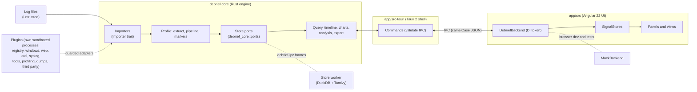

# Debrief architecture

This page ties together the design diagrams in [`docs/diagrams/`](diagrams/). The decisions behind
them are in [ADR 0001](adr/0001-architecture.md); extension points are in [plugins.md](plugins.md);
planned work is in [roadmap.md](roadmap.md). In short: a Rust engine (`crates/debrief-core`) behind the
store ports (`debrief_core::ports`) and `Importer` port, a thin Tauri 2 shell (`app/src-tauri`), and an Angular UI
(`app/src/app`) that only talks to the engine through the `DebriefBackend` service.

The diagrams follow [diagrams/STYLE.md](diagrams/STYLE.md) (the suite spec in Paddock plus Debrief's colours): planned work (not built yet) is drawn
with a dashed outline and a "planned" tag. The sections below describe the plugin runtime,
multiple windows, live tail and annotations in text.

## Overview

The Rust engine is the single source of truth for data and behaviour; Angular only presents what the
engine returns. The Tauri shell depends on the store ports (`debrief_core::ports`: `Ingest`, `Query`, `Positions`, `Analysis`,
`Profiles`, `Diagnostics`, `Search`, `Projects`, `Inspect`, `Maintain`, `Console`, `Redaction`, `Skew` and `Tail`, combined as `Store`) and importers on the `Importer` trait (ports and
adapters). The store behind the ports is DuckDB, hosted in a separate worker process
([ADR 0014](adr/0014-database-first-engine.md)): events are imported once into Parquet segments with a DuckDB catalog
and a Tantivy full-text index, so the app process holds only the page on screen, never the records. The in-memory
`Workspace` (with the older `LogStore` trait) is kept as the reference implementation that the DuckDB store is tested
against, and for engine tests that need no database.

- **Engine** (`crates/debrief-core`): importers, profiles and pipelines, query language, timeline and chart
  aggregation, analysis, live tail and alerts, exports, projects, and the plugin runtime (registry,
  manifests and dependency graph, services and extension points, the typed event bus, the watchdog,
  plugin marker kinds and annotators).
- **Shell** (`app/src-tauri`): thin Tauri 2 commands that validate every argument and run work off the
  UI thread; least-privilege capabilities and a strict CSP. Every window has its own workspace:
  commands take the calling window's state (`CurrentWindow`) and window-specific events go to that
  window only. App-wide parts: the window manager (open, close, last-window behaviour), single-instance
  hand-over, the tray, the background-task registry, desktop notifications, settings and the
  lifecycle (safe mode, crash detection, per-window session autosave).
- **UI** (`app/src`): standalone Angular components and signals, `@ngrx/signals` stores, dockview
  panels, ECharts. Components never call `invoke` directly; they use the injected backend service.
- **Around the core:** `debrief-profile` (the profiling engine, a pure library), `debrief-pdf` (PDF reports
  behind the engine's `ReportRenderer` port), the plugin crates (including the tools and profiling
  plugins), and the `debrief-monitor`, `debrief-collect` and `debrief-agent` command-line tools.
- **Contracts:** the wire contract is [`app/src/app/core/api.types.ts`](../app/src/app/core/api.types.ts)
  (camelCase JSON), mirrored by the Rust DTOs.

## Crates

| Crate | Kind | Responsibility |
|---|---|---|
| `debrief-core` | library (the core) | Records, importers, profiles and pipelines, the query language, analysis, exports, projects, the plugin runtime, live tail, redaction, reports, dashboards, bundles, clock skew, configuration diff, templates. Ports: `Store` (fourteen traits), `Importer`, `ReportRenderer`, `ConfigParser`, tools. Also Home's summary, search everything, live alerts, known issues, the incident report, playbooks, text encodings and the redacted copy. |
| `debrief-profile` | library, pure (no I/O, no `debrief-core`) | The profiling engine: profile and heap-snapshot model, builders with limits, the `CaptureImporter` and `ProfileStore` ports with the in-memory `Captures` store, and every profiling view (hotspots, trees, butterfly, flame, diff, threads, findings, moment, heap analysis). See [profiling.md](profiling.md). |
| `debrief-plugin-profiling` | plugin | Capture importers (nettrace, perf script, folded, pprof, Chrome trace / cpuprofile, speedscope, heapsnapshot) served as profile importers (the profiling plugin's process is the profile worker). |
| `debrief-plugin-tools` | plugin (shared by every window) | The system tools as `Tool`s: Performance Monitor templates and collector sets (`logman`), process monitor, Event Log follower, diagnostics collector, elevation. |
| `debrief-monitor` | library + CLI | Process sampling (and Windows PDH counters) into rolling CLEF files. |
| `debrief-collect` | library + CLI | The diagnostics collector writing redacted `.debriefz` bundles. |
| `debrief-agent` | library + CLI / service | Headless scheduled and triggered collection ([ADR 0005](adr/0005-headless-agent.md)). |
| `debrief-cli` | library + CLI (`debrief`) | The headless command line: import, query-language queries, analyses and the incident report over the store worker ([ADR 0044](adr/0044-headless-command-line.md), [cli.md](cli.md)). |
| `debrief-pdf` | adapter | PDF output for incident reports, implementing `debrief-core`'s `ReportRenderer` port, with embedded font subsets ([ADR 0007](adr/0007-reports-pdf-and-redaction.md)). |
| `debrief-plugin-registry`, `-windows`, `-web`, `-formats`, `-otel`, `-syslog` | plugins | Format importers, marker kinds, annotators and configuration parsers. `-windows` also has the Process Monitor CSV and minidump importers and the Event Log follower; `-formats` has log4j/log4net/NLog XML, SQL Server ERRORLOG, Docker json-file and Kubernetes CRI. |
| `debrief-plugin-api`, `debrief-plugin-host`, `debrief-plugins`, `debrief-ipc` | contract, host adapter, plugins binary, transport | Every plugin runs in its own sandboxed process ([ADR 0017](adr/0017-one-ipc-out-of-process-plugins.md)): `debrief-plugin-api` is the contract plugins depend on (no `debrief-core`), `debrief-plugin-host` the adapter that starts them and registers proxy contributions into the `PluginRegistry`, `debrief-plugins` the binary that serves every built-in (`--plugin <id>`, `--manifests`), and `debrief-ipc` the frames, supervisor, launcher and sandbox shared with the AI and store workers. |
| `chromium-driver` | library | The neutral Chromium renderer driver (discovery, supervised launch, minimal DevTools client, readiness, challenge detection, pinned install); no Debrief types, so other apps can copy it ([ADR 0043](adr/0043-chromium-renderer.md)). |
| `debrief-ai`, `debrief-ai-worker` | library, worker process | The local AI layer (including the browser rules, [ADR 0011](adr/0011-internal-browser.md), and the Chromium renderer's page ports, [ADR 0043](adr/0043-chromium-renderer.md)) and the worker that runs a downloaded `llama-server` ([ADR 0009](adr/0009-prebuilt-llama-server-runtimes.md)). |
| `debrief-store-duck`, `debrief-store-client`, `debrief-store-worker`, `debrief-batch` | the store ([ADR 0014](adr/0014-database-first-engine.md)) | `debrief-store-duck` is the DuckDB store: events as Parquet segments with a DuckDB catalog, queries compiled to SQL, a Tantivy full-text index (word and prefix matches first, then partial matches; the query language's `contains` stays a substring test), projects as the store folder (`.debriefz`, which opens without the original logs). `debrief-store-worker` hosts every window's store in a supervised child process (2 GiB hard cap); `debrief-store-client` is Debrief's side (`RemoteStore` over `debrief-ipc`, no DuckDB linked); the port methods that cross to the worker are listed once, in `store_port_table!` (`port_table.rs`), which expands into the `StoreOp` enum, the client's `impl Port for RemoteStore` and the worker's `dispatch.rs` ([ADR 0042](adr/0042-store-port-table.md); the operation order is the wire format, `WIRE_VERSION`); `debrief-batch` is the event batch (stable ids, the fixed Arrow schema) importers, store and plugins share. |
| `debrief-alloc` | library | The global allocator of the binaries that parse and analyse (the app, the store worker, the plugins process): mimalloc v3 with v2's purge timing set at start-up; `release()` gives freed memory back after an import, the index build and each analysis. |
| `debrief-notes`, `debrief-dump`, `debrief-etw`, `debrief-symbols` | libraries | Notes anchored to events, times, sources and image regions ([ADR 0021](adr/0021-notes.md)); the crash dump and UMDH engine ([ADR 0023](adr/0023-dumps-and-umdh.md)); ETW decoders and the NetTrace writer ([ADR 0022](adr/0022-native-profiling.md)); `debrief-symbols` matches PDBs by identity (name, GUID, age) and fetches them from opt-in symbol servers into a bounded cache ([ADR 0036](adr/0036-dump-symbols-by-pdb-identity.md)). |
| `debrief-video` | library | Video sources: the pinned LGPL FFmpeg runtime (download, self-test, rollback), sandboxed `ffmpeg`/`ffprobe` runs, pure frame selection and alignment to the logs, and the `.frames` record that `debrief-core`'s `VideoFramesImporter` reads ([ADR 0033](adr/0033-video-sources-ffmpeg-runtime.md)). |
| `debrief-plugin-dotnet`, `debrief-plugin-native`, `debrief-plugin-dumps` | plugins | .NET profiling by ETW and EventPipe ([ADR 0019](adr/0019-dotnet-profiling.md)), native profiling ([ADR 0022](adr/0022-native-profiling.md)), dump and UMDH readers and the dump capture tool ([ADR 0023](adr/0023-dumps-and-umdh.md)). |
| `debrief-plugin-package`, `debrief-plugin-test`, `debrief-plugin-e2e`, `cargo-debrief-plugin` | plugin SDK ([ADR 0027](adr/0027-plugin-sdk.md)) | The signed `.debriefplugin` package format, the test harness for plugin authors, end-to-end tests of a third-party plugin, and the `cargo debrief-plugin` tool. See [plugin-sdk.md](plugin-sdk.md). |
| `app/src-tauri` (`debrief-app`) | shell | Tauri commands, windows, tray, sessions; depends on ports only. |

The engine modules added for sharing and analysis are `redact/` (one redactor for the redacted
view, exports, reports and bundles), `report/` (versioned report model, Markdown and HTML),
`dashboard.rs`, `bundle.rs` (`.debriefz` read and write with archive limits and hashes), `svg.rs`
(SVG sanitiser), `skew/` ([ADR 0006](adr/0006-clock-skew-applied-on-load.md), [0037](adr/0037-store-clock-skew-and-live-tail.md)), `config/`
(configuration trees, parsers and diff), `templates.rs`, `ql/suggest.rs` ("did you mean") and
`overwrite.rs` (no silent overwrite). Newer engine modules, all pure over the store ports: `home.rs` (the Home dashboard's summary), `search_all/`
(search everything), `live.rs` (`LiveSession`: alerts and tail status), `known_issues.rs`, `incident.rs` and
`playbook/` ([ADR 0039](adr/0039-known-issues-incident-summary-playbooks.md)), `ingest/encoding.rs`
([ADR 0040](adr/0040-text-encodings.md)), `paste.rs`, `redact/copy.rs` ([ADR 0041](adr/0041-redacted-project-copy.md)) and
`importers/video.rs`. The in-memory `Workspace` (`workspace/*.rs`, `LogStore`) stays as the reference implementation; the shell
adds `share.rs`, `redacted_copy.rs`, `skew_commands.rs`, `config_diff.rs`, `agent_commands.rs`, `profiling.rs`, `demo.rs`, `encodings.rs`,
`paste.rs`, `search_everything.rs`, `store_pane.rs`, `symbols.rs`, `dumps.rs`, `snapshots.rs`, `window_capture/` (the native window picture of
error snapshots, [ADR 0034](adr/0034-native-window-capture.md)), `video/` and `investigate/`.

## Architecture decisions

| ADR | Decision |
|---|---|
| [0001](adr/0001-architecture.md) | Desktop architecture: Rust engine, Tauri shell, Angular UI. |
| [0002](adr/0002-microkernel-and-process-isolation.md) | Small core, everything else a plugin; native code out of process. Amended: its wire protocol, in-process default and opt-in isolation are superseded by 0017. |
| [0003](adr/0003-plugin-dependencies-services-events.md) | Plugin dependencies, services, extension points and events (engine-internal machinery since 0017; plugins cannot use it). |
| [0004](adr/0004-stable-plugin-abi.md) | Superseded by 0017. Stable plugin ABI: protobuf and gRPC for plugin processes (the WebAssembly tier was dropped on 2026-10-18). |
| [0005](adr/0005-headless-agent.md) | Headless collection agent (`debrief-agent`). |
| [0006](adr/0006-clock-skew-applied-on-load.md) | Clock-skew offsets are applied when records enter the workspace. |
| [0007](adr/0007-reports-pdf-and-redaction.md) | Incident reports: engine-side model, HTML and pure-Rust PDF; one redactor. |
| [0008](adr/0008-menus-one-model-native-on-macos.md) | Menus: one model, native on macOS. |
| [0009](adr/0009-prebuilt-llama-server-runtimes.md) | AI inference runs the official prebuilt `llama-server`, downloaded on demand. |
| [0010](adr/0010-persistent-store.md) | Amended by 0014. A persistent DuckDB store in a worker process with a Tantivy index (after a spike that is no longer in the repository). |
| [0011](adr/0011-internal-browser.md) | The AI gets web content only through a browser the user can see and stop (no AI web search). Amended by 0012: read-only research mode; by 0024 (superseded): docked panel; by 0043: a real Chromium. |
| [0012](adr/0012-jobs.md) | Jobs and notifications: every long task is a job with per-kind queues and limits in Rust; a notification centre for what needs attention; research mode as a job. |
| [0013](adr/0013-ai-browsing-banner.md) | Superseded by 0024, then 0043. "AI is browsing" while agent mode or research drives the browser; now the status chip, Chrome's banner and the frame colour. |
| [0014](adr/0014-database-first-engine.md) | Database-first engine: DuckDB is the only store, in a store worker; imports stream in parallel; projects are self-contained `.debriefz` files. Amends 0010. Implemented (phase 6c). |
| [0015](adr/0015-ai-update-checks.md) | Update checks for AI runtimes and models. |
| [0016](adr/0016-shell-command-table-typed-contract-services.md) | Shell: one command table, typed contract, one error type, Tauri-free services, path grants. |
| [0017](adr/0017-one-ipc-out-of-process-plugins.md) | One IPC: framed postcard over a private local stream; plugins and workers only out of process and sandboxed; supersedes 0004 and the transport of 0002. |
| [0018](adr/0018-themes.md) | Themes: token sets plus traits; Calm (default), Console and Precision. |
| [0019](adr/0019-dotnet-profiling.md) | .NET profiling by ETW and EventPipe, written as one NetTrace path. |
| [0020](adr/0020-mixed-sources.md) | Mixed sources: per-line formats, logical sources and per-source instance keys. |
| [0021](adr/0021-notes.md) | Notes anchored anywhere, including regions of images. Bookmarks became saved queries. |
| [0022](adr/0022-native-profiling.md) | Native (C/C++) profiling by ETW and suspend-and-sample as NetTrace, with one symbol library. |
| [0023](adr/0023-dumps-and-umdh.md) | Crash and memory dumps and UMDH heap logs: a sandboxed reader plugin, an engine crate, problem-first views. |
| [0024](adr/0024-docked-browser.md) | Superseded by 0043 (docked Browser panel with a child web view). The AI drafts the search text: this part stays. |
| [0043](adr/0043-chromium-renderer.md) | Research and the AI's browser modes drive a real Chromium over DevTools (`chromium-driver`, optional pinned download); the docked panel is removed; links open in the default browser; every AI-driven indicator is outside the page. |
| [0025](adr/0025-vision-one-model.md) | Vision: one model reads text and images; the engine finds the related logs. |
| [0026](adr/0026-parser-library.md) | Parsers are individual TOML files in a library, matched per file; profiles keep the analysis. |
| [0027](adr/0027-plugin-sdk.md) | A Rust-only plugin SDK; third-party plugins as signed, contained `.debriefplugin` packages. |
| [0028](adr/0028-native-feel.md) | Native feel: Debrief's windows behave like a desktop application, not a web page. Amended by 0034 and 0035. |
| [0029](adr/0029-knowledge-files.md) | Knowledge files: the user's Markdown notes as background for every AI feature. |
| [0030](adr/0030-store-pane-and-sql-console.md) | The Store pane and a sandboxed read-only SQL console (the `Inspect`, `Maintain` and `Console` ports). Amends 0014. |
| [0031](adr/0031-performance-settings.md) | Performance settings: memory caps, CPU, DuckDB, warnings and suggested values. |
| [0032](adr/0032-ai-parser-generation.md) | AI-assisted parser generation, verified by the engine. Amends 0026. |
| [0033](adr/0033-video-sources-ffmpeg-runtime.md) | Video sources with a downloadable, sandboxed FFmpeg runtime; frames become events in a source of their own. |
| [0034](adr/0034-native-window-capture.md) | Error snapshots: the platform captures the webview instead of rasterising the DOM (html-to-image is gone). Amends 0028. |
| [0035](adr/0035-view-areas-and-perspectives.md) | View areas and perspectives: where a view opens, named window arrangements, one search field. Overview became Home; Plugin health merged into Plugins. |
| [0036](adr/0036-dump-symbols-by-pdb-identity.md) | Dump symbols by PDB identity: matching, opt-in symbol servers, a bounded cache and a status per module. Amends 0023. |
| [0037](adr/0037-store-clock-skew-and-live-tail.md) | Clock skew and live tail on the log store: the `Skew` and `Tail` ports, offsets applied to stored events, appended segments, a held last event, alerts over the ports. Amends 0006. |
| 0038 | Not used: the number was set aside for the second half of the clock-skew and live-tail work, which shipped as the single ADR 0037. There is no ADR 0038. |
| [0039](adr/0039-known-issues-incident-summary-playbooks.md) | Known issues in knowledge files, the incident summary report and investigation playbooks. |
| [0040](adr/0040-text-encodings.md) | Text encodings: detection with confidence (`chardetng`, `encoding_rs`), per-source override, profile default. |
| [0041](adr/0041-redacted-project-copy.md) | Redacted project copy: rebuilt from redacted text so nothing derived can leak; text sources only. |
| [0042](adr/0042-store-port-table.md) | One port table for the store worker protocol: a single declarative list expands into the operation enum, the client and the worker's dispatch; the order is the wire format. |
| [0044](adr/0044-headless-command-line.md) | A headless command line (`debrief`) over the store worker: pure parsing and rendering, exit codes and `--json` as contract, bounded output. |
| [0045](adr/0045-error-outliers.md) | Error outliers: a pure function over the `Query` port (facets and counts), G-test ranking, bounded, no new store operation. |
| [0046](adr/0046-pattern-trends-and-placeholder-values.md) | Pattern trends and placeholder values: a growing shared time scale folded to 24 buckets, Space-Saving summaries per placeholder, both inside the miner. |
| [0047](adr/0047-time-window-import.md) | Time-window import: an `ImportWindow` set on the store (`Ingest::set_import_window`) filters events before the pipeline; old files are skipped by modification time. |
| [0048](adr/0048-watched-folders.md) | Watched folders: a pure `WatchState` decides readiness (debounce, retry, give-up, bounds); polling scans; `debrief watch` is the first driver. |

## Plugin runtime (ADR 0003, ADR 0017)

Code lives in `crates/debrief-core/src/plugin/` and `crates/debrief-core/src/events.rs`; the extension guide is
[plugins.md](plugins.md). Plugins themselves run out of process (ADR 0017): `debrief-plugin-host` registers
proxy contributions into this registry, so the guards, quarantine and status below apply to them unchanged.
Services, plugin-declared extension points, events, dependencies and activation (ADR 0003) remain here as
engine-internal machinery for built-in code; plugins cannot use them.

| Module | Responsibility |
|---|---|
| `plugin/mod.rs` | `Plugin`, `PluginRegistry` (install, contributions, `resolve`, `set_enabled`, `shutdown`), `PluginStatus` (`active`, `disabled`, `quarantined`, `inactive`), `TransformCtx::mark()`. |
| `plugin/manifest.rs` | `Manifest`: semver version, `requires` (required or optional `Dep`) and `provides`; bad values are rejected at install. |
| `plugin/graph.rs` | Pure dependency resolution: cycles, missing / incompatible / disabled / quarantined dependencies, inactive reasons that name the chain, activation order. |
| `plugin/runtime.rs` | Applies the graph: `activate` in dependency order, `deactivate` in reverse (when a plugin stops being active and on `shutdown`), cascade to dependents, `PluginStateChanged` events. |
| `plugin/services.rs` | Services (`provide`, lookup by id + trait + semver requirement) and plugin-declared extension points; consumers get a guarded `Service` proxy. |
| `plugin/watchdog.rs` | The watchdog thread that enforces the per-call-kind time budgets (`guard::Budgets`): a call that overruns marks its plugin *hung* (a failure towards quarantine) and further calls fail fast until it returns. Callers that can afford it (plugin imports, `Service::call_detached`) stop waiting on a helper thread instead. |
| `plugin/markers.rs` | Plugin marker kinds (`<plugin-id>/<kind>`, roles start / stop / crash), merged after the profile's rules and before the built-in defaults; `[[marker_override]]` switches a kind off or restyles it. |
| `plugin/annotate.rs` | `Annotator` over a read-only, bounded `AnnotationView`; runs after imports and live-tail appends, each run replacing the annotator's previous set (capped at 10,000). |
| `events.rs` | `EventBus`: typed events, one bounded queue (1024) and worker thread per subscriber, delivery under the subscriber's guard; `SubscriberMetrics` (`delivered`, `dropped`, `failures`, `skipped`, `queued`). |

Built-in events: `RecordsAppended`, `ProfileChanged`, `LiveAlertRaised`, `PluginStateChanged` and
`WorkspaceCleared` from the engine; `SnapshotTaken` from the shell after it saves an error snapshot
(`app/src-tauri/src/snapshots.rs`).

The shell reaches the runtime through the workspace: it deactivates a window's plugins when the window
closes and every window's plugins on app exit (`shutdown_plugins` in `app/src-tauri/src/windows.rs`,
called from `RunEvent::Exit` in `lib.rs`); it compares plugin health before and after workspace commands and
emits new failures as `debrief://error` engine errors of kind `plugin-crash`, `plugin-quarantined` or
`plugin-inactive` (`app/src-tauri/src/engine_errors.rs`); and it serves `plugin_events` (event-bus
counters) and `annotations` (`workspace_commands.rs`). The UI shows them in the *Health* tab of the Plugins view
(`app/src/app/plugins-panel/`, `app/src/app/tools/health/`), the markers manager (plugin kinds, read-only rules, overrides) and the
timeline.

The first real user is the Windows plugin: `crates/debrief-plugin-windows/src/markers.rs` (marker kinds
with the event-id sources) and `annotators.rs` (`windows.reboots`, `windows.services`). The contract
plugins build against is the `debrief-plugin-api` crate, carried over the frames of `debrief-ipc`; `debrief-plugin-host`
runs each plugin in its own sandboxed process ([ADR 0017](adr/0017-one-ipc-out-of-process-plugins.md); see
[plugins.md](plugins.md)).

## Windows, instances and sessions (shell)

`app/src-tauri/src/lib.rs` is the composition root; its module comment says where new commands and
state go.

| Module | Responsibility |
|---|---|
| `window_scoped.rs` | Features that keep state per window register a `Scope` (`on_created`, `on_destroyed`); a closed window's teardown is one loop over them, each hook off the main thread and bounded (background tasks, jobs, notification-centre messages, opened diagnostics reports, path grants). |
| `windows.rs` | Per-window state (`WindowState`: store, profile, open queue, live tail, import progress, project) and the `CurrentWindow` extractor that commands use; `emit_to_window` for window-specific events. A window's state is dropped (plugins deactivated, live tail stopped) when the window is destroyed. |
| `window_manager.rs` | `new_window`, `close_window`, `list_windows`, `focus_window`, `set_window_title`, `resolve_close`, `resolve_open`; what closing the last window does (quit, tray, ask); the "open in this window / new window" question (`debrief://open-ask`; `resolve_open` with `cancel` drops the queued paths). Events `debrief://windows-changed`, `debrief://close-requested`. |
| `panel_windows.rs` | Pop-out windows. "Keep on top of Debrief" makes a pop-out an owned window of its host (`WebviewWindowBuilder::parent`: owner window on Windows, child window on macOS, transient-for on Linux): it stays above its host, goes behind other apps together with it and minimises/hides with it. It is never a system-wide always-on-top window; an owner cannot change on a live window, so toggling rebuilds the pop-out in place. |
| `drag_ghost/` | The drag ghost: a hidden, undecorated, always-on-top (only while a drag lasts: it hides when the drag ends, on blur and when its window goes), click-through, never-focused window (`drag-ghost`, a static page with no commands or capabilities) that follows the global cursor at ~60 Hz while a tab is dragged outside its window. `drag_ghost_start` / `drag_ghost_show` / `drag_ghost_end` (MAIN windows only, request validated in `request.rs`); placement is pure geometry in physical pixels per monitor (`geometry.rs`); the end answers where the ghost was so the pop-out opens there. Off on Wayland (no window positioning). |
| `instance.rs` | Single instance (`tauri-plugin-single-instance`): a second launch hands its paths to the running process, planned by the pure `plan` function from `openFilesIn`, `--new-window` and whether the target window is empty. `--new-instance` and safe mode run a separate process. |
| `tray.rs` | Tray menu as a pure model: windows, new window, recent projects (from `recent.rs`), background tasks with Stop, diagnostic capture, quit. Without a tray, closing the last window quits. |
| `background.rs` | Registry of what runs until stopped (live tail per window, process monitor, PerfMon collection) with optional stop actions, plus the running jobs mirrored from `jobs`; `background_tasks`, `stop_background_task`, event `debrief://background-tasks`. |
| `jobs/` | Jobs (ADR 0012): `model.rs` (kinds, the state machine), `queue.rs` (pure queue: per-kind FIFO and limits, cap, AI reorder, pause, visibility and attention on an injected clock), `persist.rs` (`JobsRecord` v1 in the project), `service.rs` (threads, stop actions, each on its own thread and waited for at most 2 s, probes, Retry, listeners; Tauri-free), `mod.rs` (`run`/`run_announced`/`spawn`/`analysis`/`export`/`start_file` for commands, `jobs_wait` for dialogs that follow a job, the tray mirror, messages for finished jobs, `jobs_*` commands, event `debrief://jobs`). Jobs are the one cancel authority: imports, streamed queries (`run_query_stream` sends its job id first), research, AI set-ups and runtime installs and the update download are stopped with `jobs_cancel`. |
| `notification_centre/` | The notification centre (ADR 0012): `centre.rs` (pure list: dedupe with counts, caps trimming read messages first), `persist.rs` (project record, `notifications.json`), `mod.rs` (`post` for producers with OS notifications when Debrief is not focused, the click-to-open on focus, `notifications_*` commands, events `debrief://notifications`, `debrief://notifications-open`). |
| `notify.rs` | Desktop notification policy (level × kind × whether a window already shows it), rate limiter, and the adapter over `tauri-plugin-notification`; never includes file contents. |
| `window_prefs.rs` | The *Window & tray* settings section: `openFilesIn`, `onClose`, `notifications`, `startMinimized`. |
| `lifecycle.rs` | Safe mode, crash detection, plugin enable/disable, session autosave, restarts (`restart_app`, `restart_elevated`: the command line is built in Rust, flags first, then `--` and the window's own session file; the webview sends no arguments) and the bounded teardown on close and exit (`teardown_step`: each step on its own thread, logged, at most 3 s). |
| `commands.rs` | The command table (ADR 0016): `command_table!` in `lib.rs` lists every command once with its kind (query, mutation, quiet), the windows that may call it (`MAIN`: `main`, `w-*`; `POPOUT`: `p-*`; never the browser's page webview `browser-*`) and its largest request; it generates the invoke handler and the activity log's classification, and `commands::guard` refuses calls from other windows and oversized requests. Every command is async (a test fails on a sync one). |
| `services/` | Tauri-free services behind the commands (ADR 0016): `profile.rs` (checking a profile text against a store with the error line, the active profile on disk with its history, written atomically and only after a window's workspace swapped to it) and `project.rs` (what a window saves, writing and reading `.debriefproj` files, the captures an opened project reopens). Commands are adapters; no command calls another. |
| `config_store.rs` | One way to keep configuration and state files (ADR 0016): versioned documents (`{ version, ... }`; older ones read when their fields fit, newer or damaged ones give the defaults, a damaged one kept as `.corrupt`), atomic writes (temp file, flush, rename), one writer process-wide, `Config<T>` caches a document and persists outside its lock, `Debounced` coalesces frequent writes on its own thread (notifications; flushed at exit). Used by `settings.json`, `diagnostics.json`, `plugins.json` (the one place plugin enablement is kept), `recent.json`, `notifications.json`, `updates.json`. |
| `app_context.rs`, `sync.rs`, `plugin_config.rs`, `builtin_sections.rs` | The app's context built once in `setup` (folders, run flags; path grants, recent lists, window scopes and the UI dispatcher created up front); the shared lock and blocking helpers (`sync::lock/read/write`, `sync::blocking`); plugin enablement and registries (split out of `lifecycle.rs`); the app's own settings sections (split out of `settings.rs`). Web addresses open through `opener::open_url`. |
| `error.rs` | The one command error (ADR 0016): `CmdError { code, message, retryable, field?, line?, hint?, detail? }` with one `ErrorCode` list (general, AI, profiling and updater codes). Domain errors (`debrief_ai::Error`, `ProfilingErrorDto`, `UpdateError`, path refusals, tool failures typed with `ToolFailure`, profile rules typed with `RuleContext`) convert once at the command edge; the UI's `invoke` turns every rejection into a `CmdError` (`core/cmd-error.ts`) and reacts to `code` and `retryable`. |
| `paths.rs` | The only path validator: `PathGrants` (per window, at most 64, expiring after an hour) is filled only by the native dialogs (`pick_paths`, shown from Rust), files dropped on a window, the command line and second launches (pending opens are granted as the window takes them), the window's project file, entries of the recent lists (granted again when reopened from them), and Debrief's own outputs (an unpacked bundle, a tool's reported `bundle`/`dir`, the demo samples, the autosaved session, the captures an opened project reopens); commands that read or write a path the webview names (opening files, projects and bundles, profiling captures, local AI models and runtime archives, the agent configuration, profile import/export, exports, diagnostics, problem reports, settings files, the configuration diff) take it through `WindowGrants` and get a canonical `GrantedPath` or a message to choose the file again. The dialog plugin's JavaScript API is not permitted. |
| `recent.rs` | The recent files and recent projects, owned by Rust (`recent.json` in the config folder, versioned): an entry is recorded after a granted open or save and is granted again when reopened from the welcome page, the Recent projects dialog or the tray. Commands `recent_list`, `recent_remove`, `recent_clear`; event `debrief://recent-changed` to every window. |
| `ui_dispatch.rs` | Native UI updates (tray menu, window list) posted to the main thread with `run_on_main_thread`, coalesced and never waited for, and never called under a lock: tray and window getters wait for the main thread. |

Crash detection: `running.marker` stores the PID and the process start time (read with `sysinfo`). A
marker left behind is a crash only if that process is gone (no such PID, or a different start time,
i.e. the PID was reused); a marker of a process that still runs is taken over silently, and a process
removes the marker only while it is still its own. The main instance keeps its marker and sessions in
the data folder; a separate process (`--new-instance`, safe mode) uses `<data>/instances/<pid>/`,
removed on a clean exit, and every start prunes the folders of processes that are no longer alive.

Sessions (format version 2): each window autosaves to `sessions/<window>/last-session.debriefproj`, and
`sessions/manifest.json` lists the windows of the current run. At start, the previous run's sessions
are copied to `recovered/` for the restore offer; a version 1 single session is recovered as the
main window's. Missing or corrupt files fall back to "no session".

## Jobs and notifications

Every long task is a job (ADR 0012). A command hands its work to `jobs::run` and awaits the value; the
service queues it by kind, runs it on its own thread when a slot is free, samples its progress, and
stores what View opens (`JobResult`). The window gets its visible jobs as `debrief://jobs` (at most every
400 ms); the tray lists the running ones. A finished job that needs attention becomes a message in the
notification centre (`notification_centre::post`), which also raises the OS notification when no Debrief
window is focused. AI use cases and chat turns are AI jobs (`ai/requests.rs`): the request is saved with
the job for Retry, a quarantined worker pauses the AI queue through a gate. Web research
(`debrief_ai::browser::research`, `browser/research.rs`) is a `research` job that holds the window's
browser while it reads result pages.

## Live tail

Live tail runs over the store ports ([ADR 0037](adr/0037-store-clock-skew-and-live-tail.md)). The store reads only what a
followed file gained (`Ingest::append_tail`: appended lines become a new segment of the same source, the full-text index
follows) and keeps where it stopped (`Tail`: `tail_offsets`, `open_at_end`). The last event of a plain-text read is held back
in case it continues on the next lines, and written when another event follows or after `carry_flush_ms` (500 ms by default);
the shell asks for it with an empty `append_tail`. Files that cannot be read from the middle (shrunk, archives, binary formats)
are read again in full as a new source; a deleted file keeps its events unless `deleted_files = "drop"`. Annotators re-run
after a refresh, from a cursor and throttled. Clock offsets (`Skew`) are applied to the stored events, so every view follows them.

`debrief_core::live::LiveSession` (one per window) evaluates alert rules, silence and the anomaly detectors over `Query`/`Analysis`
after each refresh, keeps cooldowns and mutes, and builds the per-file status with lines per second. The shell
(`app/src-tauri/src/live.rs`) adapts `notify` to the engine's `WatcherFactory` (`workspace/tail/` holds the watching, rolling-file
and identity code, and the in-memory reference implementation), runs each window's session and registers it as a background
task. Stopping a session never waits: it sets the session's `StopToken` and a reaper thread ends the worker and the watchers.
Commands: `set_live`, `tail_status`, `live_state` (restores the UI after a webview reload), `mute_alerts` / `unmute_alerts`,
`open_paths_live`; events `debrief://workspace-changed` (with a `TailReport`, including changed `fileStates`), `debrief://live-alert` and
`debrief://live-stopped`.

In the UI (`app/src/app/live/`, `app/src/app/workspace/live-tail.ts`) a `RefreshCoalescer` turns reports into at most one refresh
per 250 ms that never overlap; `TailStatusStore` applies `fileStates` directly (sidebar badges, tail status panel) and keeps
polling `tail_status` as a fallback; the alerts store deduplicates by the engine's stable alert id.

## Annotations on the timeline

`LogStore::annotations` (command `annotations`, DTO `AnnotationDto`) returns the annotations overlapping
the visible range. `app/src/app/timeline/annotations.store.ts` refetches them on every data change (open,
reload, profile save, each coalesced live-tail refresh) and range change, ignoring superseded replies;
`annotation-layout.ts` (pure) places them: an `instance` annotation on its lane, an `on` field match on
every lane whose key contains that value (when the field is part of the lane key), anything else full
height; spans are bands, points glyphs. `annotation-track.ts` draws them as buttons (severity by icon
and fill pattern, not colour alone); clicking one applies its evidence query.

## Diagrams

The diagram set is split so that each drawing reads at README width (at most 1600 × 1200 pixels; "1 of n" in the kind line). All of them are on one page in [design.md](design.md); the overview is [debrief-overview.svg](diagrams/debrief-overview.svg).

### C4 model

| Diagram | What it shows |
|---|---|
| [c4-1-context](diagrams/c4-1-context.drawio) | Debrief, its users (support engineer, developer, administrator, plugin author) and the external systems: the file system, the OS webview, Windows diagnostics, third-party plugins (signed `.debriefplugin` packages, sandboxed, over `debrief-ipc`), the Chromium browser it drives for research, and the download hosts (Gitea releases, Hugging Face, GitHub releases). Debrief runs offline otherwise. |
| [c4-2-containers](diagrams/c4-2-containers.drawio) | The workbench: the app process (Angular UI, Tauri shell, `debrief-core`, `debrief-store-client`, `debrief-plugin-host`) and its sandboxed child processes (`debrief-plugins`, third-party plugins, `debrief-store-worker` with DuckDB and Tantivy) over `debrief-ipc` (ADR 0017). |
| [c4-2-containers-helpers](diagrams/c4-2-containers-helpers.drawio) | AI, research and video: `debrief-ai` and `debrief-ai-worker` with `llama-server`, `chromium-driver` and the Chromium it launches (ADR 0043), `debrief-video` and the sandboxed FFmpeg runtime, `debrief-symbols` and the symbol servers. |
| [c4-2-containers-headless](diagrams/c4-2-containers-headless.drawio) | The `debrief` command line over the store worker (ADR 0044) and the collection tools `debrief-agent`, `debrief-collect` and `debrief-monitor` that write bundles and rolling CLEF files. |
| [c4-3-engine-ingest](diagrams/c4-3-engine-ingest.drawio) | `debrief-core` ingest: archives, importers, the parser library, `ingest` (file plan, record batcher, encodings, the import window of ADR 0047), the profile and pipeline, clock skew, the Store ports, the plugin runtime with its guarded adapters and the watched-folder state machine (ADR 0048). |
| [c4-3-engine-query](diagrams/c4-3-engine-query.drawio) | `debrief-core` query and aggregation: the query language, `CompiledQuery` and `Condition`, bounded regexes, charts and spans, the read ports, and the views over them (Home, search everything, lenses of ADR 0049, live alerts). |
| [c4-3-engine-analysis](diagrams/c4-3-engine-analysis.drawio) | `debrief-core` analysis and investigation: anomalies, trends, compare and Moment, error outliers (ADR 0045), patterns and exceptions, known issues, the incident report, playbooks and related sources, over the `Analysis` and `Query` ports. |
| [c4-3-engine-sharing](diagrams/c4-3-engine-sharing.drawio) | `debrief-core` sharing, projects and configuration: export, reports (with `debrief-pdf`), the one redactor and the redacted copy, bundles, projects, dashboards, configuration diff, settings and the SVG sanitiser. |
| [c4-3-ui-frame](diagrams/c4-3-ui-frame.drawio) | The Angular UI frame: shell, docking, registries, state (`WorkspaceStore`, `QueryStore`) and the backends (`DebriefBackend`, `TauriBackend`, `MockBackend`). |
| [c4-3-ui-investigate](diagrams/c4-3-ui-investigate.drawio) | The investigating views: grid, timeline, charts, lenses and filter sets, search everything, Home, live tail, watched folders, Jobs, analysis, investigate and notes. |
| [c4-3-ui-tools](diagrams/c4-3-ui-tools.drawio) | Building, sharing and tools: profile editor and parsers, import and projects, reports and bundles, profiling and dumps, video and the Store pane, system tools, the AI assistant, research and settings. |
| [c4-3-research-browser](diagrams/c4-3-research-browser.drawio) | Research and Agent mode over a real Chromium: the three browser ports and rules in `debrief-ai`, the shell’s renderer, research jobs and pinned runtime, and the `chromium-driver` crate (ADR 0043). |

### UML

| Diagram | What it shows |
|---|---|
| [uml-use-cases-investigate](diagrams/uml-use-cases-investigate.drawio) | What a support engineer does with logs and diagnostics; a developer can do everything a support engineer does. |
| [uml-use-cases-report](diagrams/uml-use-cases-report.drawio) | Explaining and sharing: known issues, incident reports, bundles with redaction, projects, clock skew, the AI assistant, dumps. |
| [uml-use-cases-extend](diagrams/uml-use-cases-extend.drawio) | Teaching and extending: parsers and profiles, pipelines, lenses and filter sets, dashboards, profiling, configuration diff, and writing plugins. |
| [uml-use-cases-operate](diagrams/uml-use-cases-operate.drawio) | Operating and automating: the agent, collection, monitoring, watched folders, plugin management, updates and the `debrief` command line in scripts and CI. |
| [uml-class-domain-store](diagrams/uml-class-domain-store.drawio) | The `Store` ports with the DuckDB, remote and in-memory adapters, and the project state (`WorkspaceState`, `ClockOffsets`, `ProjectManifest`). |
| [uml-class-domain-events](diagrams/uml-class-domain-events.drawio) | `Record`, `Level`, `EventBatch`, `EventSchema`, `WorkspaceSummary`, `SourceInfo` and the lists it owns. |
| [uml-class-domain-profile](diagrams/uml-class-domain-profile.drawio) | `Profile` with its sections (including `LensCfg`), `CompiledProfile`, `Pipeline`, `Step`, `RecordTransform`, the parser library and `FormatCfg`. |
| [uml-class-domain-query](diagrams/uml-class-domain-query.drawio) | `Query`, `FieldFilter`, `CompiledQuery`, `Condition`, and the query-language `Program`, `Stage` and `Expr`. |
| [uml-class-plugin-api](diagrams/uml-class-plugin-api.drawio) | What a plugin implements in `debrief-plugin-api`: `Plugin`, `Contributions`, the contribution traits and `serve`. |
| [uml-class-plugin-registry](diagrams/uml-class-plugin-registry.drawio) | `PluginRegistry`, `Guard`, `Health`, the `Guarded*` adapters, `PluginInfo` and `PluginStatus`. |
| [uml-class-plugin-process](diagrams/uml-class-plugin-process.drawio) | Plugins out of process: `Builtins`, `RemotePlugin`, the `Remote*` proxies, `PluginProcess`, the supervisor and the sandboxed child. |
| [uml-component-store-protocol](diagrams/uml-component-store-protocol.drawio) | The store port table: `store_port_table!`, its three expansions (`StoreOp`, `RemoteStore`, the worker’s dispatch), the wire version and the run-time path of one call ([ADR 0042](adr/0042-store-port-table.md)). |
| [uml-activity-ingest-read](diagrams/uml-activity-ingest-read.drawio) | Ingest of one file: read, expand, plan, import; every failure is listed as unrecognised with its reason and the rest of the import continues. |
| [uml-activity-ingest-events](diagrams/uml-activity-ingest-events.drawio) | Records to events: import window, extractors, pipeline, markers and the store writer. |
| [uml-activity-video](diagrams/uml-activity-video.drawio) | A video source from file to events: runtime check and install, sandboxed probe and frame passes, pure selection, alignment, vision descriptions and the `.frames` source ([ADR 0033](adr/0033-video-sources-ffmpeg-runtime.md)). |
| [uml-seq-open-folder](diagrams/uml-seq-open-folder.drawio) | `open_paths`: path checks, the import job, progress polling and cancel, the report and the summary. |
| [uml-seq-open-folder-worker](diagrams/uml-seq-open-folder-worker.drawio) | The import in the store worker: parallel files, importer, batcher, Parquet segments and the index. |
| [uml-seq-query-timeline](diagrams/uml-seq-query-timeline.drawio) | A filter change fanning out to the grid, timeline and charts (side-effect free; stale replies are dropped). |
| [uml-seq-marker-jump](diagrams/uml-seq-marker-jump.drawio) | A marker click: the page around an anchor event and `source_context`. |
| [uml-seq-query-stream](diagrams/uml-seq-query-stream.drawio) | The search field’s query run as a job: streamed progress, Cancel through the Jobs pane. |
| [uml-seq-moment](diagrams/uml-seq-moment.drawio) | What happened around a moment: `query_moment` and `Analysis::moment` in the store. |
| [uml-seq-watched-folder](diagrams/uml-seq-watched-folder.drawio) | A watched folder: polling, `WatchState`, import jobs, known-issue notices. |
| [uml-seq-cli-outliers](diagrams/uml-seq-cli-outliers.drawio) | `debrief analyze outliers`: the CLI, the store worker and the pure `error_outliers` function over the `Query` port. |
| [uml-seq-plugin-start](diagrams/uml-seq-plugin-start.drawio) | Starting the plugin processes: manifests, supervised processes, handshake and sandbox; safe mode starts none. |
| [uml-seq-plugin-register](diagrams/uml-seq-plugin-register.drawio) | Registering contributions: `PluginRegistry`, `Guard`, `RemotePlugin` proxies, `Host` and profile compilation. |
| [uml-state-live-tail](diagrams/uml-state-live-tail.drawio) | `set_live` drives a live-tail worker per window: watching, coalescing and refreshing with `Ingest::append_tail`. |
| [uml-state-live-alerts](diagrams/uml-state-live-alerts.drawio) | Alert machines (armed, cooling down, muted) and the timeline follow mode. |
| [uml-state-project](diagrams/uml-state-project.drawio) | The open project: untitled and saved, clean and dirty. |
| [uml-state-session](diagrams/uml-state-session.drawio) | One app run: crash detection, the recovery offer, safe mode and session autosave. |
| [uml-state-watched-file](diagrams/uml-state-watched-file.drawio) | One watched file: settling, import, back-off, giving up and too-large files. |
| [uml-state-perfmon](diagrams/uml-state-perfmon.drawio) | A Data Collector Set as Debrief drives it: `PerfmonController` runs `logman`. |
| [uml-deployment-workstation](diagrams/uml-deployment-workstation.drawio) | The analyst workstation: the webview, the app process, the data folder and the supervised child processes with their sandboxes. |
| [uml-deployment-server](diagrams/uml-deployment-server.drawio) | A monitored server: `debrief-agent`, `debrief-collect`, `debrief-monitor`, the OS sources and the output folder. |
| [uml-deployment-release](diagrams/uml-deployment-release.drawio) | The Gitea build farm that produces the installers, the release assets, and the download hosts the app uses. |

## Opening and editing the diagrams

The `.drawio` files are plain, uncompressed mxGraph XML, so they diff well in git.

- **diagrams.net**: open <https://app.diagrams.net>, choose *Open existing diagram* and pick the file
  (nothing is uploaded when you choose "Device").
- **draw.io desktop**: install it from the diagrams.net releases and open the file; File > Export
  produces PNG / SVG / PDF, or use the CLI: `draw.io -x -f png -o out.png file.drawio`.
- **VS Code**: install the "Draw.io Integration" extension (`hediet.vscode-drawio`); `.drawio` files
  then open in the editor and save back in place.

When saving from draw.io, keep *File > Properties > Compressed* turned off so the XML stays readable.

## Keeping diagrams in sync with the code

- Names in the diagrams are the real type, module, command and event names. When you rename or add one
  of these, update the diagrams in the same change: a new `Importer` or plugin (class and plugin
  diagrams), a new Tauri command or event (containers, sequences), a new `Store` port method or
  `api.rs` DTO (components, domain), a new profile section (domain), a new CI job or runner (deployment).
- Treat a diagram that disagrees with the code as a bug in the diagram; fix the diagram, not the code.
- Follow [diagrams/STYLE.md](diagrams/STYLE.md) for notation, palette and layout. Planned work is drawn with a dashed
  outline and a "planned" tag; remove the tag when the code lands, and update the date in the diagram footer.
- The `.drawio` sources are generated by the scripts in [`docs/diagrams/src`](diagrams/src/README.md): change the generator, run `src/generate.sh`, then export. The SVGs under `docs/diagrams/svg/` come from `scripts/export-diagrams.sh` (draw.io desktop); re-export in the same change as the edit.
- Contracts remain defined in code: `app/src/app/core/api.types.ts` and `crates/debrief-core/src/api.rs` for
  the wire format, `crates/debrief-core/src/default_profile.toml` for the profile schema.
