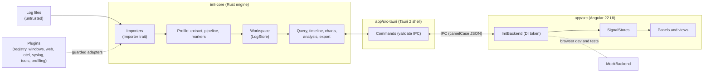

# IMT architecture

This page ties together the design diagrams in [`docs/diagrams/`](diagrams/). The decisions behind
them are in [ADR 0001](adr/0001-architecture.md); extension points are in [plugins.md](plugins.md);
planned work is in [roadmap.md](roadmap.md). In short: a Rust engine (`crates/imt-core`) behind the
`LogStore` and `Importer` ports, a thin Tauri 2 shell (`app/src-tauri`), and an Angular UI
(`app/src/app`) that only talks to the engine through the `ImtBackend` service.

The diagrams follow [diagrams/STYLE.md](diagrams/STYLE.md): planned work (not built yet) is drawn
with a dashed outline and "(planned)" after its name. The sections below describe the plugin runtime,
multiple windows, live tail and annotations in text.

## Overview

The Rust engine is the single source of truth for data and behaviour; Angular only presents what the
engine returns. The Tauri shell depends on the `LogStore` trait and importers on the `Importer` trait
(ports and adapters), so the in-memory store can later be replaced without touching commands or UI.

- **Engine** (`crates/imt-core`): importers, profiles and pipelines, query language, timeline and chart
  aggregation, analysis, live tail and alerts, exports, projects, and the plugin runtime (registry,
  manifests and dependency graph, services and extension points, the typed event bus, the watchdog,
  plugin marker kinds and annotators).
- **Shell** (`app/src-tauri`): thin Tauri 2 commands that validate every argument and run work off the
  UI thread; least-privilege capabilities and a strict CSP. Every window has its own workspace:
  commands take the calling window's state (`CurrentWindow`) and window-specific events go to that
  window only. App-wide parts: the window manager (open, close, last-window behaviour), single-instance
  hand-over, the tray, the background-task registry, desktop notifications, settings and the
  lifecycle (safe mode, crash detection, per-window session autosave).
- **UI** (`app/src`): standalone Angular components and signals, `@ngrx/signals` stores, dockview
  panels, ECharts. Components never call `invoke` directly; they use the injected backend service.
- **Around the core:** `imt-profile` (the profiling engine, a pure library), `imt-pdf` (PDF reports
  behind the engine's `ReportRenderer` port), the plugin crates (including the tools and profiling
  plugins), and the `imt-monitor`, `imt-collect` and `imt-agent` command-line tools.
- **Contracts:** the wire contract is [`app/src/app/core/api.types.ts`](../app/src/app/core/api.types.ts)
  (camelCase JSON), mirrored by the Rust DTOs.

## Crates

| Crate | Kind | Responsibility |
|---|---|---|
| `imt-core` | library (the core) | Records, importers, profiles and pipelines, the query language, analysis, exports, projects, the plugin runtime, live tail, redaction, reports, dashboards, bundles, clock skew, configuration diff, templates. Ports: `LogStore`, `Importer`, `ReportRenderer`, `ConfigParser`, tools. |
| `imt-profile` | library, pure (no I/O, no `imt-core`) | The profiling engine: profile and heap-snapshot model, builders with limits, the `CaptureImporter` and `ProfileStore` ports with the in-memory `Captures` store, and every profiling view (hotspots, trees, butterfly, flame, diff, threads, findings, moment, heap analysis). See [profiling.md](profiling.md). |
| `imt-plugin-profiling` | plugin | Capture importers (nettrace, perf script, folded, pprof, Chrome trace / cpuprofile, speedscope, heapsnapshot) served as profile importers (the profiling plugin's process is the profile worker). |
| `imt-plugin-tools` | plugin (shared by every window) | The system tools as `Tool`s: Performance Monitor templates and collector sets (`logman`), process monitor, Event Log follower, diagnostics collector, elevation. |
| `imt-monitor` | library + CLI | Process sampling (and Windows PDH counters) into rolling CLEF files. |
| `imt-collect` | library + CLI | The diagnostics collector writing redacted `.imtz` bundles. |
| `imt-agent` | library + CLI / service | Headless scheduled and triggered collection ([ADR 0005](adr/0005-headless-agent.md)). |
| `imt-pdf` | adapter | PDF output for incident reports, implementing `imt-core`'s `ReportRenderer` port, with embedded font subsets ([ADR 0007](adr/0007-reports-pdf-and-redaction.md)). |
| `imt-plugin-registry`, `-windows`, `-web`, `-formats`, `-otel`, `-syslog` | plugins | Format importers, marker kinds, annotators and configuration parsers. `-windows` also has the Process Monitor CSV and minidump importers and the Event Log follower; `-formats` has log4j/log4net/NLog XML, SQL Server ERRORLOG, Docker json-file and Kubernetes CRI. |
| `imt-plugin-api`, `imt-plugin-host`, `imt-plugins`, `imt-ipc` | contract, host adapter, plugins binary, transport | Every plugin runs in its own sandboxed process ([ADR 0017](adr/0017-one-ipc-out-of-process-plugins.md)): `imt-plugin-api` is the contract plugins depend on (no `imt-core`), `imt-plugin-host` the adapter that starts them and registers proxy contributions into the `PluginRegistry`, `imt-plugins` the binary that serves every built-in (`--plugin <id>`, `--manifests`), and `imt-ipc` the frames, supervisor, launcher and sandbox shared with the AI and store workers. |
| `imt-ai`, `imt-ai-worker` | library, worker process | The local AI layer (including the internal browser's rules, [ADR 0011](adr/0011-internal-browser.md)) and the worker that runs a downloaded `llama-server` ([ADR 0009](adr/0009-prebuilt-llama-server-runtimes.md)). |
| `imt-store-spike` | spike (outside the workspace) | DuckDB and DataFusion measurements behind [ADR 0010](adr/0010-persistent-store.md); see [store-spike.md](store-spike.md). |
| `app/src-tauri` (`imt-app`) | shell | Tauri commands, windows, tray, sessions; depends on ports only. |

The engine modules added for sharing and analysis are `redact/` (one redactor for the redacted
view, exports, reports and bundles), `report/` (versioned report model, Markdown and HTML),
`dashboard.rs`, `bundle.rs` (`.imtz` read and write with archive limits and hashes), `svg.rs`
(SVG sanitiser), `skew/` ([ADR 0006](adr/0006-clock-skew-applied-on-load.md)), `config/`
(configuration trees, parsers and diff), `templates.rs`, `ql/suggest.rs` ("did you mean") and
`overwrite.rs` (no silent overwrite). The workspace exposes them through `workspace/*.rs` and the
`LogStore` trait; the shell adds `share.rs`, `skew_commands.rs`, `config_diff.rs`,
`agent_commands.rs`, `profiling.rs` and `demo.rs`.

## Architecture decisions

| ADR | Decision |
|---|---|
| [0001](adr/0001-architecture.md) | Desktop architecture: Rust engine, Tauri shell, Angular UI. |
| [0002](adr/0002-microkernel-and-process-isolation.md) | Small core, everything else a plugin; native code out of process. Its wire protocol (gRPC, opt-in isolation) is superseded by 0017. |
| [0003](adr/0003-plugin-dependencies-services-events.md) | Plugin dependencies, services, extension points and events. |
| [0004](adr/0004-stable-plugin-abi.md) | Superseded by 0017. Stable plugin ABI: protobuf and gRPC for plugin processes (the WebAssembly tier was dropped on 2026-10-18). |
| [0005](adr/0005-headless-agent.md) | Headless collection agent (`imt-agent`). |
| [0006](adr/0006-clock-skew-applied-on-load.md) | Clock-skew offsets are applied when records enter the workspace. |
| [0007](adr/0007-reports-pdf-and-redaction.md) | Incident reports: engine-side model, HTML and pure-Rust PDF; one redactor. |
| [0008](adr/0008-menus-one-model-native-on-macos.md) | Menus: one model, native on macOS. |
| [0009](adr/0009-prebuilt-llama-server-runtimes.md) | AI inference runs the official prebuilt `llama-server`, downloaded on demand. |
| [0010](adr/0010-persistent-store.md) | Amended by 0014. A persistent DuckDB store in a worker process with a Tantivy index. |
| [0011](adr/0011-internal-browser.md) | The AI gets web content only through an internal browser the user drives (no AI web search); pages get no IPC. Amended by 0012: read-only research mode; by 0024: docked panel. |
| [0012](adr/0012-jobs.md) | Jobs and notifications: every long task is a job with per-kind queues and limits in Rust; a notification centre for what needs attention; research mode as a job. |
| [0013](adr/0013-ai-browsing-banner.md) | "AI is browsing" while agent mode or research drives the browser; the state comes from the browser hub. Superseded by 0024: the banner is the Browser panel's header. |
| [0017](adr/0017-one-ipc-out-of-process-plugins.md) | One IPC: framed postcard over a private local stream; plugins and workers only out of process and sandboxed; supersedes 0004 and the transport of 0002. |
| [0024](adr/0024-docked-browser.md) | The internal browser is a docked Browser panel: a child webview (multi-webview) kept over the panel's page area, hidden behind IMT overlays, capabilities scoped by webview label; Linux gets a page window of its own. The AI drafts the search text, checked by the leak guard and shown before it is searched. |

## Plugin runtime (ADR 0003, ADR 0017)

Code lives in `crates/imt-core/src/plugin/` and `crates/imt-core/src/events.rs`; the extension guide is
[plugins.md](plugins.md). Plugins themselves run out of process (ADR 0017): `imt-plugin-host` registers
proxy contributions into this registry, so the guards, quarantine and status below apply to them unchanged.
Services, plugin-declared extension points, events, dependencies and activation (ADR 0003) remain here as
engine-internal machinery for built-in code; plugins cannot use them.

| Module | Responsibility |
|---|---|
| `plugin/mod.rs` | `Plugin`, `PluginRegistry` (install, contributions, `resolve`, `set_enabled`, `shutdown`), `PluginStatus` (`active`, `disabled`, `quarantined`, `inactive`), `TransformCtx::mark()`. |
| `plugin/manifest.rs` | `Manifest`: semver version, `requires` (required or optional `Dep`) and `provides`; bad values are rejected at install. |
| `plugin/graph.rs` | Pure dependency resolution: cycles, missing / incompatible / disabled / quarantined dependencies, inactive reasons that name the chain, activation order. |
| `plugin/runtime.rs` | Applies the graph: `activate` in dependency order, `deactivate` in reverse (when a plugin stops being active and on `shutdown`), cascade to dependents, `PluginStateChanged` events. |
| `plugin/services.rs` | Services (`provide`, lookup by id + trait + semver requirement) and plugin-declared extension points; consumers get a guarded `Service` proxy. |
| `plugin/watchdog.rs` | The watchdog thread that enforces the per-call-kind time budgets (`guard::Budgets`): a call that overruns marks its plugin *hung* (a failure towards quarantine) and further calls fail fast until it returns. Callers that can afford it (plugin imports, `Service::call_detached`) stop waiting on a helper thread instead. |
| `plugin/markers.rs` | Plugin marker kinds (`<plugin-id>/<kind>`, roles start / stop / crash), merged after the profile's rules and before the built-in defaults; `[[marker_override]]` switches a kind off or restyles it. |
| `plugin/annotate.rs` | `Annotator` over a read-only, bounded `AnnotationView`; runs after imports and live-tail appends, each run replacing the annotator's previous set (capped at 10,000). |
| `events.rs` | `EventBus`: typed events, one bounded queue (1024) and worker thread per subscriber, delivery under the subscriber's guard; `SubscriberMetrics` (`delivered`, `dropped`, `failures`, `skipped`, `queued`). |

Built-in events: `RecordsAppended`, `ProfileChanged`, `LiveAlertRaised`, `PluginStateChanged` and
`WorkspaceCleared` from the engine; `SnapshotTaken` from the shell after it saves an error snapshot
(`app/src-tauri/src/snapshots.rs`).

The shell reaches the runtime through the workspace: it deactivates a window's plugins when the window
closes and every window's plugins on app exit (`shutdown_plugins` in `app/src-tauri/src/windows.rs`,
called from `RunEvent::Exit` in `lib.rs`); it compares plugin health before and after workspace commands and
emits new failures as `imt://error` engine errors of kind `plugin-crash`, `plugin-quarantined` or
`plugin-inactive` (`app/src-tauri/src/engine_errors.rs`); and it serves `plugin_events` (event-bus
counters) and `annotations` (`workspace_commands.rs`). The UI shows them in the plugin health view
(`app/src/app/tools/health/`), the markers manager (plugin kinds, read-only rules, overrides) and the
timeline.

The first real user is the Windows plugin: `crates/imt-plugin-windows/src/markers.rs` (marker kinds
with the event-id sources) and `annotators.rs` (`windows.reboots`, `windows.services`). The contract
plugins build against is the `imt-plugin-api` crate, carried over the frames of `imt-ipc`; `imt-plugin-host`
runs each plugin in its own sandboxed process ([ADR 0017](adr/0017-one-ipc-out-of-process-plugins.md); see
[plugins.md](plugins.md)).

## Windows, instances and sessions (shell)

`app/src-tauri/src/lib.rs` is the composition root; its module comment says where new commands and
state go.

| Module | Responsibility |
|---|---|
| `window_scoped.rs` | Features that keep state per window register a `Scope` (`on_created`, `on_destroyed`); a closed window's teardown is one loop over them, each hook off the main thread and bounded (background tasks, jobs, notification-centre messages, opened diagnostics reports, path grants). |
| `windows.rs` | Per-window state (`WindowState`: store, profile, open queue, live tail, import progress, project) and the `CurrentWindow` extractor that commands use; `emit_to_window` for window-specific events. A window's state is dropped (plugins deactivated, live tail stopped) when the window is destroyed. |
| `window_manager.rs` | `new_window`, `close_window`, `list_windows`, `focus_window`, `set_window_title`, `resolve_close`, `resolve_open`; what closing the last window does (quit, tray, ask); the "open in this window / new window" question (`imt://open-ask`; `resolve_open` with `cancel` drops the queued paths). Events `imt://windows-changed`, `imt://close-requested`. |
| `instance.rs` | Single instance (`tauri-plugin-single-instance`): a second launch hands its paths to the running process, planned by the pure `plan` function from `openFilesIn`, `--new-window` and whether the target window is empty. `--new-instance` and safe mode run a separate process. |
| `tray.rs` | Tray menu as a pure model: windows, new window, recent projects (from `recent.rs`), background tasks with Stop, diagnostic capture, quit. Without a tray, closing the last window quits. |
| `background.rs` | Registry of what runs until stopped (live tail per window, process monitor, PerfMon collection) with optional stop actions, plus the running jobs mirrored from `jobs`; `background_tasks`, `stop_background_task`, event `imt://background-tasks`. |
| `jobs/` | Jobs (ADR 0012): `model.rs` (kinds, the state machine), `queue.rs` (pure queue: per-kind FIFO and limits, cap, AI reorder, pause, visibility and attention on an injected clock), `persist.rs` (`JobsRecord` v1 in the project), `service.rs` (threads, stop actions, each on its own thread and waited for at most 2 s, probes, Retry, listeners; Tauri-free), `mod.rs` (`run`/`run_announced`/`spawn`/`analysis`/`export`/`start_file` for commands, `jobs_wait` for dialogs that follow a job, the tray mirror, messages for finished jobs, `jobs_*` commands, event `imt://jobs`). Jobs are the one cancel authority: imports, streamed queries (`run_query_stream` sends its job id first), research, AI set-ups and runtime installs and the update download are stopped with `jobs_cancel`. |
| `notification_centre/` | The notification centre (ADR 0012): `centre.rs` (pure list: dedupe with counts, caps trimming read messages first), `persist.rs` (project record, `notifications.json`), `mod.rs` (`post` for producers with OS notifications when IMT is not focused, the click-to-open on focus, `notifications_*` commands, events `imt://notifications`, `imt://notifications-open`). |
| `notify.rs` | Desktop notification policy (level × kind × whether a window already shows it), rate limiter, and the adapter over `tauri-plugin-notification`; never includes file contents. |
| `window_prefs.rs` | The *Window & tray* settings section: `openFilesIn`, `onClose`, `notifications`, `startMinimized`. |
| `lifecycle.rs` | Safe mode, crash detection, plugin enable/disable, session autosave, restarts (`restart_app`, `restart_elevated`: the command line is built in Rust, flags first, then `--` and the window's own session file; the webview sends no arguments) and the bounded teardown on close and exit (`teardown_step`: each step on its own thread, logged, at most 3 s). |
| `commands.rs` | The command table (ADR 0016): `command_table!` in `lib.rs` lists every command once with its kind (query, mutation, quiet), the windows that may call it (`MAIN`: `main`, `w-*`; `POPOUT`: `p-*`; never the browser's page webview `browser-*`) and its largest request; it generates the invoke handler and the activity log's classification, and `commands::guard` refuses calls from other windows and oversized requests. Every command is async (a test fails on a sync one). |
| `services/` | Tauri-free services behind the commands (ADR 0016): `profile.rs` (checking a profile text against a store with the error line, the active profile on disk with its history, written atomically and only after a window's workspace swapped to it) and `project.rs` (what a window saves, writing and reading `.imtproj` files, the captures an opened project reopens). Commands are adapters; no command calls another. |
| `config_store.rs` | One way to keep configuration and state files (ADR 0016): versioned documents (`{ version, ... }`; older ones read when their fields fit, newer or damaged ones give the defaults, a damaged one kept as `.corrupt`), atomic writes (temp file, flush, rename), one writer process-wide, `Config<T>` caches a document and persists outside its lock, `Debounced` coalesces frequent writes on its own thread (notifications; flushed at exit). Used by `settings.json`, `diagnostics.json`, `plugins.json` (the one place plugin enablement is kept), `recent.json`, `notifications.json`, `updates.json`. |
| `app_context.rs`, `sync.rs`, `plugin_config.rs`, `builtin_sections.rs` | The app's context built once in `setup` (folders, run flags; path grants, recent lists, window scopes and the UI dispatcher created up front); the shared lock and blocking helpers (`sync::lock/read/write`, `sync::blocking`); plugin enablement and registries (split out of `lifecycle.rs`); the app's own settings sections (split out of `settings.rs`). Web addresses open through `opener::open_url`. |
| `error.rs` | The one command error (ADR 0016): `CmdError { code, message, retryable, field?, line?, hint?, detail? }` with one `ErrorCode` list (general, AI, profiling and updater codes). Domain errors (`imt_ai::Error`, `ProfilingErrorDto`, `UpdateError`, path refusals, tool failures typed with `ToolFailure`, profile rules typed with `RuleContext`) convert once at the command edge; the UI's `invoke` turns every rejection into a `CmdError` (`core/cmd-error.ts`) and reacts to `code` and `retryable`. |
| `paths.rs` | The only path validator: `PathGrants` (per window, at most 64, expiring after an hour) is filled only by the native dialogs (`pick_paths`, shown from Rust), files dropped on a window, the command line and second launches (pending opens are granted as the window takes them), the window's project file, entries of the recent lists (granted again when reopened from them), and IMT's own outputs (an unpacked bundle, a tool's reported `bundle`/`dir`, the demo samples, the autosaved session, the captures an opened project reopens); commands that read or write a path the webview names (opening files, projects and bundles, profiling captures, local AI models and runtime archives, the agent configuration, profile import/export, exports, diagnostics, problem reports, settings files, the configuration diff) take it through `WindowGrants` and get a canonical `GrantedPath` or a message to choose the file again. The dialog plugin's JavaScript API is not permitted. |
| `recent.rs` | The recent files and recent projects, owned by Rust (`recent.json` in the config folder, versioned): an entry is recorded after a granted open or save and is granted again when reopened from the welcome page, the Recent projects dialog or the tray. Commands `recent_list`, `recent_remove`, `recent_clear`; event `imt://recent-changed` to every window. |
| `ui_dispatch.rs` | Native UI updates (tray menu, window list) posted to the main thread with `run_on_main_thread`, coalesced and never waited for, and never called under a lock: tray and window getters wait for the main thread. |

Crash detection: `running.marker` stores the PID and the process start time (read with `sysinfo`). A
marker left behind is a crash only if that process is gone (no such PID, or a different start time,
i.e. the PID was reused); a marker of a process that still runs is taken over silently, and a process
removes the marker only while it is still its own. The main instance keeps its marker and sessions in
the data folder; a separate process (`--new-instance`, safe mode) uses `<data>/instances/<pid>/`,
removed on a clean exit, and every start prunes the folders of processes that are no longer alive.

Sessions (format version 2): each window autosaves to `sessions/<window>/last-session.imtproj`, and
`sessions/manifest.json` lists the windows of the current run. At start, the previous run's sessions
are copied to `recovered/` for the restore offer; a version 1 single session is recovered as the
main window's. Missing or corrupt files fall back to "no session".

## Jobs and notifications

Every long task is a job (ADR 0012). A command hands its work to `jobs::run` and awaits the value; the
service queues it by kind, runs it on its own thread when a slot is free, samples its progress, and
stores what View opens (`JobResult`). The window gets its visible jobs as `imt://jobs` (at most every
400 ms); the tray lists the running ones. A finished job that needs attention becomes a message in the
notification centre (`notification_centre::post`), which also raises the OS notification when no IMT
window is focused. AI use cases and chat turns are AI jobs (`ai/requests.rs`): the request is saved with
the job for Retry, a quarantined worker pauses the AI queue through a gate. Web research
(`imt_ai::browser::research`, `browser/research.rs`) is a `research` job that holds the window's
browser while it reads result pages.

## Live tail

The engine owns live tail (`crates/imt-core/src/workspace/tail/`): file identity and fingerprints
(`identity.rs`), rolling-file families (`rolling.rs`), incremental reading (`reader.rs`), watching with
a polling fallback and burst coalescing (`watch.rs`), applying a refresh with stable ids (`apply.rs`,
`index.rs`), detectors and alert rules (`alerts.rs`) and engine-side mutes (`mutes.rs`). The shell
(`app/src-tauri/src/live.rs`) only adapts `notify` to the engine's `WatcherFactory`, runs each window's
session and registers it as a background task. Stopping a session never waits: it sets the session's
`StopToken` (checked before and after taking the workspace lock), and a reaper thread ends the worker
and the watchers. Commands: `set_live`, `tail_status`, `live_state`
(restores the UI after a webview reload), `mute_alerts` / `unmute_alerts`, `open_paths_live`; events
`imt://workspace-changed` (with a `TailReport`, including changed `fileStates`), `imt://live-alert` and
`imt://live-stopped`.

In the UI (`app/src/app/live/`, `app/src/app/workspace/live-tail.ts`) a `RefreshCoalescer` turns
reports into at most one refresh per 250 ms that never overlap; `TailStatusStore` applies `fileStates`
directly (sidebar badges, tail status panel) and keeps polling `tail_status` as a fallback; the alerts
store deduplicates by the engine's stable alert id.

## Annotations on the timeline

`LogStore::annotations` (command `annotations`, DTO `AnnotationDto`) returns the annotations overlapping
the visible range. `app/src/app/timeline/annotations.store.ts` refetches them on every data change (open,
reload, profile save, each coalesced live-tail refresh) and range change, ignoring superseded replies;
`annotation-layout.ts` (pure) places them: an `instance` annotation on its lane, an `on` field match on
every lane whose key contains that value (when the field is part of the lane key), anything else full
height; spans are bands, points glyphs. `annotation-track.ts` draws them as buttons (severity by icon
and fill pattern, not colour alone); clicking one applies its evidence query.

## C4 model

| Diagram | What it shows |
|---|---|
| [c4-1-context](diagrams/c4-1-context.drawio) | IMT, its users (support engineer, developer, administrator, plugin author) and the external systems it reads from or talks to: the file system, the OS webview, Windows Event Log and performance counters, plugins (separate sandboxed processes; the diagram predates ADR 0017 and still shows gRPC), and the only network hosts, used when the user starts an update or a download: Gitea releases, Hugging Face (models) and GitHub releases (llama-server). IMT runs offline otherwise. |
| [c4-2-containers](diagrams/c4-2-containers.drawio) | The runnable units, the processes they run in and how they talk; libraries linked into the app process are drawn inside it. |
| [c4-3-components-engine](diagrams/c4-3-components-engine.drawio) | Modules of `imt-core`: `workspace` (the `LogStore` implementation), `store`, `api`, `importers`, `archive`, `profile`, `pipeline`, `query` and `ql`, `analysis`, `patterns`, `exceptions`, `chart`, `export`, `project`, the plugin registry, and the plugin runtime (manifests, dependency graph, services, watchdog), the event bus and plugin marker kinds / annotators; the sharing and analysis modules (`report`, `redact`, `dashboard`, `bundle`, `skew`, `config`, templates / did-you-mean / overwrite); and the crates around the core: `imt-pdf`, `imt-agent`, `imt-profile` and the plugin crates (including the tools and profiling plugins). The engine is the single source of truth; the shell reaches it only through `LogStore`. |
| [c4-3-components-ui](diagrams/c4-3-components-ui.drawio) | Folders under `app/src/app`: shell, `WorkspaceStore`, the `ImtBackend` token with `TauriBackend` / `MockBackend`, views, extension tokens, docking, logger. Angular presents what the engine returns; state lives in SignalStores. |

## UML

| Diagram | What it shows |
|---|---|
| [uml-use-cases](diagrams/uml-use-cases.drawio) | What each role does with IMT. A developer can do everything a support engineer does (generalisation); «include» marks a step that is always part of the base use case. |
| [uml-class-domain](diagrams/uml-class-domain.drawio) | `Record`, `Level`, `Query`, `CompiledQuery`, `Profile` and its sections, `CompiledProfile`, `Pipeline`, `Condition`, `Workspace`, `ProjectFile`, `SourceInfo`, `WorkspaceSummary`. |
| [uml-class-plugin-api](diagrams/uml-class-plugin-api.drawio) | The traits plugins implement (`Plugin`, `Importer`, `BinaryImporter`, `RecordTransform`, `WorkspaceHook`, `Exporter`, `Collector`, `EventSink`, `LogStore`), `PluginRegistry`, and the real plugin crates with their importers and collectors. |
| [uml-seq-open-folder](diagrams/uml-seq-open-folder.drawio) | `open_paths`: files are imported in parallel (archive, importer selection, ingest), merged, indexed and announced to hooks; the UI polls progress and can cancel. |
| [uml-seq-query-timeline](diagrams/uml-seq-query-timeline.drawio) | A filter change fanning out to the grid, timeline and chart queries (side-effect free; stale replies are dropped), a marker click with an anchored page and `source_context`, and the query panel, which streams progress and can be cancelled. |
| [uml-seq-moment](diagrams/uml-seq-moment.drawio) | What happened around a moment: `MomentView` asks `query_moment` for the selected range; `Workspace::moment` summarises it against the window before it. |
| [uml-seq-plugin-registration](diagrams/uml-seq-plugin-registration.drawio) | Each window builds a `PluginRegistry`: built-ins run out of process over `imt-ipc` frames (the diagram predates ADR 0017 and still shows gRPC); every contribution is wrapped in a `Guarded*` adapter before the `Workspace` compiles the profile. |
| [uml-activity-ingest](diagrams/uml-activity-ingest.drawio) | Ingest of one file (`import_file`, `import_bytes`, `CompiledProfile::ingest`: extractors, pipeline, markers). Every failure lists the file as unrecognised with its reason; the rest of the import continues. |
| [uml-state-perfmon](diagrams/uml-state-perfmon.drawio) | A Data Collector Set as IMT drives it: `PerfmonController` (`imt-plugin-tools`) runs `logman`; the Performance Monitor view installs, starts, stops, queries, deletes and imports its output. |
| [uml-state-live-tail](diagrams/uml-state-live-tail.drawio) | `set_live` drives a live-tail worker per window; `Workspace::refresh_tail` follows changed files and evaluates live alerts. |
| [uml-state-project](diagrams/uml-state-project.drawio) | Left: the open project as `ProjectService` tracks it (`save_project` / `open_project`). Right: one app run with crash detection, recovery offer and session autosave (lifecycle). |
| [uml-deployment](diagrams/uml-deployment.drawio) | Where IMT's parts run: the analyst workstation, monitored servers, the Gitea build farm that produces the installers, and the download hosts. |

## Opening and editing the diagrams

The `.drawio` files are plain, uncompressed mxGraph XML, so they diff well in git.

- **diagrams.net**: open <https://app.diagrams.net>, choose *Open existing diagram* and pick the file
  (nothing is uploaded when you choose "Device").
- **draw.io desktop**: install it from the diagrams.net releases and open the file; File > Export
  produces PNG / SVG / PDF, or use the CLI: `draw.io -x -f png -o out.png file.drawio`.
- **VS Code**: install the "Draw.io Integration" extension (`hediet.vscode-drawio`); `.drawio` files
  then open in the editor and save back in place.

When saving from draw.io, keep *File > Properties > Compressed* turned off so the XML stays readable.

## Keeping diagrams in sync with the code

- Names in the diagrams are the real type, module, command and event names. When you rename or add one
  of these, update the diagrams in the same change: a new `Importer` or plugin (class and plugin
  diagrams), a new Tauri command or event (containers, sequences), a new `LogStore` method or
  `api.rs` DTO (components, domain), a new profile section (domain), a new CI job or runner (deployment).
- Treat a diagram that disagrees with the code as a bug in the diagram; fix the diagram, not the code.
- Follow [diagrams/STYLE.md](diagrams/STYLE.md) for notation, palette and layout. Planned work is drawn with a dashed
  outline and "(planned)"; remove the marker when the code lands, and update the date in the diagram footer.
- Contracts remain defined in code: `app/src/app/core/api.types.ts` and `crates/imt-core/src/api.rs` for
  the wire format, `crates/imt-core/src/default_profile.toml` for the profile schema.
