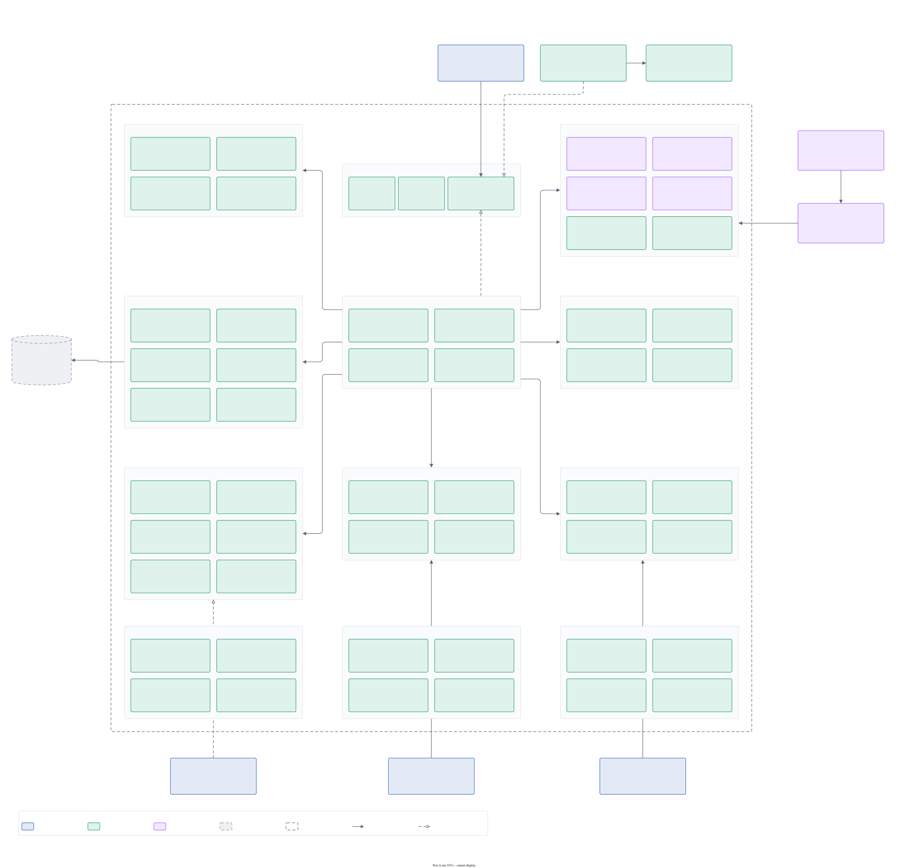
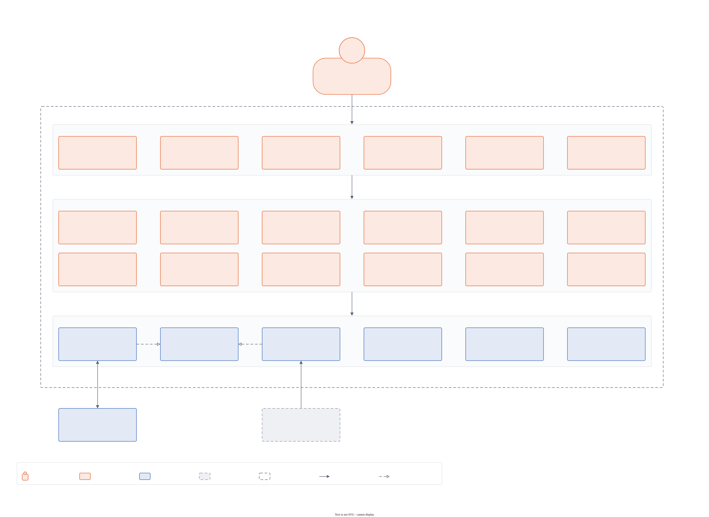
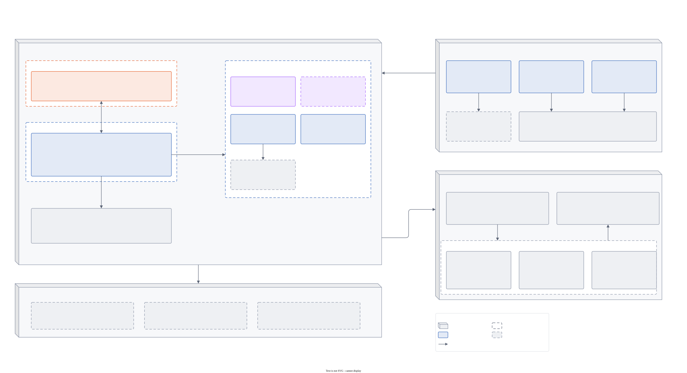
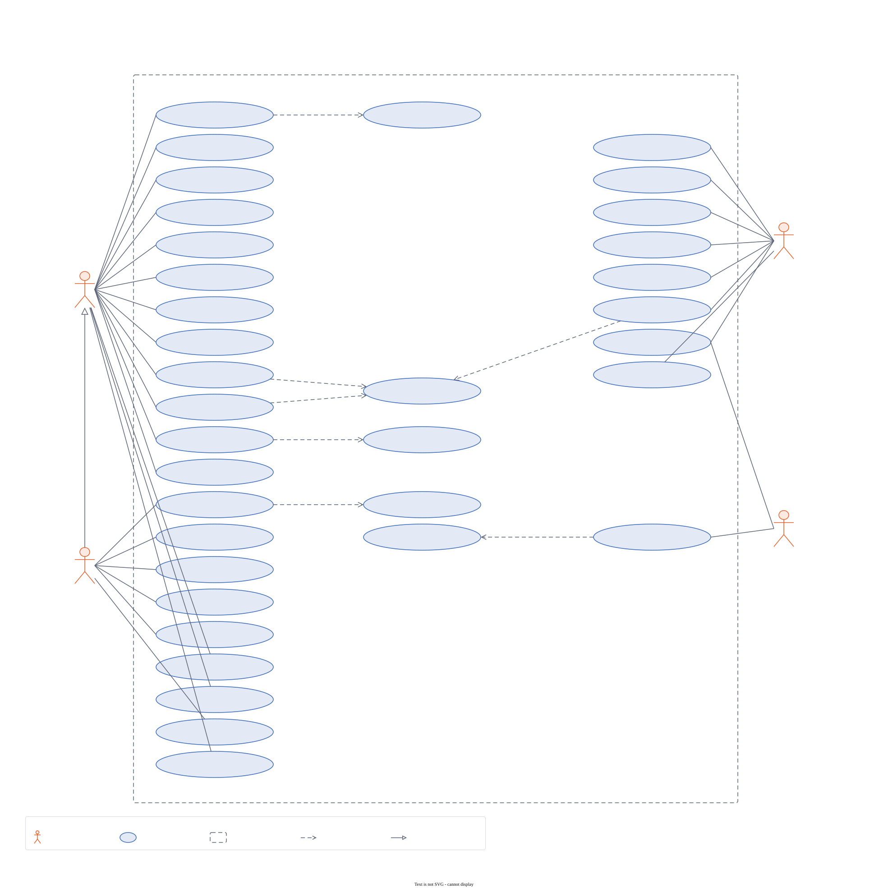
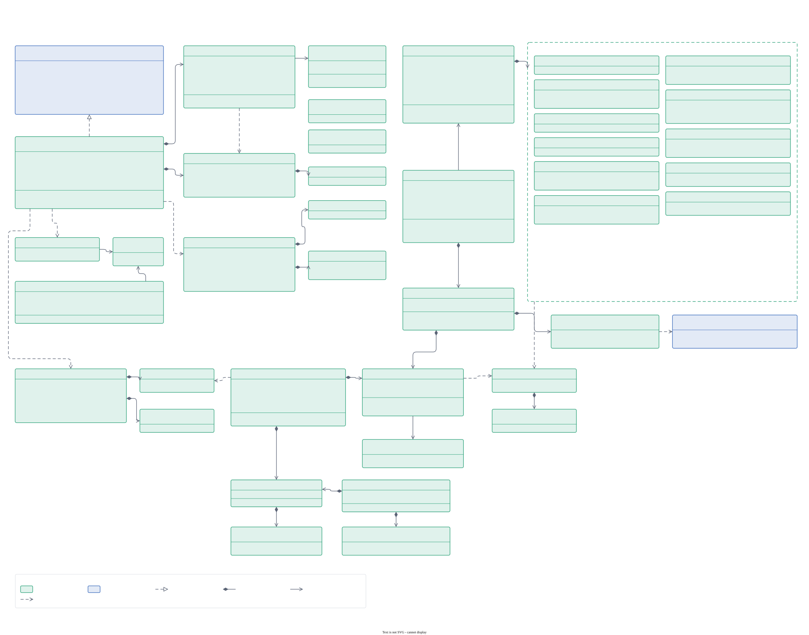
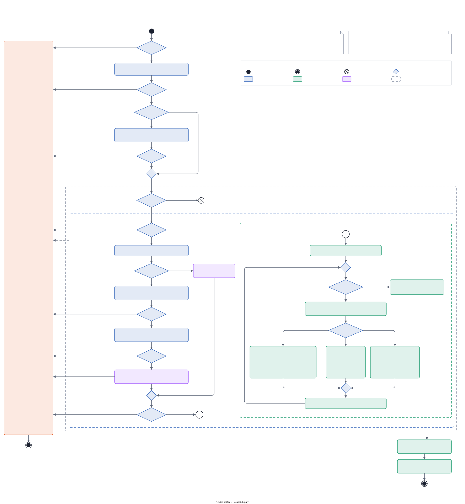
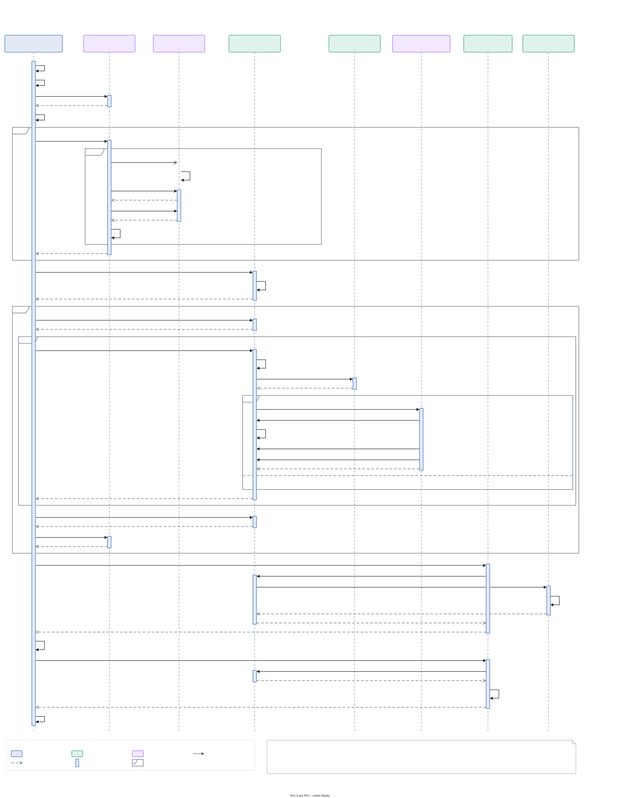

# IMT design

All of IMT's design diagrams on one page, from the big picture down to individual flows. Each image
is exported from its editable draw.io source (linked under the image) with
[`scripts/export-diagrams.sh`](../scripts/export-diagrams.sh); edit the `.drawio`, then re-run the
script. The style rules are in [diagrams/STYLE.md](diagrams/STYLE.md), the reasoning behind the
design in the [architecture decision records](adr/), and the prose overview in
[architecture.md](architecture.md).

Contents: [Overview](#overview) · [C4 model](#c4-model) · [Deployment](#deployment) ·
[Use cases](#use-cases) · [Domain and plugin API](#domain-and-plugin-api) · [Flows](#flows) ·
[States](#states)

## Overview

Many sources and collectors, one Rust engine with a DuckDB store, Rust plugins in their own sandboxed processes, and a workbench that shows
and shares what the engine computes.

## C4 model

### Level 1 — system context

Who uses IMT and which outside systems it reads from or talks to. IMT runs offline; the network is
used only for downloads the user starts (models, AI runtimes, updates).

Source: [c4-1-context.drawio](diagrams/c4-1-context.drawio)

### Level 2 — containers

The runnable units and the processes they run in: the Tauri app with its linked Rust libraries,
the Angular UI in the OS webview, and the supervised, sandboxed child processes (the plugins process and
third-party plugins, the store worker with DuckDB and Tantivy, the AI worker driving `llama-server`), all over `imt-ipc`, plus the headless tools.
See ADR [0009](adr/0009-prebuilt-llama-server-runtimes.md), [0014](adr/0014-database-first-engine.md),
[0017](adr/0017-one-ipc-out-of-process-plugins.md) and [0027](adr/0027-plugin-sdk.md).

Source: [c4-2-containers.drawio](diagrams/c4-2-containers.drawio)

### Level 3 — engine components

Inside `imt-core`: the `Store` ports (adapted by the DuckDB store in the store worker; the in-memory workspace is the test oracle), Home, search, investigation (known issues, incident report, playbooks), ingest (importers, archives,
the parser library, profiles, the pipeline with calculated fields and Rhai scripts), query and aggregation, analysis,
sharing and reports, projects and configuration, and the plugin runtime with its guards.

Source: [c4-3-components-engine.drawio](diagrams/c4-3-components-engine.drawio)

### Level 3 — UI components

The Angular workbench: the app frame (shell, docking, pop-outs, windows, palette), the feature
areas, and the core services. Components reach the engine only through the backend service (the
Tauri backend, or the mock for browser development and tests).

Source: [c4-3-components-ui.drawio](diagrams/c4-3-components-ui.drawio)

## Deployment

Where each part runs: the desktop app and its child processes on a workstation, the `imt-agent`
service on monitored servers, the CI runners and release assets on Gitea, and the hosts IMT
downloads from.

Source: [uml-deployment.drawio](diagrams/uml-deployment.drawio)

## Use cases

What support engineers, developers, administrators and plugin authors do with IMT.

Source: [uml-use-cases.drawio](diagrams/uml-use-cases.drawio)

## Domain and plugin API

### Domain model

Records, sources, the workspace summary and state, the profile and its sections, queries, the
pipeline and the `Store` ports.

Source: [uml-class-domain.drawio](diagrams/uml-class-domain.drawio)

### Plugin API

The plugin contract, the registry with its guarded adapters and quarantine, the extension traits
(importers, transforms, markers, annotators, tools, config parsers),
and, since ADR 0017, plugins that each run in their own sandboxed process over one IPC (`imt-plugin-api`, `imt-plugins`). See ADR [0003](adr/0003-plugin-dependencies-services-events.md) (engine-internal since 0017) and
[0017](adr/0017-one-ipc-out-of-process-plugins.md).

Source: [uml-class-plugin-api.drawio](diagrams/uml-class-plugin-api.drawio)

## Flows

### Ingesting a file

From a path to event batches: locked-file retries, archives and their limits, the parser library's choice, sniffing and decoding,
importer selection under panic containment, the pipeline steps, markers and clock skew.

Source: [uml-activity-ingest.drawio](diagrams/uml-activity-ingest.drawio)

### Opening a folder

`open_paths` to `Ingest::open`: an import job in the store worker with parallel per-file import, progress and cancel,
Parquet segments and the full-text index.

Source: [uml-seq-open-folder.drawio](diagrams/uml-seq-open-folder.drawio)

### Opening a video

A recording becomes events: the pinned FFmpeg runtime (downloaded, self-tested), sandboxed probe and frame passes, a
pure frame selection, alignment to the logs, vision descriptions, and the frames source the importer reads.

Source: [uml-activity-video.drawio](diagrams/uml-activity-video.drawio)

### Filtering, the timeline and queries

A filter change fanning out to the timeline, grid and charts (stale replies dropped), a marker click,
the inspector's source context, and a cancellable query with streamed progress.

Source: [uml-seq-query-timeline.drawio](diagrams/uml-seq-query-timeline.drawio)

### The Moment view

What happened around a point in time: instances, patterns, metric windows and cached anomalies.

Source: [uml-seq-moment.drawio](diagrams/uml-seq-moment.drawio)

### Plugin registration at start-up

Built-in and installed plugin processes registered under guards, resolved, warmed up, and
compiled into the profile; safe mode.

Source: [uml-seq-plugin-registration.drawio](diagrams/uml-seq-plugin-registration.drawio)

### The store protocol

How a port method reaches the store worker: one row in `store_port_table!` expands into the operation enum, the client
and the worker's dispatch (ADR [0042](adr/0042-store-port-table.md)).

Source: [uml-component-store-protocol.drawio](diagrams/uml-component-store-protocol.drawio)

## States

### Live tail and alerts

Following growing files (rotation, truncation, new files), coalesced refreshes that append only what grew, alert rules with
cool-down and mutes over the store ports, and the UI's follow mode.

Source: [uml-state-live-tail.drawio](diagrams/uml-state-live-tail.drawio)

### Projects and sessions

Untitled and saved projects with their dirty state, autosave, and crash recovery with safe mode.

Source: [uml-state-project.drawio](diagrams/uml-state-project.drawio)

### Performance Monitor collector sets

Installing, starting and stopping Windows data collector sets from IMT, and importing their output.

Source: [uml-state-perfmon.drawio](diagrams/uml-state-perfmon.drawio)
