# Features

What IMT does, with screenshots. The [README](../README.md) has the short version, the [user guide](user-guide.md)
covers inputs, profiles, the query language and shortcuts, and [development](development.md) covers building and testing.

> The screenshots are captured automatically from the UI running against the built-in demo data.
> See [Regenerating the screenshots](development.md#regenerating-the-screenshots).

## Timeline per instance, with lifecycle markers

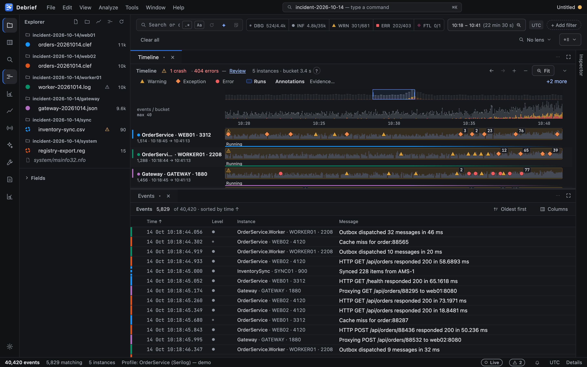

- One lane per instance (by default machine + process; configurable with `[instance] key`), each
  with an event-density histogram and markers for start, stop, crash, exception, error and warning.
- **Mixed and shared files.** A file several products write (a log server, a shared log) is read line
  by line with each line's own format, JSON lines included; lines no format reads are reported instead
  of silently joining another product's events. Each product gets lanes from its own fields (syslog
  hosts, apps and process ids included), and profile routes (`[[route]]`) split the file into logical
  sources listed under it in the Explorer.
- Drag to zoom, `Zoom in`/`Zoom out`/`Fit`, and previous/next range history (`Alt+←` / `Alt+→`).
- Lifecycle markers (start/stop) can be kept visible at any zoom level.
- **Runs.** Each start → stop on a lane is drawn as a band, even when many instances share one log
  file: pair per lane or by a field such as `Worker` or `ProcessId`. A run still going shows as
  *still running*; a start without a stop (often a crash) and a stop without a start are flagged.
  Hover for times, duration and both messages, click to filter to the run. Set rules up with the
  guided editor in the Markers manager (presets for services and processes, live preview), and see
  every run in the **Runs** view. Profiles use `[[span]]` rules; a default rule ships enabled.
- Time can be shown in UTC or local time.
- **Several timelines.** *New timeline* adds more timeline panels, each with its own query and
  instance selection. While a panel is linked (*Sync time*) it zooms, pans and shares the time cursor
  with the main timeline; unlinked, it keeps its own range and cursor (and is marked *Unlinked*).
  Extra timelines are kept in projects and sessions.
- **Annotations** from plugins (for example reboots and service uptime found in Windows event logs)
  are drawn over the lanes: a span is a translucent band on the lane it concerns, on every lane of a
  machine when it is about the machine (and the machine is part of the lane key), or across the full
  height otherwise; a point is a glyph. Severity is shown by an icon and a fill pattern (hatched,
  dotted, plain), never by colour alone. Hover or focus one for its label, owner and time; click it
  (or press `Enter`) to filter to the events behind it. The **Annotations** legend switches kinds on
  and off, and annotations refresh with every data change, including live tail.

## Events grid with virtualisation

- Millions of rows stay smooth: only visible rows are rendered, results are paged from the engine.
- Choose columns, sort oldest/newest first, group by any fields, follow growing files with **Live**
  (live tail), and jump from a marker or a metric to the exact rows behind it.
- Row actions on a selection: highlight, mark, extract a value, mask, drop, bookmark, and "same
  CorrelationId".
- **Source colours**: a thin stripe at the start of each row tells which file the line came from, with
  matching dots in the Explorer, the inspector and the timeline lane labels; hover one for the file
  name. *View ▸ Source colours* (or Settings ▸ Appearance) colours by file, by instance (the timeline
  lane key) or switches it off; the choice is remembered. The four colours are checked for
  colour-vision deficiency (protanopia, deuteranopia, tritanopia) and for 3:1 contrast on every row
  and panel background in both themes; past four, they repeat dashed and then dotted. A file keeps
  its colour when others are added or removed.
- **Open the actual file**: *Open file* (the program your system uses for it), *Open at line N* (in
  VS Code when it is installed, else the default program) and *Show in folder* are in the row menu,
  the inspector and the Explorer row menu. IMT opens only files it has opened in that window, named by
  id, never a path from the page; a file inside a zip archive cannot be opened on its own (*Show
  archive in folder* reveals the archive), a gzip or binary file has no line to jump to, and scripts
  and programs are never started with their default program.

## Live tail and alerts

- **Open for live tail…** picks files or a folder and follows them, optionally skipping their
  history (start at end); **Toggle live tail** follows what is already open. Rolled, dated and rotated
  files (Serilog, log4net, NLog, logrotate) are followed as one log, across renames, truncation and
  copy-truncate.
- **Follow** keeps the timeline on the newest events, optionally in a sliding window (last 1, 5, 15
  or 60 minutes, or custom); zooming or panning pauses it ("Resume following"). While the grid is not
  following, an **N new events** pill shows what arrived.
- **Tail status** lists every file with its state (tailing, read whole, rotated, truncated, deleted,
  error) and sets how often the live detectors run (`detectEveryMs`). Changed file states arrive
  with each live update and show as badges in the sidebar without polling; polling remains as a
  fallback.
- **Alerts**: detectors (error spike, silence, crash, slow outlier, rate change, memory growth) and
  your own rules (a query-language condition matched N times within a window, edited in **Live alert
  rules**) raise alerts in the **Alerts** panel and as toasts. Alerts have stable ids, so repeats are
  not shown twice; **Mute this kind for 15 min** is applied in the engine, so a muted alert is not
  raised at all and does not start its cooldown.
- Bursts of changes are coalesced into at most one UI refresh per 250 ms, and a reloaded window
  restores its live controls from the engine (`live_state`).

## Inspector

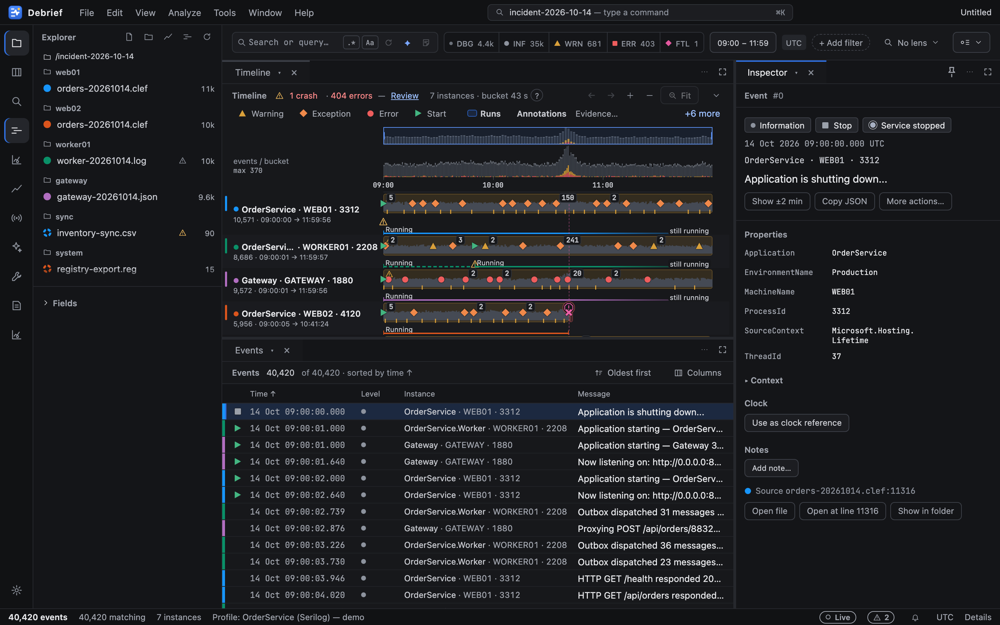

Click a row or a timeline marker to see the level, instance, rendered message and message template,
every property, the exception and stack trace, and where the event came from (`file:line`, with the
file's colour). Quick actions show the surrounding ±2 minutes, the same correlation id, or copy the
event as JSON; *Open file*, *Open at line* and *Show in folder* open the event's file outside IMT (a
disabled one says why, e.g. the file is inside an archive).

## Filters, facets and the query language

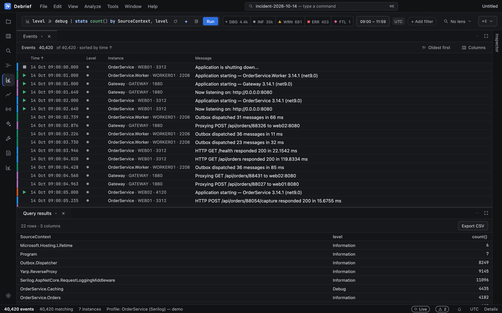

- Full-text search (with regex and case toggles), level chips, time range, field filters, "marked
  only", and a **facets sidebar** listing every field with its coverage and number of distinct values.
- A small query language in the spirit of KQL/LogQL with completions and history: filters, `stats`,
  `sort`, `head` and percentiles. See the [cheat sheet](user-guide.md#query-language).
- Queries run in the engine off the UI thread, report progress and can be cancelled; a superseded
  query is dropped instead of overwriting a newer result.

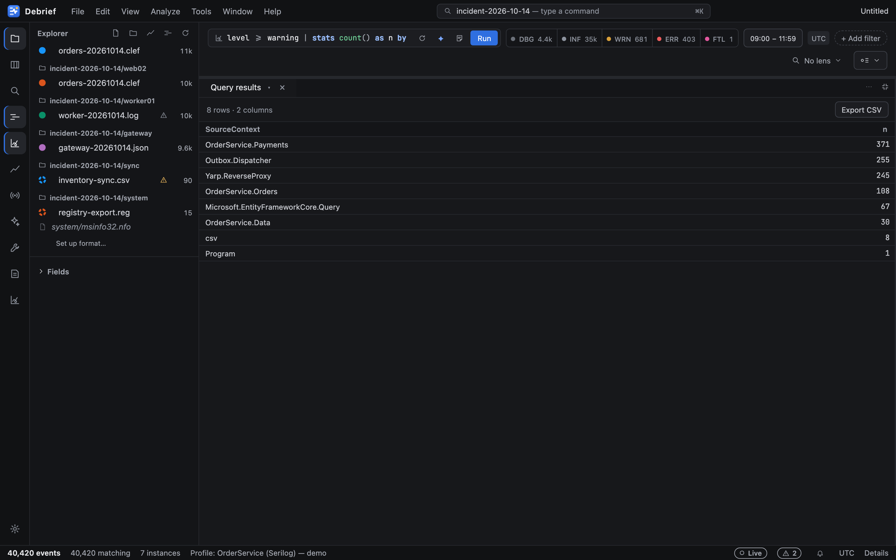

## Many formats, extensible by plugins

Serilog (CLEF, JSON and text), log4net/NLog layouts, generic JSON and CSV, plus plugins for
Windows Event Logs, registry exports, `msinfo32`, Performance Monitor, Process Monitor CSV exports,
minidump summaries, IIS/Apache/Nginx logs, HAR, OpenTelemetry, syslog/journald, log4j/log4net/NLog
XML events, SQL Server `ERRORLOG` and Docker and Kubernetes container logs. Gzip and zip archives
are read transparently. See [Supported inputs](user-guide.md#supported-inputs).

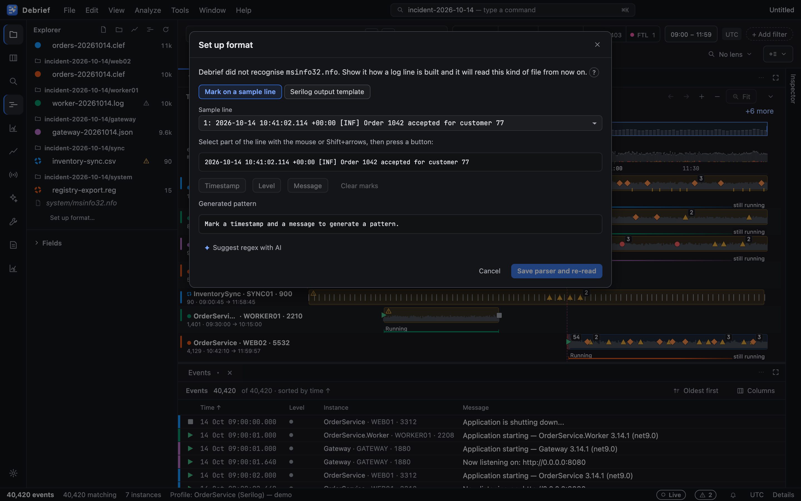

Files IMT cannot read yet are listed with a **Set up format** button: mark the timestamp, level and
message on a sample line and IMT generates a pattern (or a Serilog output template) and re-imports.
Files whose lines IMT reads but whose timestamps it cannot get a warning in the Explorer and a
Notifications message; IMT proposes a timestamp format it checked against those lines, and **Fix
timestamps** previews and saves it. See [Supported inputs](user-guide.md#supported-inputs).

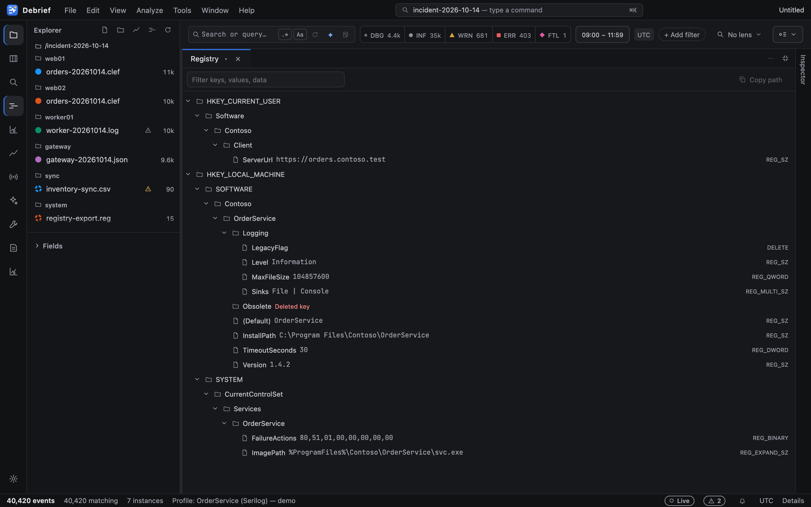

## Profiles, extractors, pipelines, markers and badges

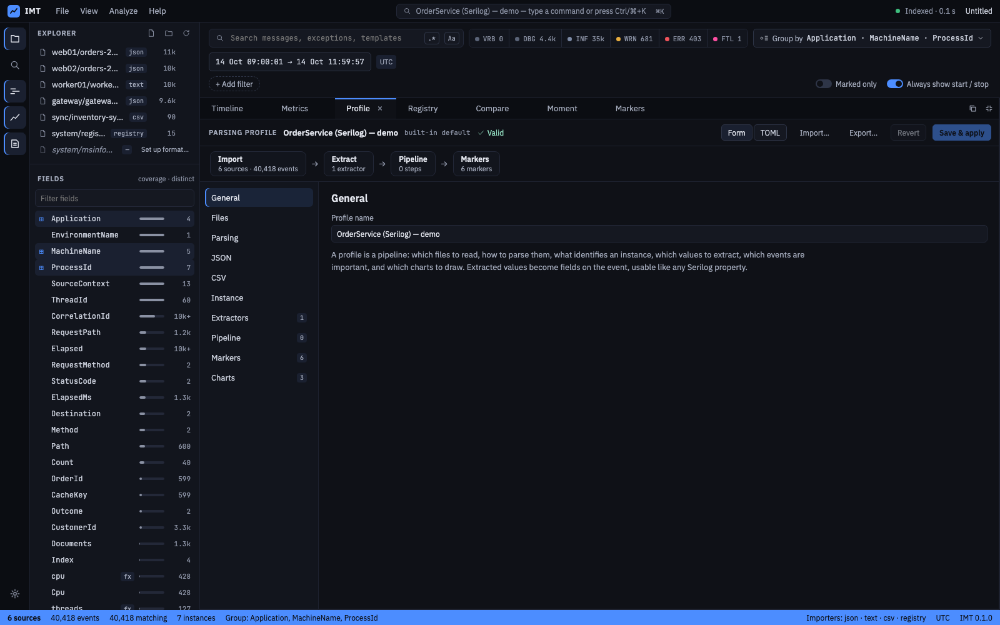

A **profile** is a TOML pipeline: `files → parse → instance → extract → pipeline → markers → charts`.
Edit it as a form or as TOML, with live previews; a profile that does not compile is never saved, and
previous versions are kept. Extractors turn text into typed fields (numbers, byte sizes, durations)
that then work everywhere: columns, filters, group-by, marker rules and charts. Pipeline steps clean
and enrich events during import (drop, keep, mask, dedupe, rename, parse JSON/key-value, lookup,
shift time, ...). See [Profiles](user-guide.md#profiles).

Two pipeline steps cover transforms the others cannot express. **Calculated fields** (`step = "calc"`)
compute a new field from others with a small expression (arithmetic, comparisons, `if`, `round`,
`coalesce`, string functions) and the result works like any extracted field. A **Rhai `script`**
step runs a short [Rhai](https://rhai.rs) script on every event to change its message, level, time
or fields, or to drop it. Both are compiled when the profile loads, so an error names its place;
scripts have no file, network or process access and run under operation, depth and size limits, and a
failing event is left unchanged and counted in the pipeline statistics.

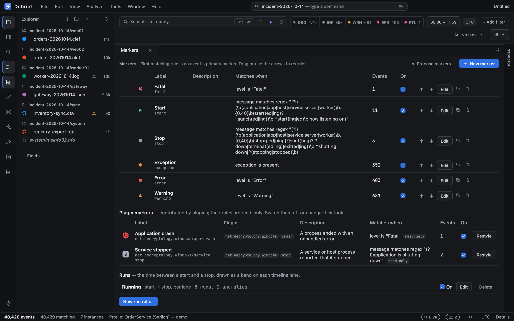

Markers are rules (condition + label + colour). Give a marker a built-in icon, a custom sanitised
SVG/PNG, or a generated badge such as a hexagon with "3". Rules can be created from a selection
("Highlight lines…", "Infer pattern from selected lines…").

Plugins contribute marker kinds of their own, named `<plugin-id>/<kind>` (for example
`net.decryptology.windows/app-crash` for Application Error 1000); kinds with the start, stop or crash
role are always shown on the timeline. The markers manager lists them with an owner badge and their
rule read-only: you can switch a kind off or restyle it (label, colour, icon, badge, shape,
description), which writes a `[[marker_override]]` to the profile through the same
validate-and-save flow as every other profile change.

## Charts

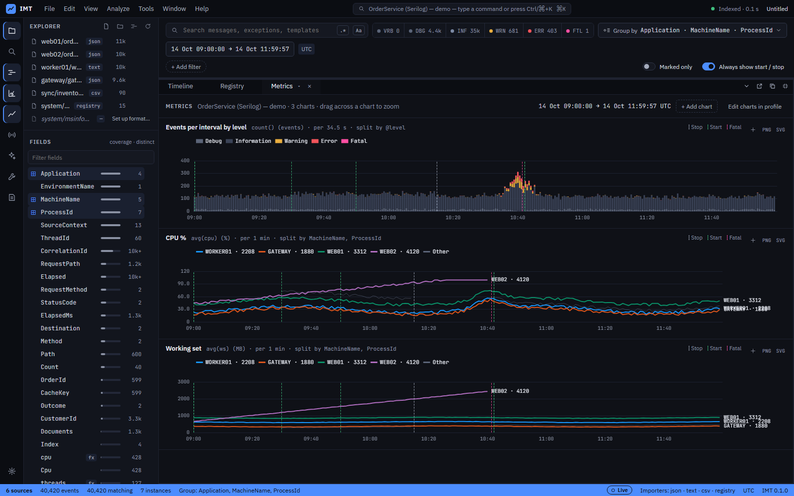

Charts (Apache ECharts) are defined in the profile or added ad hoc: aggregate any numeric field
(`count()`, `avg(cpu)`, ...) per time bucket, split by instance or any field, with lifecycle markers
drawn over the series. Drag across a chart to zoom the whole workspace.

## Analysis

Analysis runs in the engine and is available from the command palette (`Ctrl/⌘+K`).

| View | What it does |
|---|---|
| **Moment** | Everything around a point in time or a selected range: per-instance counts, top patterns, metrics against the previous window, and what users were doing. `Ctrl/⌘+Shift+M`. |
| **Patterns** | Clusters similar messages into templates so 100k lines become a short list, with first/last seen and level colouring. |
| **Exceptions** | Groups exceptions by type and normalised stack with counts, first/last seen and affected instances. |
| **Anomalies** | Error-rate spikes, slow-request outliers and crashes, listed with their time window and instance. |
| **Compare** | Two windows side by side ("current vs previous", before/after a time, or any two selections): changed fields, new values and event mix. |
| **Field statistics** | Distributions and percentiles for a field. |
| **Traces** | Follows trace/span/request ids (for example from OpenTelemetry). |

<table>
<tr>
<td width="50%">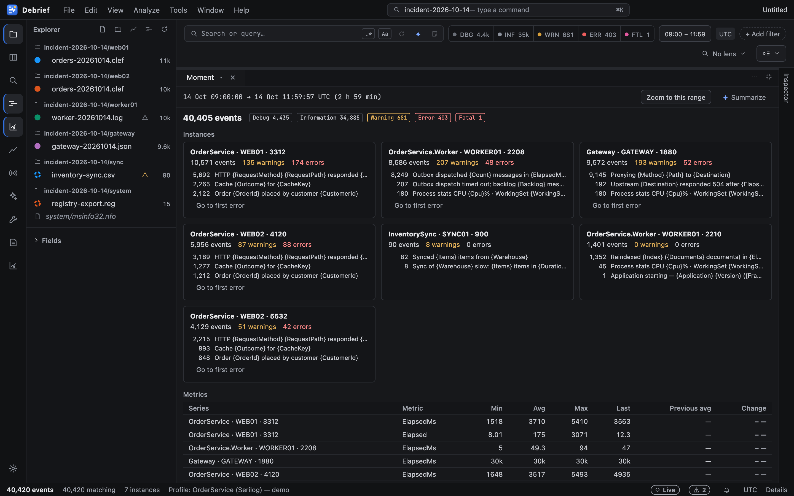</td>
<td width="50%">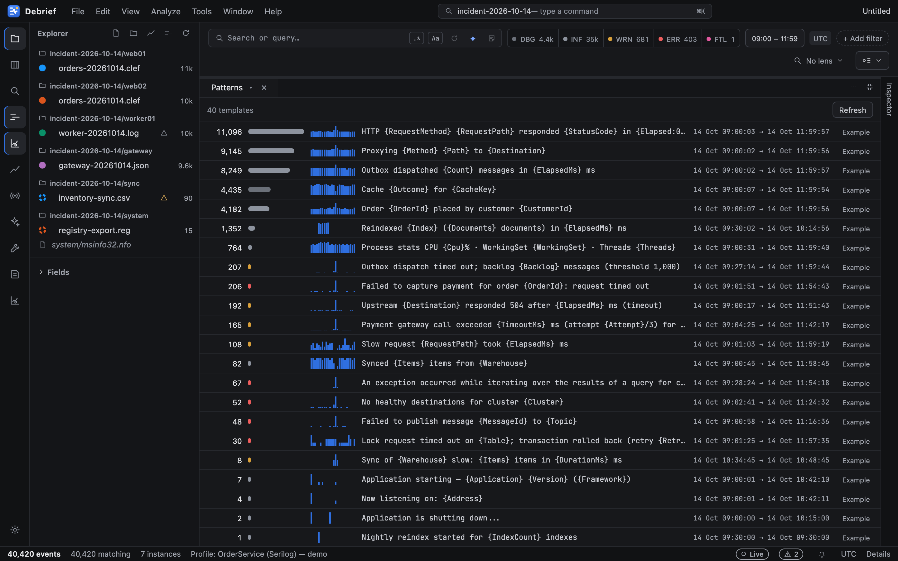</td>
</tr>
<tr>
<td>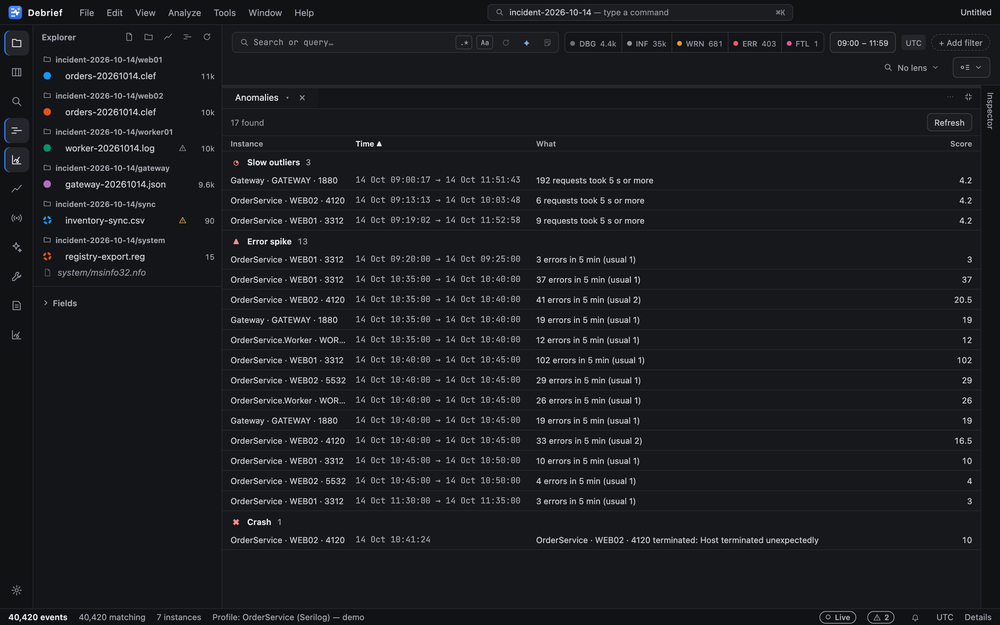</td>
<td>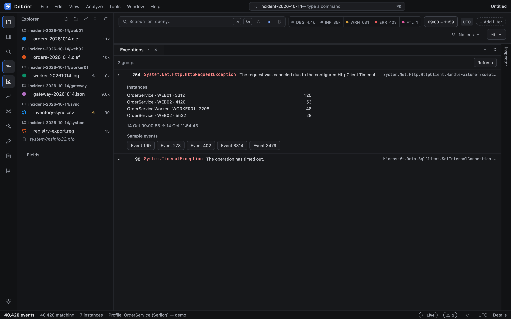</td>
</tr>
</table>

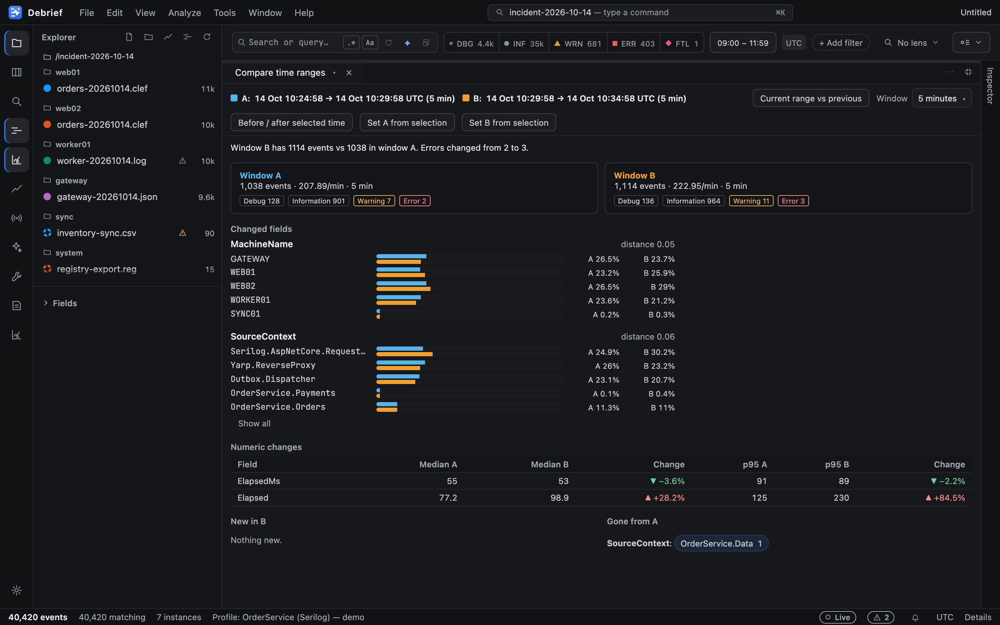

## Clock-skew correction

Logs from several machines only line up when their clocks agree. *Adjust clock…* on a source shifts
its timestamps by a typed offset, by aligning the selected event on a reference event in another
source (*Use selected event as clock reference*), or by the engine's suggestion: the median delta of
events that share a `CorrelationId`, `TraceId` or `RequestId`, shown with the number of pairs, their
spread and a confidence. The engine applies the offset when records are loaded, so every view,
filter and analysis follows it; offsets are kept per source path (they survive reloads, rotation and
projects), bounded to ±7 days, and shown in the inspector's *Clock* section. See
[ADR 0006](adr/0006-clock-skew-applied-on-load.md).

## Configuration diff

*Compare configuration files…* (Tools) diffs two configuration-like files or folders by path, not by
line: JSON, XML, INI, TOML and YAML are built in, the registry plugin adds `.reg` exports and the
Windows plugin `msinfo32` `.nfo` reports. Changed, added and removed values are listed with their
typed old and new values; volatile keys (install dates, last-write and boot times, timestamps) are
ignored by default and the ignore list is editable. Two folders (for example two snapshots of one
machine) are compared file by file. Parsers enforce size, depth and node limits, and the diff
exports to CSV or HTML.

## Profiling

Profiler captures open next to the logs (drag them onto the window or use *Open profile…*); IMT tells
captures from logs by content, so a mixed drop goes to the right place. Formats: `.nettrace`
(dotnet-trace / EventPipe), `perf script` text, collapsed ("folded") stacks, pprof (`.pb.gz`),
Chrome trace and `.cpuprofile`, speedscope JSON, and V8/Chromium `.heapsnapshot` files. All analysis
runs in the `imt-profile` engine:

- **Hotspots** sortable by self/total time, samples, calls, average per call, allocations,
  exceptions and wait time; **call tree** and **inverted tree** with expand-hottest-path,
  "just my code" and recursion folding; the **caller/callee** (butterfly) view.
- **Flame graph and icicle** with search, zoom and *Flame (focus)*, a **differential flame graph**
  and a per-function comparison of two captures (baseline vs regression).
- **Thread timeline** (CPU, GC, JIT, exceptions, lock waits); brushing a range re-aggregates every
  view. Captures with a wall-clock start appear on the log timeline and in the Moment view.
- **Automatic findings** linking to the evidence, and **heap snapshots**: top types, snapshot diff,
  growth over three or more snapshots, dominator tree with retained sizes and paths to GC roots.

Values are labelled *sampled* (an estimate) or *exact*. Open captures and the profiling view state
are kept in projects and sessions. Details, limits and how to regenerate the sample captures are in
[docs/profiling.md](profiling.md).

## Performance Monitor, process monitor and diagnostics collector

<table>
<tr>
<td width="50%">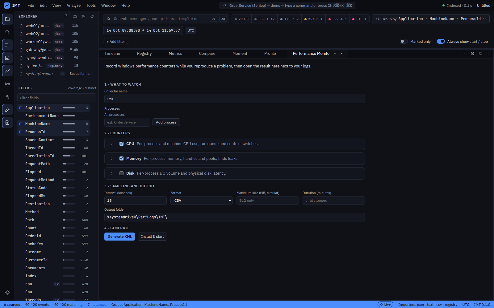</td>
<td width="50%">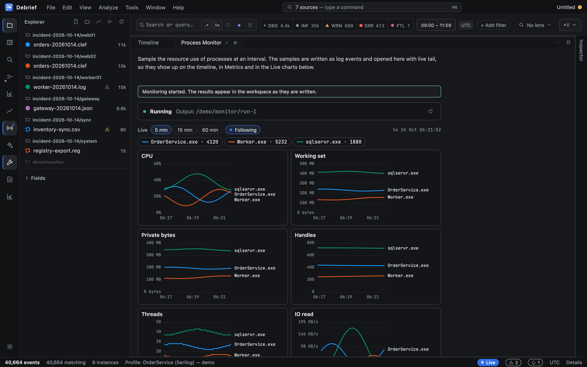</td>
</tr>
</table>

- **Performance Monitor** (Windows): build a Data Collector Set from presets, install and start it
  with `logman`, then open the `.csv`/`.blg` result next to your logs. Counter rows become metrics.
- **Process monitor**: samples CPU, memory and other counters of the processes you pick and writes
  them as rolling CLEF files that open live in IMT; process start/exit events give start/stop markers
  and show crashes and restarts. Also available headless as `imt-monitor`. For .NET Framework
  processes (Windows) it can add the runtime counters (GC collections and heap sizes per generation,
  Large Object Heap and more, as `Dotnet*` fields); .NET Core and .NET 5+ processes are marked
  `DotnetRuntime = "core"` with a notice because their counters need EventPipe. The monitor shows
  live charts of the sampled counters.
- **Event Log follower** (Windows): follows chosen Windows event log channels live, with a level
  filter and an optional backfill window, and writes the events as rolling CLEF files that open live
  in IMT. It resumes where it stopped (positions are saved), retries after a cleared log or stopped
  service, and reports the state of each channel.
- **Diagnostics collector**: gathers app logs, Windows event logs, `msinfo32`, registry keys, a
  performance-counter sample and environment info into one `.imtz` bundle, with redaction. Run it
  from the app (*Collect diagnostics bundle…*) or on a customer machine with `imt-collect`.

Windows-only collectors are skipped with a clear note on other platforms.

These tools come from the built-in **tools plugin** (`imt-plugin-tools`): Performance Monitor
templates and collector sets, the process monitor, the diagnostics collector, elevation checks and
the live counter source. Like any plugin it can be disabled or quarantined, and it is left out in
safe mode; the shell then still checks administrator rights itself, and the tools say why they are
unavailable. Files the tools write (collector-set XML, bundles, agent configuration) are never
replaced without confirmation.

## Scheduled and triggered collection (`imt-agent`)

`imt-agent` collects unattended on servers, without the IMT app running: schedules are cron
expressions, fixed intervals, or triggers (a process metric above a threshold for a while; a new
log event matching a query). Actions run the diagnostics collector, record the process monitor,
copy logs or run a Performance Monitor capture. Each run gets its own folder with a manifest; old
runs are pruned by count, age and size; a schedule never overlaps itself; low disk space skips a
run; every external tool has a timeout; and the agent opens no network connection. It runs once
(`imt-agent once`), in the foreground (`imt-agent run`) or as a service (Windows Service,
generated systemd unit or launchd plist). In IMT, *Open collection schedules* edits
`imt-agent.toml` with validation per field (comments in the file are kept) and *Open collection
runs* browses and opens the output. See [ADR 0005](adr/0005-headless-agent.md) and
[`imt-agent.example.toml`](../crates/imt-agent/imt-agent.example.toml). The Windows service has been
type-checked but only exercised on the Windows CI runner.

## Local AI assistant

An optional assistant helps to set IMT up for a format: it proposes a regex, a parsing profile,
pipeline steps, markers or extractors from sample lines. It only proposes; the engine validates and
previews every proposal and you apply it. The model runs on your machine in a separate worker process
(`imt-ai-worker`), so a native crash cannot take IMT down, and nothing about your logs leaves it.
The set-up wizard checks your hardware and, only when you ask, downloads a model and a prebuilt
llama.cpp `llama-server` build for your platform (CPU, Vulkan, CUDA, Metal and others); downloads
are resumable and checked against pinned SHA-256 hashes. Builds are not bundled and nothing needs
compiling ([ADR 0009](adr/0009-prebuilt-llama-server-runtimes.md)). Settings ▸ AI chooses the
build, or a `llama-server` of your own.

Downloads trust the operating system's certificate store (the same roots as your browser), so they work
behind TLS-inspecting corporate proxies such as Zscaler once IT has installed the proxy's root
certificate; certificate checking is never switched off. A proxy is used only when you set *Download
proxy* in Settings ▸ AI. A failed download says why in plain words (certificate problem, the proxy wants
a sign-in, the proxy cannot be used, offline, timeout, an HTTP status) and offers **Download manually**:
IMT opens the exact model or runtime file in your browser (the address comes from IMT's catalogs, never
from the page), shows its expected SHA-256 and the steps, and *Add downloaded file…* / *Add downloaded
files…* checks what you downloaded against that SHA-256 before using it, as a cancellable job with
progress. A model added with *Add local GGUF…* that is named like a catalog model, or has its exact size,
is checked the same way.

## Internal web browser

*Search the web for this error* (the event's context menu, the inspector, the chat, the palette) opens
IMT's own browser window: the engine builds the search from the event without names from your logs or
other private details, and you can edit it first. You browse in a separate window with its own cookies
and history; the **Web** panel (Tools ▸ Web) has back and forward, the address box with your search engine
(Google by default; DuckDuckGo, Bing, Stack Overflow or your own URL template with `{q}`, chosen in
Settings ▸ Web browser and per search), *Add page to AI context*
and *Open in your browser*. The AI never searches the web by itself. It sees a page only when you add it
to a chat (as cited, untrusted web content it must not take instructions from), when you turn on *Let AI
read the browser* for a chat, or in **agent mode**: then it drives the visible browser one step at a time,
asks before new sites, typing and forms, highlights data from your logs headed into an address or a field,
stops for logins, payments and CAPTCHAs, and logs every step; *Stop* takes the browser back at once. It
can also suggest a search or a page as a card that opens only when you click it; *Open and let AI read
it* opens it and the chat goes on with the page. Pages get no access to IMT at all; downloads and popups
are blocked. See [ADR 0011](adr/0011-internal-browser.md).

**"AI is browsing" on the browser window:** while agent mode or research drives the browser, the browser
window itself says so: an amber banner of IMT's own across its top (never put into the page) reads *AI is
browsing* with a *Stop* button, the window title starts with "AI browsing —", and on Windows 11 the window
frame turns amber. It all clears as soon as the AI lets go: Stop (there, in the chat or in the Web panel),
the answer or the research is done, cancelled or failed, agent mode is turned off, or the browser or its IMT
window is closed. See [ADR 0013](adr/0013-ai-browsing-banner.md).

**Research mode:** when a question needs outside information (an error code, an exception, how a product
behaves), or you say "search" or "look up", the AI researches by itself, read-only: it searches with your
engine in the visible browser, takes the result links of that results page once and reads up to five of
them by their address, in order ("Reading result 2 of 5: example.org"; 1–10 in Settings ▸ Web browser, or
"read 10 results"), never follows links further, types nothing and fills no forms, skips
logins, payments and CAPTCHAs, and answers with a summary, likely causes and fixes as steps, a citation per
claim, and the pages it read or skipped. If the search text contains data from your logs, you confirm or
edit it first. *Research this* (an event, the inspector, the chat's *Research…*) does the same on demand,
with a 3/5/10 picker; turn automatic research off and the AI only offers the button. Research runs as a
job you can stop from the Jobs pane or the Web panel.

## Jobs and notifications

Everything that takes a while is a **job**: AI answers and chat turns, web research, imports, long queries
and analyses, exports and bundles, model and runtime downloads, the folder survey, storage clean-up and
diagnostics collections. The engine runs them in queues per kind with limits (one AI request at a time,
because there is one model; one import per window; two exports and two downloads; analyses on all but one
core), so starting one never blocks the UI: *Explain this event*, an export, a bundle, a problem report or
applying a profile returns at once ("Explaining event #7 — running in Jobs · Show in Jobs"), and the
proposal, query and regex dialogs may be closed while the model works. The **Jobs** pane (activity bar, *View ▸ Jobs*) lists running,
waiting and finished jobs with progress, time left, Cancel, Retry, View and, for waiting AI requests, move
up and down; a job shows only once it has run about two seconds. When a job of ten seconds or more
finishes, and always for an answer, a proposal or a written file you asked for, a toast says so with
**View** ("Explanation ready · View": the answer and its citations, the proposals to review, the analysis
with its query, the folder set-up with its proposals, Settings ▸ Storage with what was freed, the
workspace, the model manager) or **Show in folder** for an exported file, and a desktop notification when
IMT is not in front. Finished jobs are saved with the project; jobs cut off by a crash come back as
interrupted, with Retry. **Notifications** (the bell) collects what may need you: finished and failed jobs,
live alerts (repeats merge: "Error spike on WEB02 (×4)"), files that were not imported (*Set up format*), a
plugin that was switched off (*Reset plugin*), the paused AI (*Reset AI*), an update, a recovered session.
See [ADR 0012](adr/0012-jobs.md).

## Projects, sessions and export

- **Projects** (`.imtproj`): sources, profile, filters, time range, zoom history, columns and
  bookmarks saved and reopened (`Ctrl/⌘+S`); recent projects; file association.
- **Bookmarks** on events and time ranges (`Ctrl/⌘+D`).
- **Export** the filtered events to CSV or Serilog CLEF (re-importable), and query results to CSV.
- **Sessions are autosaved** per window: after a crash IMT offers to restore your work.

## Explain and share

- **Redaction**: the profile's `[redact]` section picks built-in detectors (bearer tokens, JWTs,
  API keys, passwords, connection-string secrets, user names in home folders, e-mail, card
  numbers with a Luhn check, IPv4/IPv6, GUIDs, phone numbers, host names) and custom regex rules,
  where they apply (message, exception, fields or all) and how values are replaced: `<email>`,
  a salted hash `<email:1a2b3c4d5e>` that stays equal within one export (a new salt per export),
  or nothing. *Toggle redacted view* masks the grid, facets and source context of a window;
  exports, reports and bundles can be redacted too, with a preview of what will be masked.
- **Images**: charts and the timeline export as PNG or SVG (light or dark). The timeline SVG is
  drawn from the timeline model, not a screenshot; every SVG is sanitised by the engine.
- **Incident reports**: collect bookmarks, events, charts, timeline snapshots, query results,
  health-check findings and annotations into sections with Markdown notes, reorder them, and
  export a self-contained HTML file (no scripts) or a PDF with selectable text and vector charts.
  Reports are saved in the project.
- **Dashboards** per profile (`[[dashboard]]`): grids of chart, stat (with sparkline), table,
  top-N, alert and annotation tiles that follow the window's filters or a sliding window of their
  own; edit with the mouse or keyboard (arrows move, Shift+arrows resize) and show them full
  screen in wall mode. The sample profile has an "OrderService health" dashboard.
- **Shareable bundles** (`.imtz`): the project, the effective profile, the raw logs or the
  filtered (optionally redacted) events as CLEF, reports, dashboards and a manifest with SHA-256
  hashes, with a size estimate before writing. Opening one extracts it to a temporary folder
  (archive limits, no path may leave it), checks the hashes and opens it read-only.

## Dockable workspace

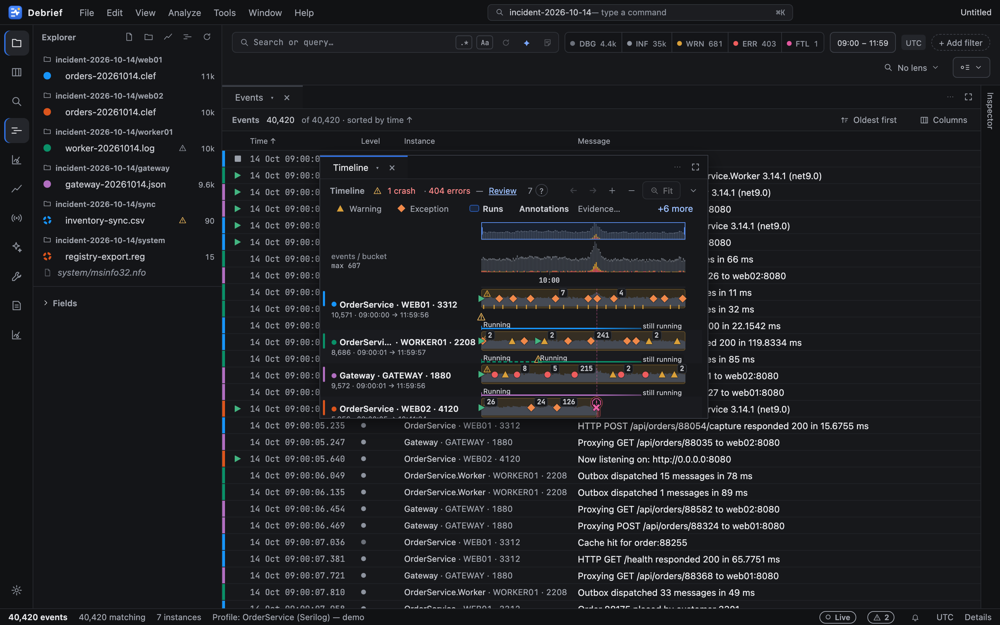

Every view is a panel. Drag tabs to split, float a panel (`Float panel` button), maximise it, and
reset the layout from the command palette. Layouts are remembered.

Dragging a tab shows where it goes. On a docking guide (the compass over a group, the guides at
the dock's edges) or a tab strip it docks there. Anywhere else in the window a dashed ghost of the
panel, sized as it will float, follows the pointer with **Release to float**; outside the window
the ghost waits at the window's edge with **Release to open in a new window**. Releasing does
what the hint says; `Esc` cancels the drag. The hint is also announced to screen readers, and the
ghost does not animate when reduced motion is on.

IMT behaves like a desktop app, not a web page: right-clicking toolbars, tabs and other chrome
shows IMT's own menus or nothing (text fields and selected text keep the system Copy/Paste menu),
and the browser's reload, back/forward (keys and mouse buttons), page zoom (`Ctrl` `+`/`-`/`0`,
`Ctrl`+wheel), find, print, save page and view source do nothing, as do the developer tools in
release builds. IMT's own shortcuts and `Ctrl`+wheel zoom on the timeline still work. Buttons, tabs,
menus and bars do not select like text; log messages, inspector values and fields do. Images and
links cannot be dragged out of the window.

The first run is focused. With nothing open, the window shows only the welcome page (open a folder or files,
or try the demo) and the Explorer; the filter bar and the Fields section appear once data is open. After
opening data, the default layout is the timeline over the events grid. The inspector waits at the right edge
and slides out when you select an event (pin it to keep it docked); views for what you just opened (a registry
export, a profile capture, a diagnostics report) open by themselves. The Overview, the query bar and Metrics
stay one click away: the timeline header shows the health check's headline on one line ("⚠ 2 crashes · 287
errors · 1 went silent — Review"; each count jumps to or filters those events, *Review* opens the Overview),
`Ctrl/⌘+/` opens the query bar, and the **activity bar** on the left offers Explorer, Search, Timeline,
*Analysis ▸* (patterns, anomalies, exceptions, Moment, compare, traces, runs, …), Metrics, *Live tail*, *AI*,
*Tools ▸* and the profile editor. Buttons that need data (Search, Timeline, Analysis, Metrics, Live tail) appear
once data is open; everything stays reachable from the View menu. Plugins can add their own buttons.

The filter bar is one row: search, level chips, the time range, *+ Add filter* and **View options** (group by,
*Marked only*, *Always show start / stop*); field and instance filters appear as chips on a second row while
there are any. The timeline legend lists only the marker kinds in the data, on one line, with *+N more* for the
rest. The Fields section of the sidebar starts collapsed and remembers whether you opened it. After opening a
folder of several files, *Set up analysis…* is offered as a message in Notifications (the bell), not as a banner.

*View ▸ Layout* switches between **Focused** (the default) and **Full**, where the query bar is part of the
default layout and the Overview opens after every import, as in earlier versions. The switch applies to new
layouts (*Reset layout*, a new window); a layout you saved or arranged is never changed by it.

## Windows, tray and notifications

- **Several windows, one workspace each.** *New window* (`Mod+Shift+N`) opens a window with its own
  files, profile, filters, live tail and project; closing a window frees its workspace and stops its
  live tail.
- **One IMT per user.** Starting IMT again (or opening files from Finder or Explorer) hands the
  paths to the running instance, which opens them as set in *Settings → Window & tray*: in a new
  window (the default), in the current window, or by asking each time. An empty window is always
  reused. Dismissing the "this window / new window" question cancels and drops the files.
  `--new-window` always opens a new window; `--new-instance` and safe mode start a separate process
  (see [Command line](user-guide.md#command-line)).
- **Closing the last window** asks (the default), quits, or keeps IMT running in the system tray,
  where live tail, the process monitor and other background work continue. The tray menu shows the
  windows, a new window, recent projects, the running background tasks with *Stop* actions, a
  diagnostic screenshot and *Quit*. IMT can also start hidden in the tray. Without a tray (for
  example Linux without an app indicator) closing the last window quits.
- **Desktop notifications** (off, alerts only (the default), or alerts and finished work): live
  alerts in a window you cannot see, a crash detected at start, failed jobs, a plugin or the AI
  switched off, imports and long jobs finished while IMT is not in front, and updates. They are
  rate-limited and never contain file contents; clicking one opens its message in Notifications.

The tray and notifications use the platform's own facilities; they are covered by unit tests of
their pure logic but have not been checked on every desktop environment.

## Updates, storage, language and accessibility

- **Updates are opt-in and signed.** IMT checks for a new version only when you choose *Check for
  updates…* or turn on *Check for updates automatically* in Settings ▸ Updates (off by default). The
  check is one HTTPS request for `latest.json` that carries no identifier; every update is verified
  with the key built into the app before it is installed. See [docs/releasing.md](releasing.md).
- **Storage.** Settings ▸ Storage lists what IMT keeps on disk (opened-bundle copies, the web view
  cache, AI runtimes and models, logs, error snapshots, session backups) with sizes. *Clear cache…*
  says what goes and how much, then removes it.
- **Language.** All UI text is marked for translation and extracted to an XLF file; a generated
  pseudo-locale checks for hard-coded text and overflow. Settings ▸ General ▸ Language offers system
  default, English and the pseudo-locale (used after a restart); only English ships today. Log text and
  file contents are never translated, and messages produced by the Rust engine are not translated yet.
- **Accessibility.** The Playwright suite runs axe against WCAG 2.0, 2.1 and 2.2 level A and AA and
  fails on serious violations; severity and state are never shown by colour alone.

## Themes, colour schemes and density

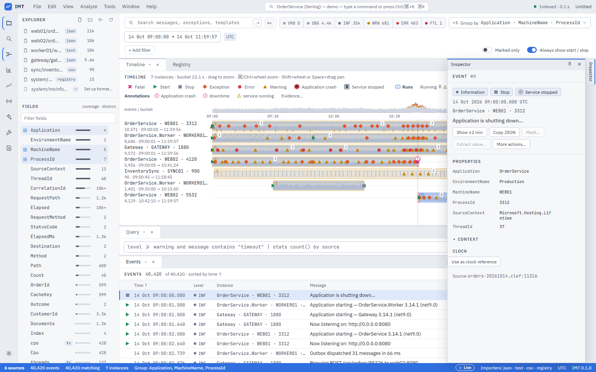

Settings ▸ Appearance (or *View ▸ Theme*, or the command palette) chooses how IMT looks:

- **Theme.** *Calm* (the default) is quiet and neutral: graphite surfaces, one blue accent, 1 px structure, and
  colour only where the data is. *Console* has soft cards on a tinted canvas, a violet accent and richer severity
  colour: findings as chips, lanes filled in their source colour, labelled run pills, a band behind each crash and
  a floating summary while you brush a range. Themes differ in shape as well as colour (Inter + JetBrains Mono for
  Calm, Geist + Geist Mono for Console; the fonts are bundled).
- **Colour scheme.** Light, dark, or *System* (the default), which follows the operating system as it changes.
- **Density.** *Comfortable* or *Compact* row and lane heights, in every theme.
- **Colour lanes by source.** Draws each lane's volume in its source colour instead of neutral grey; each theme
  has its own default, and *Use the theme's default* goes back to it.

The choice is yours (kept for your user, not in projects) and applies at once in every window, pop-outs
included. Every theme and scheme is checked: all text has at least 4.5:1 contrast on the surfaces it is drawn
on, markers and source colours at least 3:1, the source and chart palettes stay distinct under protanopia,
deuteranopia and tritanopia, axe (WCAG 2.2 AA) runs on the main window, and screenshot tests guard the main
window and the timeline. With *reduce motion* set in the operating system there are no transitions.

**The timeline** takes its look from the theme: lanes show their volume as an area (on a square-root scale shared
by all lanes, so volumes compare) or, for a quiet lane, one tick per busy moment; markers differ by shape (crash,
error, warning, exception, start, stop) and have a ring so they stay clear of what they overlap; the histogram
stacks errors and warnings on its baseline so a single error still shows, with its scale in the label column.
**Overlapping runs** on a lane (several views open at once, nested "X started" / "X ended") are stacked on labelled
sub-tracks below the lane's markers, so none hides another; the lane grows by one thin row per sub-track.

## Robust by design

- **Never modifies your files.** Input is opened read-only.
- **Safe mode** (`--safe-mode` or `IMT_SAFE_MODE=1`, or *Restart in safe mode*) starts without
  plugins and without the saved profile, for when something misbehaves. It runs as a separate
  process with its own sessions, so it never touches the main instance's.
- **Crash detection that is not fooled.** A running marker records the process id and its start
  time; a marker left behind is reported as a crash only when that process is gone (a reused PID is
  recognised by its different start time). Separate instances (`--new-instance`, safe mode) keep
  their marker and sessions in `<data>/instances/<pid>/`, removed on a clean exit; folders of dead
  processes are pruned at the next start.
- **Plugin containment.** Plugin code runs inside guarded adapters: panics become errors attributed
  to the plugin, and repeat offenders are quarantined. Every call has a time budget; a watchdog marks
  a plugin that overruns it as *hung* and its further calls fail fast. A plugin whose required
  dependency is missing, incompatible, disabled or quarantined becomes *inactive* with the reason,
  and so do its dependents. The *Plugin health* panel shows each plugin's status (active, disabled,
  quarantined, inactive), what it requires and provides, the reason it is inactive, its dependents,
  warnings, whether it is hung, and per-subscriber event counters (delivered, dropped, failures,
  skipped); a plugin can be reset or disabled there. A plugin that crashes, is quarantined or becomes
  inactive is also reported to its window as an engine error (`imt://error`, which can trigger an
  error snapshot). Plugins are deactivated when their window closes and when IMT exits.
- **Only files you chose.** Commands that read or write a file the UI names accept only paths chosen
  in a native dialog, dropped on the window, given on the command line or the window's own project;
  anything else is refused with a message to choose the file again. Restarting (safe mode, as
  administrator) passes no arguments from the UI to the new process. Closing a window and quitting
  never wait more than a few seconds for a step (live tail, plugins, jobs), and each step is logged.
- **One bad file never stops the import.** It is reported as unrecognised with a reason; the rest
  loads.
- **Bounded resources.** Limits on line length, regex size, archive expansion and result sizes; a text
  event collects at most 1 MiB or 10,000 continuation lines (the rest continues in a new event with
  `ContinuedFromLine`, counted per source as `splitEvents`); an analysis over more than 2,000,000
  matching events covers the first ones and says so (*Analysed the first ... of ...*);
  external tools run with timeouts; locked files and missing rights produce a message and a next step
  (retry, restart as administrator) instead of an error dialog.
- **Diagnostics with or without the UI.** *Help ▸ Report a problem…* (and *Save diagnostics…* on the safe-mode and crash banners) and `imt-app --export-diagnostics [<file.zip>] [--force]` (no window, no plugins; exits 0/1) write one zip with IMT's logs, each child process's log (AI engine, llama-server, plugin processes; secrets scrubbed), `processes.json`, steps, snapshots, crash marker and a versioned `manifest.json`; opening that zip in IMT shows it as a diagnostics workspace (one lane per log, crash/restart markers, the *Diagnostics report* panel). Sample: `samples/diagnostics/imt-diagnostics-sample.zip`.

## Easy to start, hard to get wrong

- **Try a demo** on the welcome screen opens the bundled sample incident and offers a short, skippable
  guided tour of the timeline, grid, query bar, Moment view, markers and overview.
- **Overview:** a health check lists crashes, error spikes, exceptions, unread lines, files that could not
  be opened (with the reason) and plugins with problems, each with a button to jump to the time, show the
  events or fix the cause. Its headline is on the timeline header; in the Full layout the Overview opens after
  every import (which can be turned off).
- **Import progress with Cancel:** files, bytes, the current file and the time left; a cancelled import
  says clearly what was not read, and *Re-import all* loads the rest.
- **Undo and redo** for user edits; changes to the profile are undone by saving the previous version
  through the normal, validated save. The profile editor keeps the last 20 saved versions with a diff
  and *Restore*.
- **Templates** for common formats (Serilog, log4net, NLog, Microsoft.Extensions.Logging, IIS, Apache/Nginx
  access and Apache error logs, syslog, Windows events, Android logcat, Hadoop/Spark, CSV, plain text) with a
  live preview against your own file.
- **"Did you mean"** for unknown field names in the query language (computed by the engine) and for
  commands in the palette; helpful empty states say what to do next.
- **IMT never modifies your files.** Opened logs and folders are only read. IMT writes only where you
  explicitly save or export, and never replaces an existing file without asking: every write command
  refuses to overwrite unless the user confirmed it (in the system's save dialog or in IMT).

## Privacy

Everything runs on your machine. IMT sends no telemetry and makes no network requests to analyse
files; the webview's content security policy allows no remote origins. Logs written by IMT itself do
not contain file contents.
