# Debrief usability audit (2026-10-22)

> A point-in-time record. Findings from it were acted on the same day (perspectives and view areas in [ADR 0035](../adr/0035-view-areas-and-perspectives.md), Home in place of Overview, one search field, the Plugins view with a Health tab); its text and screenshots describe the UI as audited, including the Overview, the Query panel, Plugin health and the Focused/Full layouts that no longer exist. The screenshots were taken under the product's former name, IMT, and are kept unchanged as part of the record.

A walk through the whole UI of the browser build (`npm start`, mock backend) on `feature/log-analysis-ide`
(`eafca99`), driven by Playwright (Chromium, 1440×900 unless stated) with axe-core (WCAG 2.2 A/AA) on every
state. Every view in *View ▸ Other windows…*, every Settings section, the menus, the command palette, context
menus, dialogs, toasts, the AI assistant, the docked browser, empty, loading, error (`?mockFail=…`,
`?debriefFault=view:*`, `?mockProfilingFail=…`, `?mockAiFail=1`, `?mockCorrupt=markers`), live tail (`?mockLive=1`),
narrow windows (1024, 900, 800, 600 px), and the three themes in light and dark.

Findings are judged against Nielsen's ten heuristics, desktop-IDE conventions (VS Code, JetBrains: panes,
palette, status bar, keyboard), discoverability, information density, wording, keyboard-only use, accessible
names and contrast, and narrow windows.

**Priorities.** **P1** must fix before v1 (blocks or misleads users, or was requested). **P2** should fix (real
friction, inconsistency or a11y gap). **P3** nice to have (polish).

**Caveat.** The mock backend is not the reference for behaviour (AGENTS.md). Findings marked *(verify)* may be
artefacts of the mock (counts, saved-state) and must be confirmed against the real engine before fixing.

axe found almost nothing serious (see [Appendix A](#appendix-a-axe-results)): the accessibility problems below
are the ones axe cannot see (keyboard flow, focus order, density, wording, layout).

## Top 15

| # | ID | P | Finding |
|---|----|---|---------|
| 1 | [A1](#a1-p1-dock-drag-releasing-off-a-guide-must-cancel-requested) | P1 | Releasing a dragged tab off a drop guide floats it; it must snap back, with "open in new window" only outside the window and Float only from the tab menu. |
| 2 | [B1](#b1-p1-ai-chat-composer-redesign-requested) | P1 | The AI composer is five loose rows (mode pill, two checkboxes, a second Research…, a context chip, a resizable textarea); make it one card with a toolbar. |
| 3 | [C1](#c1-p1-view--store-pane-and-a-read-only-sql-console-requested) | P1 | There is no way to see the store (segments, fields, index, worker memory) or to query it in SQL; add a read-only Store pane and a sandboxed read-only SQL console. |
| 4 | [A2](#a2-p1-every-view-opens-as-another-tab-in-the-same-two-groups) | P1 | Every view opens as one more tab in the same two groups: the grid and timeline get buried (17–22 hidden tabs) and each view gets ~200 px. |
| 5 | [D1](#d1-p1-a-query-syntax-error-shows-no-message-and-keeps-stale-results) | P1 | A query syntax error shows only a red border; the previous results stay on screen as if current. |
| 6 | [E1](#e1-p1-one-import-reports-its-progress-three-times-and-says-0-of-0-files) | P1 | One import reports its progress three times ("Opening 1 item…", a card over the grid, the status bar), all saying "0 of 0 files". |
| 7 | [G1](#g1-p1-no-way-to-move-between-regions-by-keyboard) | P1 | No F6 region cycling or skip links: about 35 Tab presses from the activity bar to the grid; every level chip is its own tab stop. |
| 8 | [H1](#h1-p2-narrow-windows-clip-the-filter-bar-the-right-dock-and-the-status-bar) | P2 | Below ~1100 px the filter bar, the right dock and the status bar are clipped instead of reflowing. |
| 9 | [F2](#f2-p2-one-word-several-meanings-profile-storage-workspace-compare) | P2 | "Profile" means both the parsing profile and a profiler capture (*File ▸ Open profile…* opens a capture); "Storage", "Workspace" and "Compare" are similarly overloaded. |
| 10 | [F1](#f1-p2-command-palette-ranking-and-naming) | P2 | The palette opens on "Capture diagnostic screenshot", matches loosely ("anom" finds "Full screen does…"), and lists one view under several names. |
| 11 | [F3](#f3-p2-the-event-context-menu-is-18-flat-items) | P2 | The event context menu is 18 flat items with no groups or shortcuts, Copy last, and two overlapping web-research items. |
| 12 | [D3](#d3-p2-the-status-bar-match-count-disagrees-with-the-grid-verify) | P2 | The status bar's "N matching" disagrees with the grid after filtering *(verify)*. |
| 13 | [I1](#i1-p2-settings-say-they-apply-immediately-but-have-an-apply-button) | P2 | Settings say they "apply immediately" yet the dialog has Apply/Close: users can't tell what is saved. |
| 14 | [I2](#i2-p2-live-tail-settings-live-in-three-places) | P2 | Live-tail settings are split over Settings ▸ Workspace, the Tail status panel and the alert-rules dialog. |
| 15 | [K1](#k1-p2-inspector-actions-are-a-wall-of-buttons-some-disabled-without-a-reason) | P2 | The inspector is a wall of equal buttons, two disabled with no reason, and values break mid-word. |

## Batch plan

Each batch is one coherent change set (one branch, one review), ordered by priority. Batches 1–3 are the
user's requests; 4–6 are the other P1s.

| Batch | Scope | Findings | Priority | Notes |
|---|---|---|---|---|
| 1 Docking and layout | Drag semantics, view placement, perspectives, activity bar | A1–A6 | P1 | Changes `dock/`; e2e `dock-float.e2e.ts` must be rewritten (release-to-float goes away); features.md "Dockable workspace" updated. |
| 2 AI chat | Composer card, chat header, research dialog, wording | B1–B5 | P1 | `ai/chat/chat-panel.ts`, `browser/chat-browser-bar.ts`; no engine change. |
| 3 Store pane and SQL console | New read-only engine queries, maintenance jobs, sandboxed SQL | C1–C2 | P1 | Needs an ADR amending 0014 (stable SQL views, console sandbox) and contract changes in `api.types.ts` + Rust DTOs. |
| 4 Query and filters | Inline errors, stale results, one query bar, counts | D1–D6 | P1 | Error positions come from the engine's parser (no TS re-implementation). |
| 5 Progress and feedback | One progress surface, title/status truth, toasts, error text | E1–E6 | P1 | Builds on the Jobs store. |
| 6 Keyboard and accessibility | Regions, roving tab stops, target sizes, contrast | G1–G3 | P1 | Add a keyboard-only e2e that reaches every region. |
| 7 Commands, menus and words | Palette ranking/naming, menus, context menu, glossary | F1–F7 | P2 | Write a short glossary in `docs/user-guide.md` first; rename in one pass. |
| 8 Narrow windows | Overflow menus, auto-hide docks, explorer names | H1–H2 | P2 | Test at 1024/900/600 px in Playwright. |
| 9 Settings consolidation | Apply model, live tail, parsers, plugins, updates | I1–I7 | P2 | |
| 10 Onboarding and view polish | Welcome, profiling landing, inspector, analysis tables, notifications | J1–J3, K1–K6 | P2/P3 | |

---

## Batch 1 — Docking and layout

### A1 (P1) Dock drag: releasing off a guide must cancel (requested)

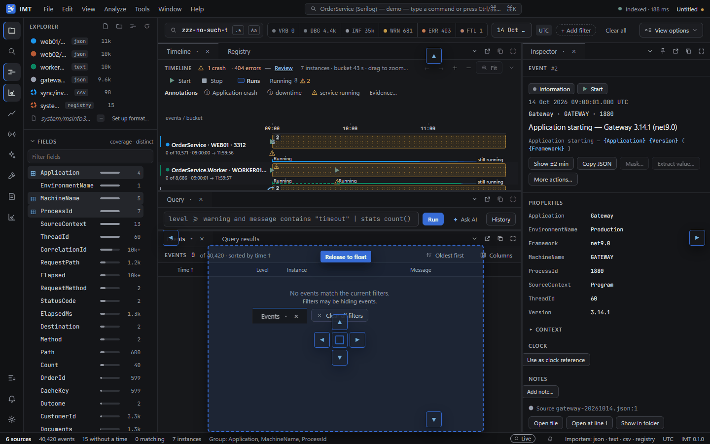

**Problem.** Today a tab dropped anywhere in the window that is not a guide becomes a floating panel ("Release
to float", the dashed ghost above). Most such drops are misses aimed at a guide.
**Impact.** A missed drop silently turns a docked panel into a floating window over the data; users then have to
find *Dock* in the tab menu. It breaks the IDE convention (VS Code, JetBrains: a drop on no target cancels).

**Proposed behaviour.**

1. **Inside the main window, on a guide** (group compass, the dock's edge guides, a tab strip): unchanged, the
   drop preview shows where it docks.
2. **Inside the main window, off any guide:** no ghost. The dragged tab chip dims to 50 % and a small hint next
   to the pointer reads **"Release to cancel"**. Releasing animates the tab back to its strip (150 ms; instant
   with reduced motion). `Esc` cancels at any time, as today.
3. **Outside the main window** (pointer beyond the window bounds): a translucent preview (60 % opacity, the
   panel's current size, accent outline) follows the pointer with **"Release to open in a new window"**;
   releasing opens a new Debrief window at that screen position with the panel in it.
4. **Floating inside the window only on request:** the tab context menu's *Float inside window* becomes **Float**
   (and stays in the panel's *⋯* menu, A6). No drag gesture creates an in-window float.
5. **Accessibility:** the hint is announced through the existing `aria-live` status; keyboard users get
   *Move to ▸ Left / Right / Bottom / New window* in the panel menu (`Alt+-`).
6. **Tests and docs:** rewrite `e2e/dock-float.e2e.ts` (free-spot release leaves the layout unchanged; outside
   release opens a window; Float from the menu floats), update "Dockable workspace" in `docs/features.md`.

### A2 (P1) Every view opens as another tab in the same two groups

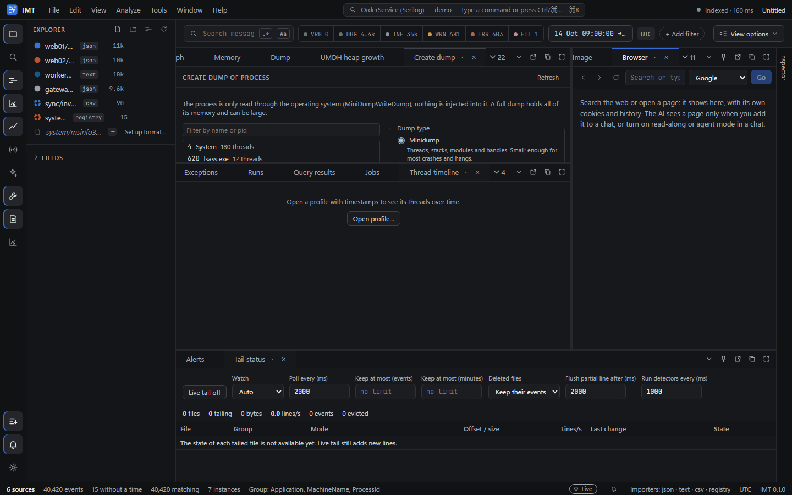

**Problem.** Every view (Metrics, Moment, Anomalies, Patterns, all ten profiling views, Dump, Browser, Plugins…)
opens as a new tab in the group that holds the timeline or the events grid. After a normal session the top group
had 22 tabs (`⌄22`), the grid's group 4 more, and the grid itself was hidden behind Anomalies
([55](screenshots/55-anomalies.png), [67](screenshots/67-jobs.png)). Each view gets the ~200–300 px height of
the group it lands in.
**Impact.** Users lose the timeline and the grid, their main context, while analysing; views are cramped; tab
overflow menus become the navigation. Violates *visibility of system status* and *recognition over recall*.

**Proposed change.**

- Give every view a **home area** by kind, declared in the view registry (not hard-coded per call site):
  - *Documents* (centre, may share a group): Timeline, Events, Query results, Profile editor, Parsers, flame
    graph and the other profiling documents, Dump, Configuration diff, Report, Dashboards.
  - *Analysis panel* (one bottom group, below the grid): Anomalies, Patterns, Exceptions, Moment, Compare, Field
    statistics, Traces, Runs, Markers, Alerts, Tail status.
  - *Side tool windows* (right): Inspector, Overview, AI assistant, Browser, Notes, Saved queries.
  - *Status tool windows* (bottom, auto-hide): Jobs, Notifications, Plugins, Plugin health, Error snapshots.
- **Never cover Timeline or Events** when opening a view: if its home group is theirs, split instead.
- **Reuse**: opening a view that is already open activates it; the analysis panel caps at ~8 tabs, the oldest
  inactive one closes (with its state kept for reopening).
- **Perspectives:** *Investigate* (default), *Profiling*, *Live*, *Diagnostics* as built-in window layouts,
  switchable from the activity bar and *Window ▸ Layouts*; opening a profile switches to *Profiling* once (and
  says so in a toast with *Undo*).

### A3 (P2) The activity bar has several "active" items and duplicates the status bar

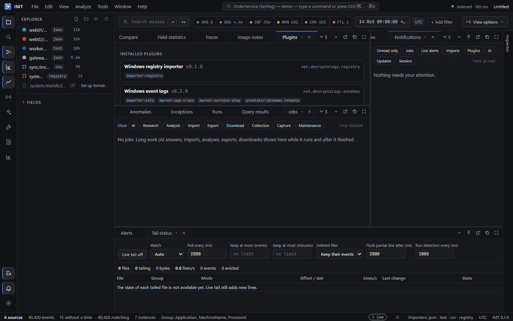

**Problem.** The activity bar highlights every button whose view is open somewhere (five at once above), so it
does not show which side view is visible. Jobs and Notifications appear both in the activity bar and in the
status bar (two bells, [159](screenshots/159-notifications.png)).
**Impact.** Ambiguous state; wasted space; users don't know which icon toggles what.
**Proposed change.** One accent bar for the visible side-bar view only; a small dot for "open elsewhere". Keep
side-bar views (Explorer, Search, AI, Tools) in the activity bar; move Jobs and Notifications to the status bar
only (progress item and bell with badge), as in VS Code. Tooltips show name and shortcut.

### A4 (P2) Panels do not adapt to narrow docks

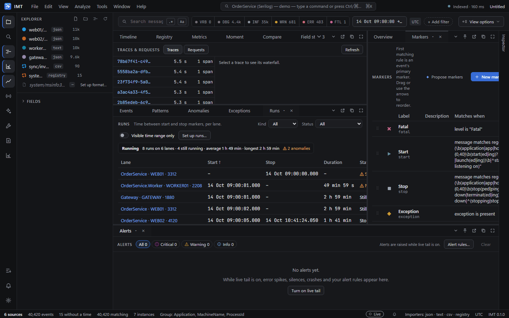

**Problem.** Panels lay out for full width only: Markers in the right dock wraps its description one word per
line and clips *New marker*; the Profile editor in a 200 px group shows only its header
([72](screenshots/72-profile-editor.png)); Plugin health clips its table.
**Impact.** Views are unreadable in the places A2 puts them today.
**Proposed change.** Container queries on each panel: below 420 px tables become stacked cards, toolbars fold
into *⋯*, long descriptions move into a (?) tooltip. Declare a minimum size per view and let the dock refuse a
smaller split. Heavy editors (Profile editor, Parsers) open as documents (A2).

### A5 (P2) The drag chip hides the guide under the pointer

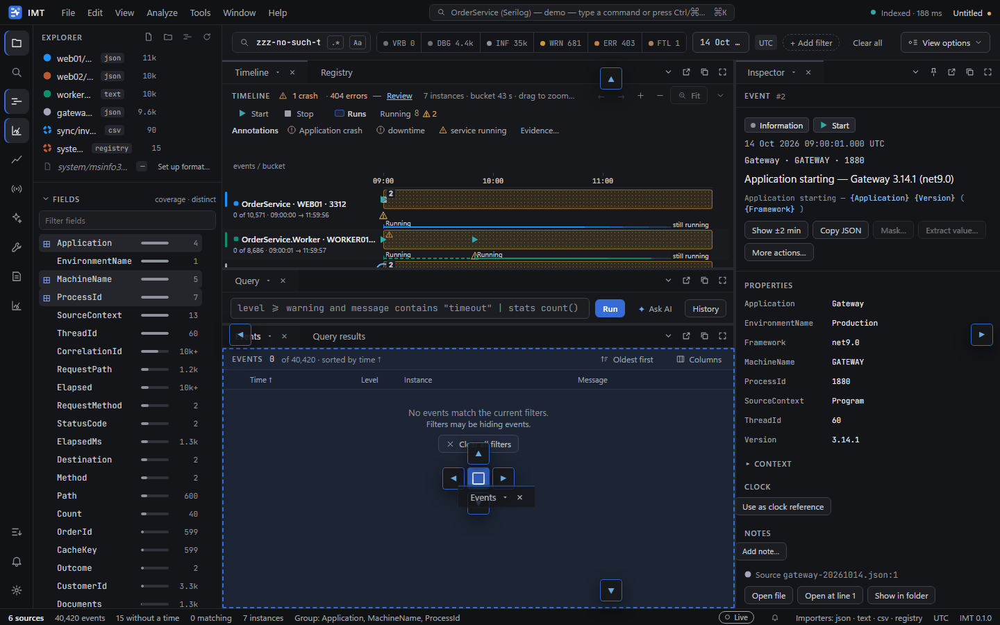

**Problem.** The tab chip that follows the pointer is drawn over the compass, hiding the guide being targeted.
**Proposed change.** Offset the chip 12 px right and below the pointer and draw it under the guides.

### A6 (P3) Four tiny unlabeled header icons on every group

**Problem.** Every group header shows chevron, pop out, float and maximise icons (≈16 px), repeated on each group;
the overflow dropdown fails axe *target-size*.
**Proposed change.** Keep *Maximise* and one *⋯* menu (Float, Pop out, Move to ▸, Close group), 24 px targets.

## Batch 2 — AI chat

### B1 (P1) AI chat composer redesign (requested)

| Today | |
|---|---|
| 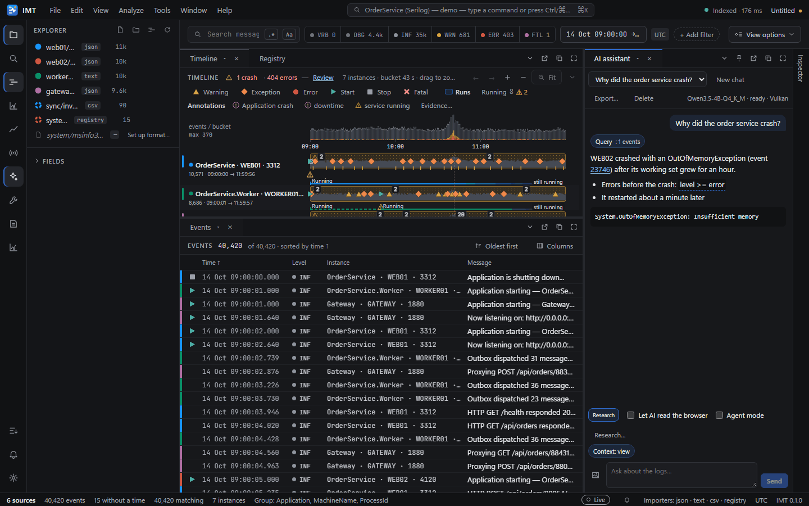 | 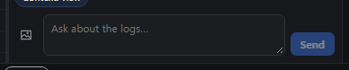 |

**Problem.** Under the conversation sit five loosely aligned rows: a *Research* mode pill, *Let AI read the
browser* and *Agent mode* checkboxes, a second *Research…* button, a *Context: view* chip, then the composer
(image button, a textarea with a resize grip, *Send*). With agent mode on, an *Agent* pill, the checkbox and a
separate *Stop agent* button describe one state three times ([162](screenshots/162-ai-agent-mode.png)).
**Impact.** The primary task (type a question) competes with six controls; two Research entries and three agent
controls invite mistakes; checkboxes hide that read-along and agent are exclusive modes.

**Proposed design.** One card, focus ring on the card (`:focus-within`), the whole card a drop target:

```
┌──────────────────────────────────────────────────────────────────────┐
│ [▣ dialog.png ✕] [▣ trace.png ✕]          ← attachment chips (only when present)
│ Ask about the logs…                       ← textarea, grows 1→8 lines, then scrolls
│                                                                      │
│ [🖼]  [Context: Current view ▾]  [Browser: Off ▾]  [Research…]   [Send ➤] │
└──────────────────────────────────────────────────────────────────────┘
  Enter to send · Shift+Enter for a new line
```

- **Textarea:** no resize grip (`resize: none`), auto-grows with content (`field-sizing: content`, JS fallback)
  up to 8 lines or 40 % of the panel, then scrolls. Keeps `maxlength`, paste of images.
- **Attach image** (icon button, aria-label "Attach image"): picked, pasted or dropped images appear as
  **thumbnail chips** above the text (thumbnail, name, ✕ remove; *Find related logs* moves into the chip's
  context menu). Over the image limit the button is disabled with a tooltip saying why.
- **Context ▾** (CDK menu, radio items, label shows the choice): *Selected events (n)* (disabled with "Select
  events in the grid first" when none), *Current view* (filters + time range, default), *None*. The note "The
  engine checks these and reads the events itself. Nothing leaves this computer." becomes the menu's footer.
- **Browser ▾** (radio): *Off* · *Read along* (the AI may read the page open in Debrief's browser) · *Agent* (the AI
  drives the browser; asks before new sites, typing and forms; the small-model warning shows as the item's
  description). Replaces both checkboxes, the mode pill and the separate *Stop agent* button.
- **Research…**: the single entry point; opens the research dialog **prefilled with the draft** (B2). The other
  Research button and the mode pill are removed.
- **Send ↔ Stop:** one button in one place; while an answer or an agent run is in progress it becomes **Stop**
  (`Esc` also stops). Disabled Send explains itself ("Type a question" / "Set up the AI assistant first" with a
  link).
- **Hint** under the card in muted small text: "Enter to send · Shift+Enter for a new line"; hidden below 320 px.
- **Running agent:** one banner above the card ("Agent is browsing example.com · Stop") instead of three controls.
- Wire through `ChatStore`/`ChatBrowserStore` only; state lives in the stores; e2e `ai-chat`, `ai-vision`,
  `browser-panel` updated.

### B2 (P2) The research dialog's main button does not say what happens

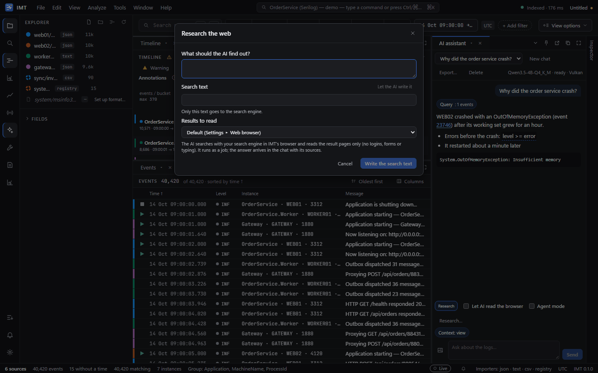

**Problem.** The primary button reads *Write the search text*; *Let the AI write it* is a faint link at the far
right; the question field is empty although the user just asked in the chat.
**Proposed change.** Prefill *What should the AI find out?* with the draft (or last question). Buttons: *Cancel*,
*Suggest search text* (secondary), **Start research** (primary, enabled once a search text exists). Keep "Only
this text goes to the search engine" next to the field.

### B3 (P2) The chat header crowds session actions

**Problem.** Session select, *New chat*, *Export…* and *Delete* sit side by side; a fresh session is named "New
chat" next to a *New chat* button ([146](screenshots/146-ai-fail.png)); *Delete* is one click from *Export…*.
**Proposed change.** Session select (titled from the first question) + *New chat* (icon `+`) + *⋯* menu
(Export…, Rename…, Delete chat… with an *Undo* toast). Model status moves to a small line under the header.

### B4 (P3) Wording in answers

**Problem.** Tool chips read "Query : 1 events" ([102](screenshots/102-ai-chat-answer.png)).
**Proposed change.** Use ICU plurals ("Query · 1 event"), no space before colons.

### B5 (P3) AI settings contradict the chat *(verify)*

**Problem.** Settings ▸ AI assistant says "The AI assistant is not installed in this build" while it lists a
ready model and the chat answers ([160](screenshots/160-settings-ai-knowledge.png)).
**Proposed change.** One status source (`AiStatusStore`) for the badge, the banner and the chat; show "Ready ·
Qwen… · Vulkan" or the real reason.

## Batch 3 — Store pane and SQL console

### C1 (P1) View ▸ Store pane and a read-only SQL console (requested)

**Problem.** The DuckDB/Parquet store and its Tantivy index are invisible. When an import is slow, memory is high,
a field is slow to filter or search seems incomplete, users (and support) cannot see segments, field promotion,
index state or worker memory against the budgets, and cannot run ad-hoc SQL for questions the query language
does not cover. Settings ▸ *Storage* is about files on disk, not the store, which adds to the confusion (F2).
**Impact.** No visibility of system status for the engine; support relies on logs; power users have no escape
hatch.

**Proposed design.** *View ▸ Store* opens a **read-only** tool window (bottom or document area), also in the
palette (*Open Store*). It shows only what the engine reports; all numbers come from new **query** commands with
no side effects (command–query separation); actions run as **jobs**.

| Section | Content |
|---|---|
| **Overview** | Store folder (with *Show in folder*), size on disk, events, sources, segments, schema version, state (*Ready / Importing / Indexing / Compacting*), worker PID and uptime, last compaction. |
| **Segments** | Paged table: file, source(s), rows, live/sealed, size, indexed ✓, promoted fields (n), created. Sort and filter. Row action *Show these events* opens the grid on the segment's id range. |
| **Fields** | Key, type, coverage %, approx. distinct, promoted in n of N segments, rule ("promoted when ≥ 50 % of a segment's first batch has it"). Explains why filtering on a non-promoted field is slower. |
| **Full-text index** | Up to date / indexing x % / behind by N rows, documents, size, last commit, writer budget. |
| **Memory** | Worker RSS against the budgets as bars: query 300 MB, import 600 MB, hard cap 2 GiB; DuckDB `memory_limit`, Tantivy, spill (temp) size; peak since start; a warning when near a budget with a link to Settings to raise it. |
| **Maintenance** | *Compact segments*, *Rebuild full-text index*, *Recompute field statistics*, *Checkpoint*, *Clear spill files*. Each runs as a cancellable job (Jobs pane, notifications), asks to confirm when it rewrites data, and is disabled with a reason while an import runs. |

No raw catalog dump and no editing of store internals: the pane explains, it does not administer.

### C2 (P1) Read-only SQL console (user decision)

A **SQL** tab of the Store pane (and *Open SQL console* in the palette) for power users and support.

- **Sandbox (Rust, store worker):** a *separate* DuckDB connection, opened read-only, with
  `enable_external_access = false`, `autoinstall_known_extensions = false`, `autoload_known_extensions = false`,
  then `lock_configuration = true`, so no file, network or extension access and no `SET` can undo it.
- **SELECT only, validated in Rust:** parse once at the edge (DuckDB's parser via `json_serialize_sql`, or the
  statement type from `prepare`): exactly one statement, of type SELECT (incl. `WITH`, `EXPLAIN SELECT`); reject
  PRAGMA, COPY, ATTACH, INSTALL, LOAD, SET, CALL, CREATE/INSERT/UPDATE/DELETE and table functions outside an
  allowlist (no `read_*`, `glob`, `parquet_*`). Errors name the offending keyword and position.
- **Bounded:** row cap (10 000 rows returned, paged 500 at a time), time limit (30 s default, `interrupt()` on
  expiry), memory cap inside the 300 MB query budget (connection `memory_limit` e.g. 128 MB, 2 threads). Each
  limit hit produces a clear message ("Stopped after 30 s. Narrow the time range or add LIMIT.").
- **Cancellable job:** a run is a *SQL query* job (Jobs pane, Stop button, `Esc` in the editor).
- **Stable surface:** the connection sees only documented, versioned **views** in an `debrief` schema: `events`
  (event columns + `extra` as MAP), `sources`, `fields`, `notes`. Internal tables (`segments`,
  `segment_fields`, `events_wide`, `p_*` columns) are not visible, so the store can change without breaking
  saved SQL. The views are documented in `docs/user-guide.md` with their columns.
- **Editor:** monospace, multi-line, `Ctrl+Enter` runs, schema **autocomplete** (views, columns, DuckDB
  functions) from a `sql_schema` query, inline error underline at the reported position, history.
- **Explain:** an *Explain* toggle shows the query plan (`EXPLAIN`, tree view) instead of rows.
- **Results:** when the result has the event `id` column (and is rows of `events`), it renders in the **events
  grid** component with **Open in Events** (filters the main grid to those ids, capped); otherwise a generic
  virtualised table with *Copy* and *Export CSV*.
- **Saved SQL** lives next to saved queries (Saved queries panel shows *QL* / *SQL* badges; projects save both).
- **Contract and docs:** new commands (`store_status`, `store_segments`, `store_fields`, `store_index`,
  `store_memory`, `store_maintenance → JobId`, `sql_schema`, `sql_run → JobId`, `sql_explain`) mirrored in
  `api.types.ts` and the Rust DTOs; an **ADR amending 0014** records the stable views and the console sandbox;
  robustness tests trigger each limit (timeout, row cap, memory, rejected statements, external access).

## Batch 4 — Query and filters

### D1 (P1) A query syntax error shows no message and keeps stale results

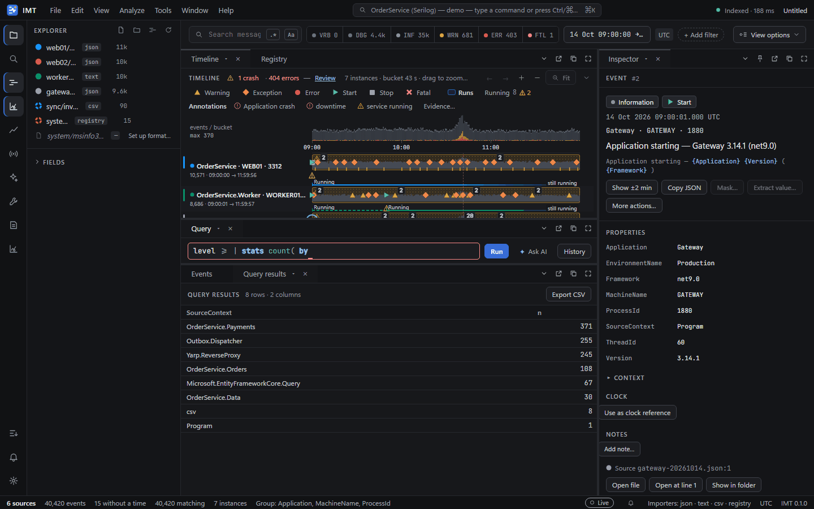

**Problem.** `level >= | stats count( by` turns the bar red with a squiggle but no message, and *Query results*
still shows the previous query's table as if it answered this one.
**Impact.** Users can't tell what is wrong or whether the table is current (error recovery, status).
**Proposed change.** An inline error line under the bar from the engine's parser ("Expected a value after `>=` at
column 10"), with *did you mean* where the engine offers it, and the squiggle's tooltip carrying the same text.
The results panel greys out with a banner "Results of the previous query — fix the error and run again".

### D2 (P2) Two separate ways to search, and the query bar is a panel

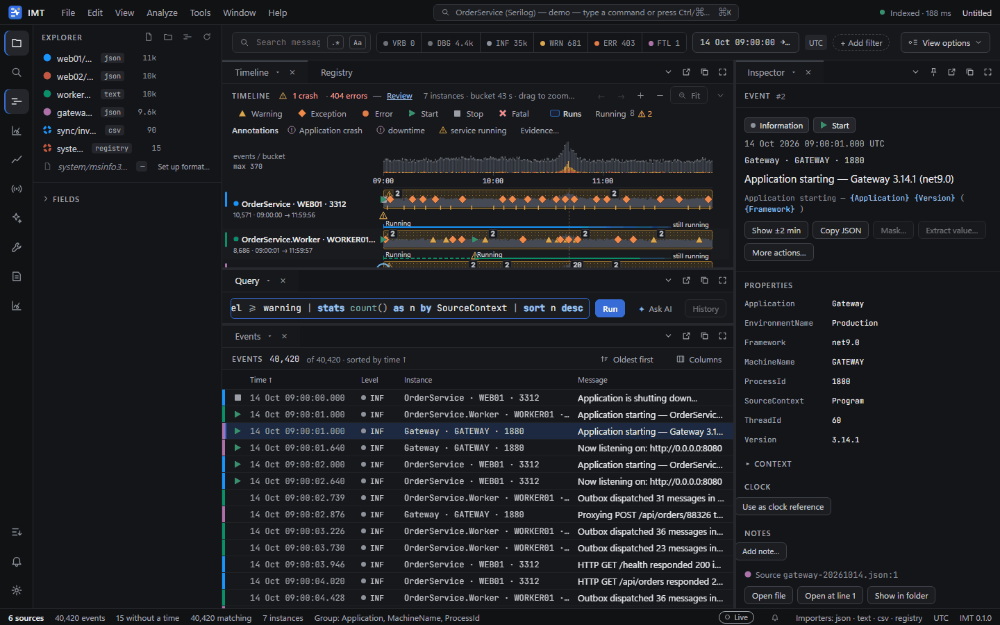

**Problem.** The filter bar's *Search messages* box and the query language bar are independent; `Ctrl+/` opens
the query bar as a dock panel that takes a group and a tab, single-line, scrolling horizontally (the start of the
query is cut off).
**Proposed change.** One query field in the filter bar: plain text = message search (as today), anything with an
operator or `|` = query language, recognised by the engine. It expands to multi-line on focus, `Ctrl+/` focuses
it, `Ctrl+Enter` runs, autocomplete for fields and values. *History*, *Ask AI* and *Save* sit inside it. Chips
and level toggles stay the structured view of the same query.

### D3 (P2) The status bar match count disagrees with the grid *(verify)*

**Problem.** With a search matching nothing, the grid says "0 of 40,420" while the status bar says "40,420
matching" ([29](screenshots/29-timeline-zoomed.png) vs [30](screenshots/30-dock-drag-free-spot.png)).
**Proposed change.** Status bar, grid header and timeline read the same query-result signal; add an e2e that
filters and compares the three.

### D4 (P2) The inspector keeps showing an event the filter hides

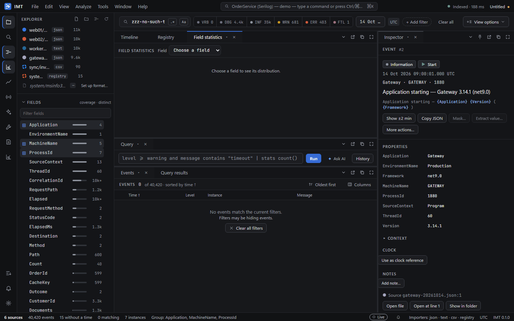

**Proposed change.** When the selection leaves the result, show "This event is hidden by the current filters"
with *Show it anyway* (adds an exception) and *Clear selection*.

### D5 (P3) Filter bar details

**Problem.** The search placeholder is cut ("Search messag"); level chips keep their totals while the text filter
matches nothing ([27](screenshots/27-empty-grid.png)); the time range collapses to "14 Oct …".
**Proposed change.** Placeholder "Search…", chips show matching counts (`ERR 0 / 403` dimmed), time range keeps
both ends at a smaller size before truncating.

### D6 (P3) View options targets are 16 px high

**Problem.** The group-by field list in *View options* fails axe *target-size* (43 items at 16 px,
[24](screenshots/24-view-options.png)); "Instance key" jargon.
**Proposed change.** 24 px rows; heading "Group events into timeline lanes by".

## Batch 5 — Progress and feedback

### E1 (P1) One import reports its progress three times and says "0 of 0 files"

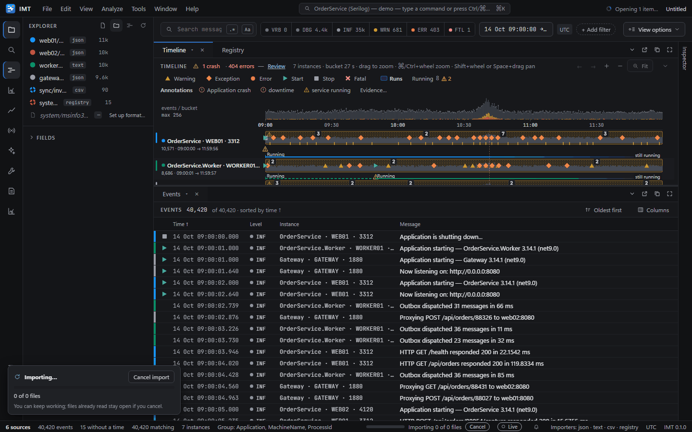

**Problem.** Opening a folder shows "Opening 1 item…" at the top right, an *Importing…* card over the Explorer and
grid with *Cancel import*, and "Importing 0 of 0 files · Cancel" in the status bar, all at once; "0 of 0" while
the folder is being scanned.
**Impact.** Noise, covered content, and a counter that looks broken.
**Proposed change.** One progress surface: the status-bar item (determinate bar, "Scanning folder…" until the total
is known, then "Importing 3 of 12 files", *Cancel*); clicking it opens the job in Jobs. The floating card only on
the welcome screen (nothing else to look at). The title area shows the project name, not progress.

### E2 (P2) Title and status bar state things that aren't true

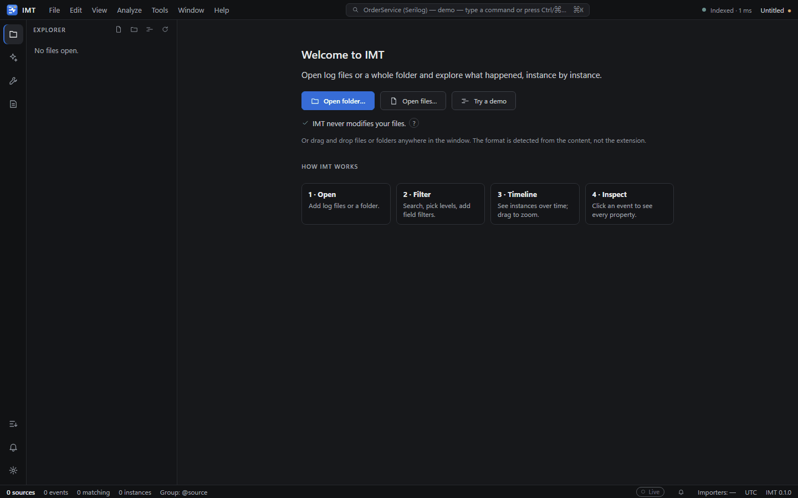

**Problem.** After *Close workspace* the command centre still names the demo profile, the title shows *Untitled ●*
(unsaved) with nothing to save, the status bar shows "Indexed · 1 ms" and "Group: @source".
**Proposed change.** Command centre shows the project/folder name (or "No folder open"); the active parsing profile
moves to the status bar; the dirty dot appears only when there is something to save; hide index/group items when
empty.

### E3 (P2) `Ctrl+S` on an untitled project saves silently *(verify)*

**Problem.** `Ctrl+S` showed "Saved Untitled" without asking where ([41](screenshots/41-format-wizard.png)).
**Proposed change.** Untitled → *Save project as…* dialog, as every desktop app does.

### E4 (P2) Error toasts are long and stack on top of each other

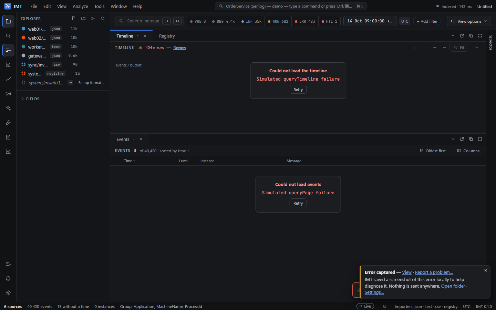

**Problem.** "Error captured — View · Report a problem… Debrief saved a screenshot… Open folder · Settings…" (four
links) and a second toast peeking from behind it.
**Proposed change.** A toast stack with spacing and a max of three; error toast: "Something went wrong in
Timeline." [Details] [Report…]; the screenshot explanation lives in Details.

### E5 (P3) Errors show raw internal text

**Problem.** Inline errors print the backend message in monospace red ("Simulated queryPage failure").
**Proposed change.** A human sentence ("Couldn't load events.") + *Retry* + collapsible technical details.

### E6 (P3) Error snapshots' empty state contradicts itself

**Problem.** With no snapshots, the panel still says "Debrief saved a screenshot of this error…" and *Export
diagnostics…* is the primary button ([76](screenshots/76-diagnostics-report.png)).
**Proposed change.** Show only the empty-state sentence and *Capture now*; enable export when there is something.

## Batch 6 — Keyboard and accessibility

### G1 (P1) No way to move between regions by keyboard

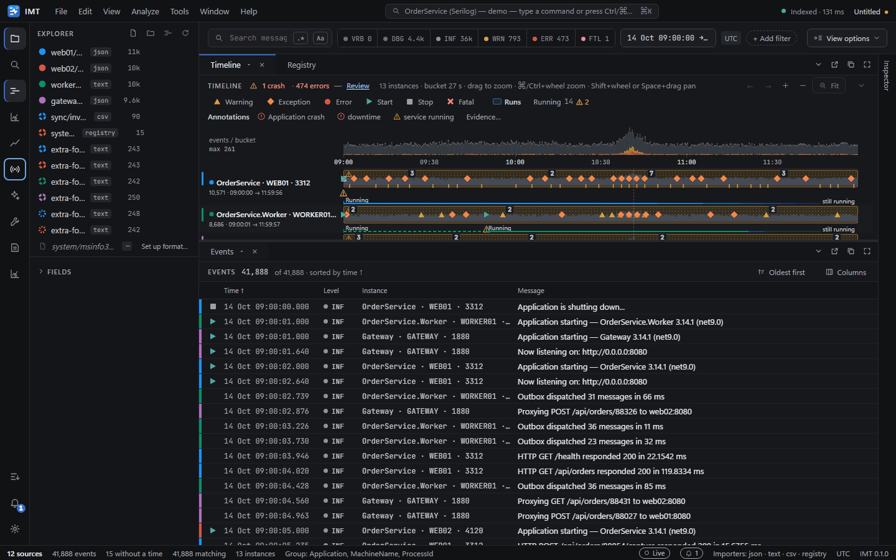

**Problem.** Tab order runs activity bar (13) → Explorer → filter bar (search, `.*`, `Aa`, six level chips, time,
UTC, Add filter, View options) → each panel header's four icons → timeline headline links → legend entries… The
grid is about 35 Tab presses away. There is no F6 region cycling, no skip link, no shortcut to focus a group.
**Impact.** Keyboard-only and screen-reader users cannot work efficiently; IDE users expect F6 / `Ctrl+1…`.
**Proposed change.** F6 / Shift+F6 cycle regions (activity bar, side bar, filter bar, each dock group, status
bar), each with a landmark name; roving tabindex inside toolbars (level chips = one stop, arrows move);
`Ctrl+0` side bar, `Ctrl+1…9` dock groups, `Ctrl+Shift+E` events grid; a visible focus ring on the region
container. Add a keyboard-only e2e reaching each region in ≤ 3 keys.

### G2 (P3) axe findings

**Problem.** *target-size* on the dock's overflow dropdown and maximise button; *label-content-name-mismatch* on
Settings ▸ Plugins' reset button; *target-size* in View options (D6). Full list in Appendix A.
**Proposed change.** 24 px targets; accessible names that start with the visible label.

### G3 (P3) Selected state of segmented controls is faint

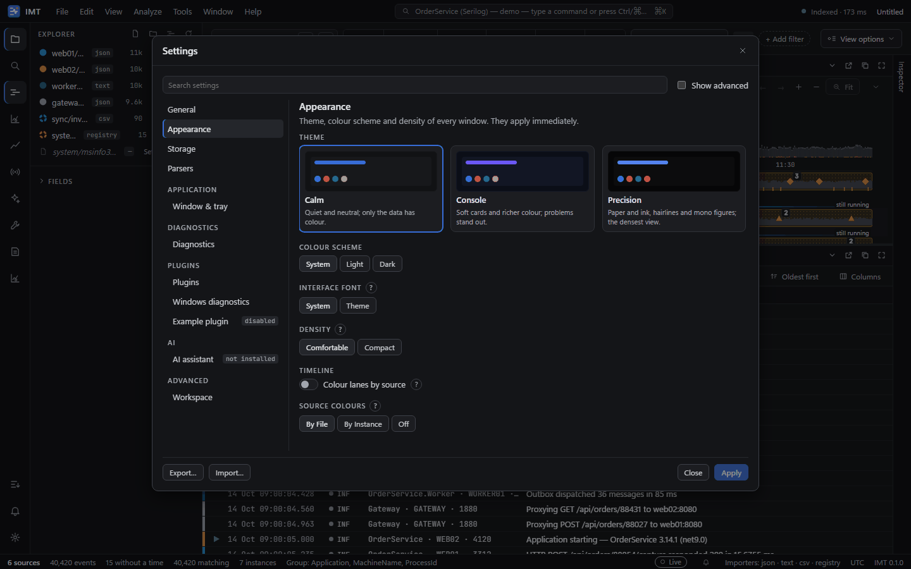

**Proposed change.** Selected segment uses the accent fill + `aria-pressed`/radio semantics, not only a slightly
lighter border.

## Batch 7 — Commands, menus and words

### F1 (P2) Command palette ranking and naming

| Empty | "anom" |
|---|---|
| 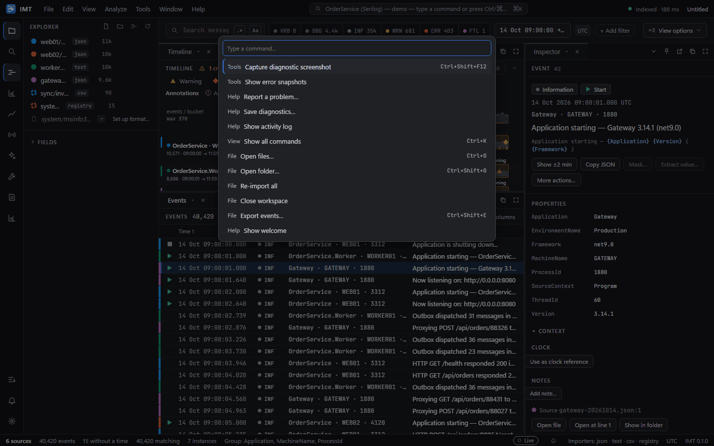 | 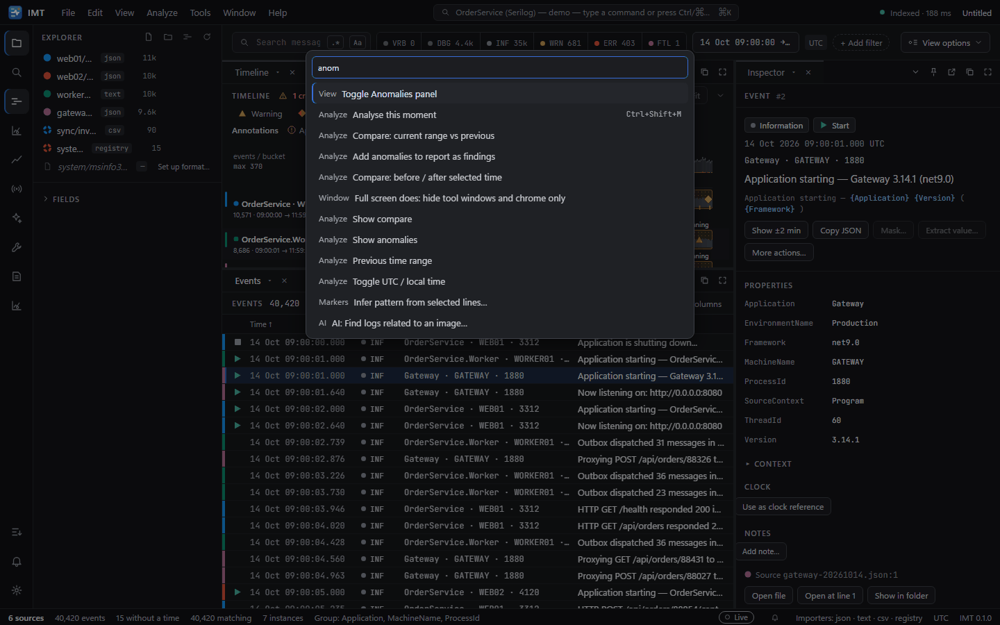 |

**Problem.** The empty palette starts with *Capture diagnostic screenshot*, *Show error snapshots*, *Report a
problem…*; "anom" matches *Full screen does: hide tool windows…* and *Previous time range*; one view has several
commands (*Toggle Anomalies panel*, *Show anomalies*); names mix styles (*Show X*, *Toggle X panel*, *View: Jobs*,
*Profiling: hotspots*, *AI · AI: Open the assistant chat*).
**Proposed change.** Empty palette = recently used, then the most common (Open folder, Search, Show anomalies…);
word-prefix scoring with highlighted matches and a threshold; one *Open <View>* command per view (toggle stays a
keybinding); category shown once (no "AI · AI:"); naming rule "Verb object" in sentence case.

### F2 (P2) One word, several meanings: Profile, Storage, Workspace, Compare

**Problem.** *Profile* is the parsing profile (Profile editor, *Profile* tab, Settings ▸ Parsers) and a profiler
capture (*File ▸ Open profile…*, *Profiling ▸ Profiles*, "Open a profile to see its flame graph"). *Storage*
(Settings) is disk usage, not the store. Settings ▸ *Workspace* holds only "Live tail delay". *Compare*,
*Compare profiles* and *Configuration diff* are three features.
**Proposed change.** A glossary in `docs/user-guide.md`, then rename in one pass: profiler captures →
**Performance capture** (*File ▸ Open performance capture…*, *Profiling ▸ Captures*); parsing profile stays
**Profile**; Settings ▸ Storage → **Disk usage**; Settings ▸ Workspace → merged into **Live tail** (I2); *Compare*
→ **Compare time ranges**.

### F3 (P2) The event context menu is 18 flat items

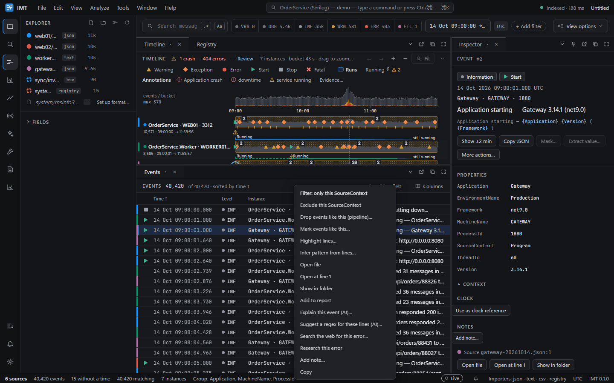

**Problem.** No groups, separators, icons or shortcuts; *Copy* is last; *Search the web for this error…* and
*Research this error* overlap; field-named items ("Filter: only this SourceContext") are long.
**Proposed change.** Groups with separators: **Copy ▸** (message, row as JSON, value) first with `Ctrl+C`;
**Filter** (Only this …, Exclude this …); **Mark, highlight, note** (`Ctrl+D`); **Open** (file, at line, in folder);
**Rules ▸** (Drop like this…, Mark like this…, Infer pattern…); **AI ▸** (Explain, Suggest a regex, Research this
error…); *Add to report*. Shortcuts right-aligned.

### F4 (P2) The Edit menu has only Undo and Redo

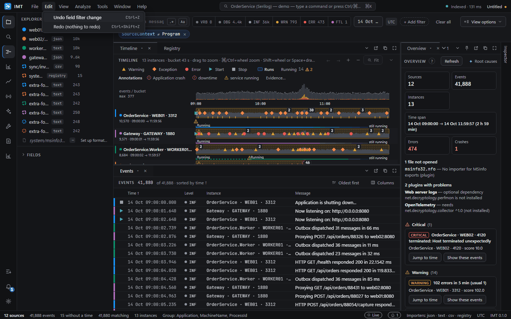

**Problem.** No Copy, Copy as JSON, Select all or Find; `Ctrl+F` does nothing (browser find is disabled).
**Proposed change.** Edit: Undo/Redo, Cut/Copy/Paste, Copy as JSON, Select all, **Find** (`Ctrl+F` focuses the
query field; inside a text panel, finds in that panel).

### F5 (P3) Recent items are a dialog, not a submenu

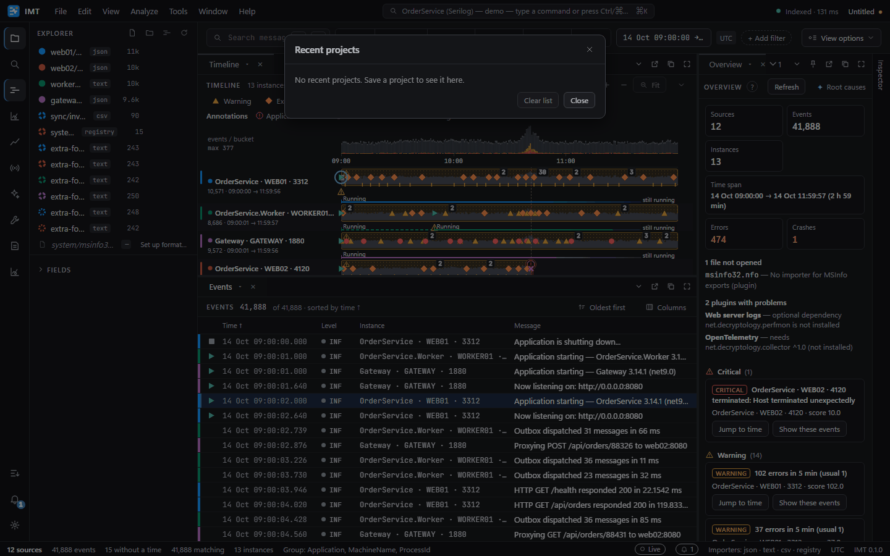

**Proposed change.** *File ▸ Open recent ▸* submenu with folders, files and projects (and *Clear recent*), mirrored
on the welcome page (J1). *Toggle live tail* moves from File to View ▸ Live.

### F6 (P3) Shortcut hints show Mac keys on Windows

**Problem.** The command centre reads "type a command or press Ctrl/⌘… ⌘K" on Windows; Error snapshots say
"Ctrl/Cmd+Shift+F12".
**Proposed change.** Platform-specific labels from one keybinding formatter.

### F7 (P3) The timeline header is busy

**Problem.** The hint "drag to zoom · ⌘/Ctrl+wheel zoom · Shift+wheel or Space+drag pan" is always shown and the
legend takes 2–3 rows (features.md says one line with *+N more*) ([02](screenshots/02-first-run-workspace.png)).
**Proposed change.** Hint behind a (?) and a one-time coach mark; legend on one row with *+N more*.

## Batch 8 — Narrow windows

### H1 (P2) Narrow windows clip the filter bar, the right dock and the status bar

| 1024 px | 900 px (AI open) | 600 px |
|---|---|---|
| 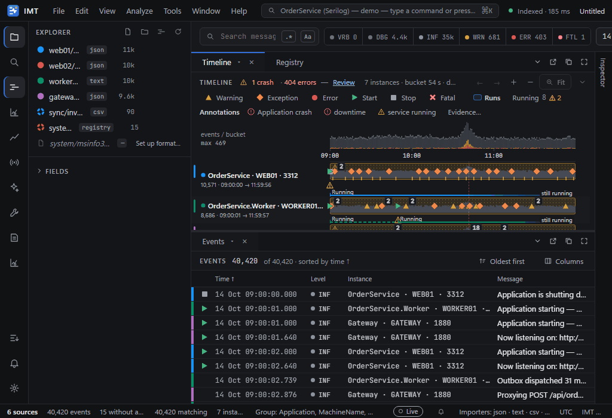 | 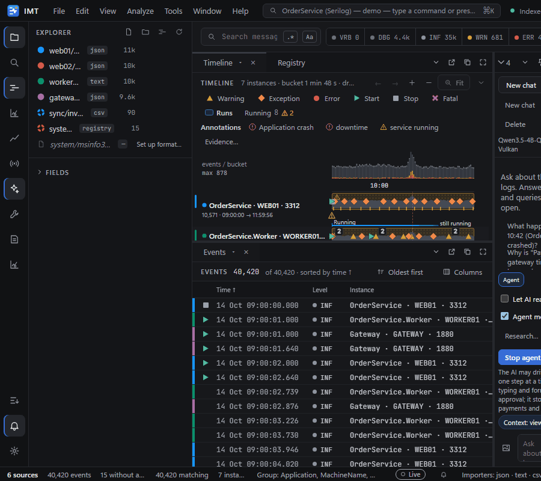 | 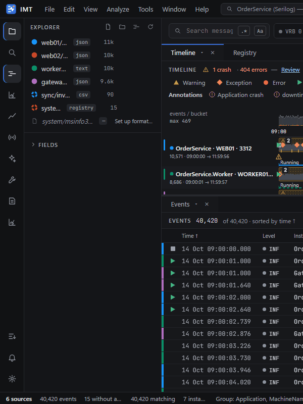 |

**Problem.** At 1024 px the time range, *Add filter* and *View options* disappear; at 900 px the right dock is cut
off mid-control; at 600 px the 270 px Explorer takes half the width and the grid shows two columns; status bar
items are truncated.
**Proposed change.** Filter bar overflow: items fold into a *⋯* menu by priority (search and levels stay);
Explorer auto-hides below 1100 px; side docks become auto-hide tabs below 1000 px; grid columns get min widths with
Message flexible; status bar drops low-priority items into a menu. Playwright checks at 1024/900/600.

### H2 (P2) Explorer names are truncated to the same prefix

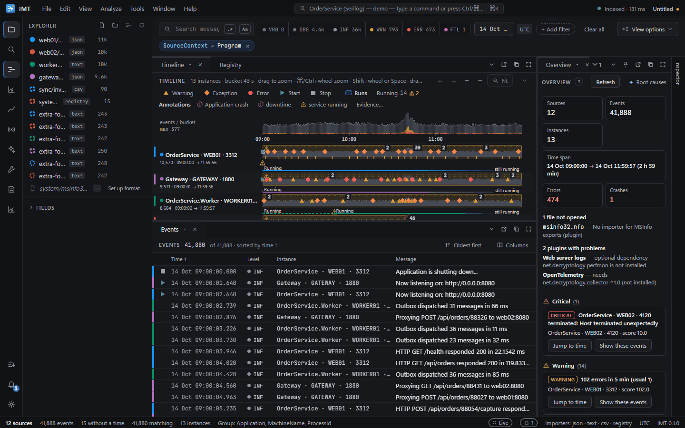

**Proposed change.** Middle ellipsis that keeps the file name's end ("extra-…-04.log"), format badge as a small icon
with tooltip, full path on hover, group by folder when several folders are open.

## Batch 9 — Settings consolidation

### I1 (P2) Settings say they apply immediately but have an Apply button

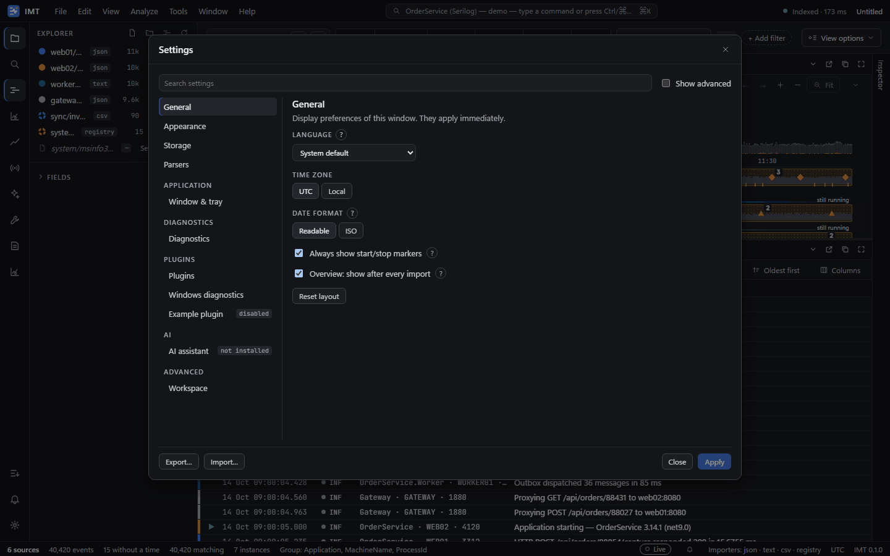

**Problem.** Section text says "They apply immediately" while the footer has *Apply* and *Close*; some engine
settings need *Apply* and a restart.
**Proposed change.** Apply immediately everywhere a change is cheap (with *Undo* in a toast); settings that need
a restart are marked "Needs restart" inline and collected in one bar ("2 changes take effect after restart —
Restart now"); remove the footer *Apply*. Footer *Export…/Import…* become "Export settings…/Import settings…".

### I2 (P2) Live-tail settings live in three places

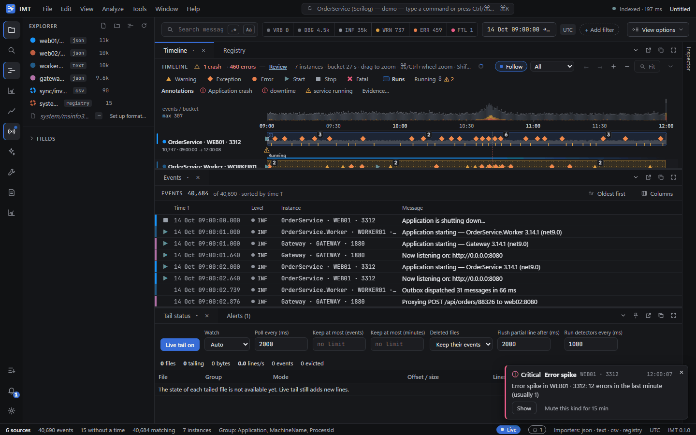

**Problem.** Settings ▸ Workspace (delay), the Tail status panel (poll, keep, deleted files, flush, detectors) and
*Edit live alert rules…* each own part of live tail; units in labels ("(ms)").
**Proposed change.** Settings ▸ **Live tail** holds all of them (with units as suffixes); Tail status becomes a
read-only status view with *Settings…*; alert rules stay a dialog linked from there.

### I3 (P2) The parser library is a heavy editor inside a modal

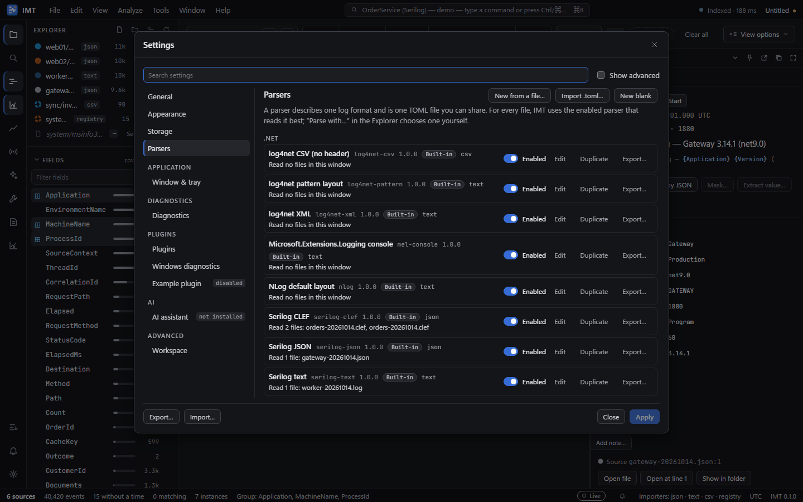

**Problem.** *Tools ▸ Manage parsers…* opens Settings ▸ Parsers: a list with four actions per row and "Read no
files in this window" repeated, inside a modal that blocks the data it is about.
**Proposed change.** A **Parsers** document view (list + detail, preview against the open files), opened from
Tools and from "Parse with…"; Settings keeps a link.

### I4 (P2) Plugins appear in three places

**Problem.** Plugins panel, Plugin health panel, Settings ▸ Plugins (+ a section per plugin)
([69](screenshots/69-plugins.png), [72](screenshots/72-profile-editor.png)).
**Proposed change.** One **Plugins** view with tabs *Installed* / *Health* and per-plugin *Settings…* links.

### I5 (P3) Updates have no settings section

**Problem.** App updates live only in *Help ▸ Check for updates…*; AI runtime and model updates in Settings ▸ AI.
**Proposed change.** Settings ▸ **Updates** with both, schedule and last check.

### I6 (P3) Two overlapping lane-colour settings

**Problem.** Appearance has *Colour lanes by source* (toggle) and *Source colours: By file / By instance / Off*.
**Proposed change.** One setting: *Source colours: Off / By file / By instance*.

### I7 (P3) Settings navigation mixes flat and grouped items

**Problem.** General/Appearance/Storage/Parsers are ungrouped; Diagnostics is a group with one item called
Diagnostics; *Example plugin · disabled* sits among core settings.
**Proposed change.** Groups *Application* (General, Appearance, Window & tray, Updates, Disk usage), *Data* (Parsers,
Live tail), *AI*, *Plugins* (one entry per plugin), *Diagnostics*.

## Batch 10 — Onboarding and view polish

### J1 (P2) The welcome page has no recent items and no project entry


**Proposed change.** Add *Open project…* and a **Recent** list (folders, files, projects with path and date);
hide the empty Explorer ("No files open.") on the welcome page; keep "How Debrief works" collapsible.

### J2 (P3) Ten profiling views each have their own empty state

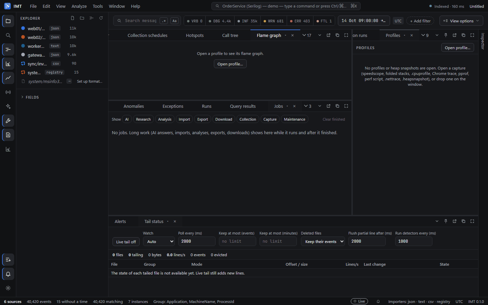

**Proposed change.** The *Profiling* perspective (A2) opens one landing view (Open capture, Profile a process,
recent captures); the others appear once a capture is open.

### J3 (P3) The tour's first step is not anchored

**Problem.** Step 1 of the tour is a centred modal over the grid ([03](screenshots/03-tour.png)).
**Proposed change.** Anchor each step to its control with a spotlight; first step points at the timeline.

### K1 (P2) Inspector actions are a wall of buttons, some disabled without a reason

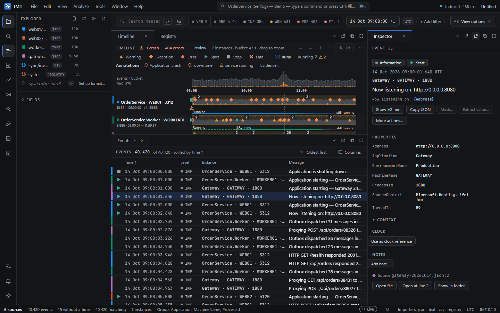

**Problem.** Equal-weight buttons; *Mask…* and *Extract value…* disabled with no explanation; values break
mid-word ("Microsoft.Hosting.Lifet ime"); the level reads "Information" here and "INF" in the grid.
**Proposed change.** An icon toolbar (Copy, Show ±2 min, Add note) + *More ▾*; disabled items explain why in a
tooltip ("Select text in the message first"); break values at `.`/`/`; copy button on hover per property.

### K2 (P3) Anomalies table has no headers

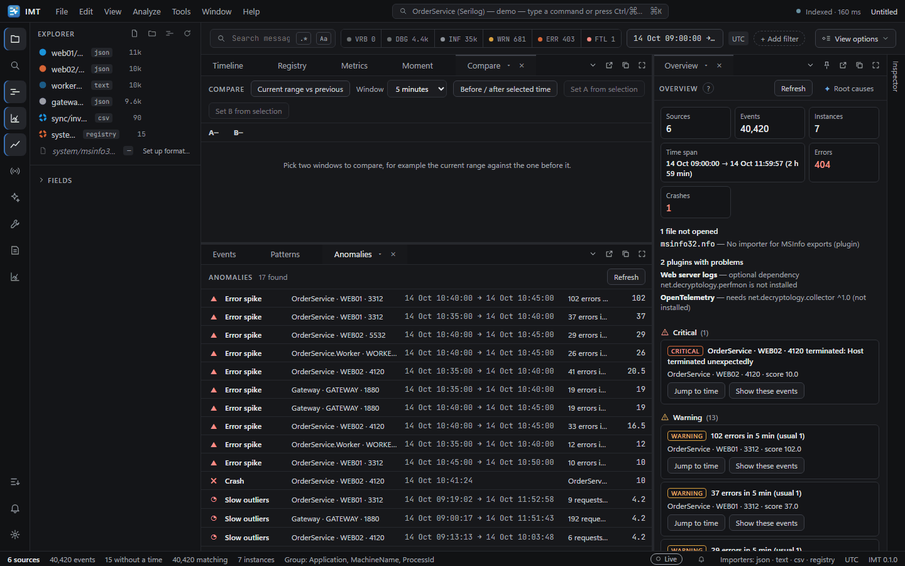

**Proposed change.** Column headers (Kind, Instance, Time, What, Score), sortable; descriptions wrap or show in a
tooltip; Overview's Warnings link into Anomalies instead of repeating them.

### K3 (P3) Overview tiles wrap unevenly

**Problem.** Six KPI tiles in a narrow dock wrap 3/2/1 ([50](screenshots/50-overview.png)).
**Proposed change.** `grid-template-columns: repeat(auto-fit, minmax(110px, 1fr))`, time span as a full-width row.

### K4 (P3) Notification categories

**Problem.** "New folder? Set up analysis…" is filed under *AI* ([159](screenshots/159-notifications.png)).
**Proposed change.** Category *Workspace*; AI is one of its actions.

### K5 (P3) Filter chips in Jobs and Notifications look like buttons

**Problem.** *AI, Research, Analysis, Import…* chips give no selected state ([67](screenshots/67-jobs.png)).
**Proposed change.** A segmented "All · Running · Failed" + a *Kind ▾* filter with counts.

### K6 (P3) Saved queries mixes highlight rules

**Problem.** The Saved queries panel also edits *Highlight rules* ([67](screenshots/67-jobs.png)).
**Proposed change.** Highlight rules move to Markers (they are line markers); Saved queries lists QL and SQL (C2).

---

## What works well

- Panel error boundaries: a failed panel says what failed and offers *Reload panel* / *Retry* while the rest keeps
  working ([142](screenshots/142-error-view-fault.png)).
- Empty states almost everywhere say why and offer the next step (empty grid with *Clear all filters*, Compare,
  Alerts with *Turn on live tail*).
- Undo is real and named ("Undo field filter change").
- The live alert toast offers *Show* and *Mute this kind for 15 min* ([147](screenshots/147-live-tail-alerts.png)).
- axe reports no serious contrast or naming problem in any theme ([themes](screenshots/120-theme-calm-light.png)).

## How this audit was run

1. `cd app && npx ng serve --port 4377 --watch=false` (browser build, mock backend).
2. A throwaway Playwright script (not committed) opened each state, saved a screenshot here and ran
   `@axe-core/playwright` with the WCAG 2.0–2.2 A/AA tags, as `e2e/axe.ts` does.
3. Mock switches used: `?mockSlowImport=1500`, `?mockAiStepMs=5`, `?mockAiVision=1`, `?mockLive=1`,
   `?mockFail=queryPage:9,queryTimeline:9,queryFacet:9`, `?mockFail=workspaceSummary:9`, `?debriefFault=view:*`,
   `?mockStorageFail=1`, `?mockProfilingFail=hotspots:3`, `?mockCorrupt=markers`, `?mockAiFail=1`.

Views were opened in one session through *View ▸ Other windows…*, which is how A2's tab pile-up shows; their
screenshots therefore show each view in whatever group it landed in.

## Appendix A: axe results

Serious or critical violations only (WCAG 2.2 A/AA); every other captured state had none.

| State | Rule | Nodes | Where |
|---|---|---|---|
| View options | `target-size` | 43 | group-by field list rows (16 px) |
| Settings ▸ Plugins | `label-content-name-mismatch` | 1 | *Reset* button |
| Several (tab overflow present) | `target-size` | 1 | `.dv-tabs-overflow-dropdown-root` |
| Settings ▸ AI | `target-size` | 1 | dock *Maximize panel* button |
| Query results with overflow | `target-size` | 1 | "2 more tabs" partly obscured |

## Appendix B: screenshots

[`screenshots/`](screenshots/) keeps the 47 screenshots referenced above (256-colour PNG, 3.6 MB in all), named
by state: `0x` first run and welcome, `1x–4x` workspace, menus, palette, query, filters, dialogs, `5x–9x` views,
`10x` AI, `110` Settings, `120` themes, `130` narrow windows, `14x` error and live states, `15x–16x` progress,
keyboard, recent, edit menu, notifications, AI settings and agent mode. About 80 more states were captured and
checked with axe but are not kept, to keep the repository small; rerun the steps above to regenerate them.
